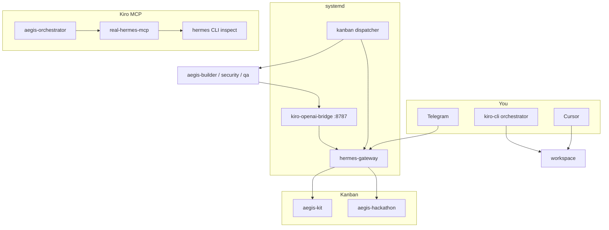

# Aegis Hackathon Kit

Reusable **Kiro + Hermes + Telegram** workspace for the Aegis Protocol / Aegis RPC SEABW hackathon. This repo is the **kit** (agents, MCP bridge, systemd stack, docs) — not the final product app.

**Operations runbook (24/7):** [.hermes/plans/24-7-multi-agent-environment.md](.hermes/plans/24-7-multi-agent-environment.md)

---

## Quick start

```bash
# Once — install always-on stack + shell alias
~/dev/Project/aegis-hackathon-kit/scripts/install-systemd-user.sh
~/dev/Project/aegis-hackathon-kit/scripts/setup-shell.sh
sudo loginctl enable-linger $USER    # WSL: survive logout
source ~/.bashrc

# Every login — smoke bridge, gateway, MCP
aegis-dev

# Coding in repo
cd ~/dev/Project/aegis-hackathon-kit
kiro-cli --agent aegis-orchestrator
```

In Kiro: `/tools` → `@real-hermes/real_hermes_stack_health`.

**Telegram (once per bot/chat):** message **Aegis Hermes** → `/commands`, `/set-home`, `/model` (expect custom → `http://127.0.0.1:8787/v1`).

---

## Operations overview

| What you want | Command / surface |
|---------------|-------------------|
| Check stack health | `aegis-dev` or `~/.hermes/scripts/aegis-stack-health.sh` |
| Bridge only | `curl -sf http://127.0.0.1:8787/health` |
| Gateway status | `hermes gateway status` |
| Restart stack | `systemctl --user restart aegis-stack.target` |
| Gateway logs | `journalctl --user -u hermes-gateway -f -l` |
| Bridge logs | `journalctl --user -u kiro-openai-bridge -f -l` |
| Kanban UI | `hermes dashboard` → http://127.0.0.1:9119 |
| List cron jobs | `hermes cron list` |
| Hermes profiles | `hermes profile list` |

### Three surfaces

| Surface | Use for |
|---------|---------|
| **Telegram** (Aegis Hermes) | 24/7 coordination, `/plan`, grill-me, cron summaries |
| **Kiro CLI** | Primary coding, `subagent` to builder/security/qa/pitch |
| **Cursor** | Parallel IDE in same repo; `Co-authored-by: Cursor` on commits |

Hermes **does not** invoke Cursor automatically. Kanban workers call Kiro via the bridge.

---

## 24/7 stack (systemd)

Installed by `scripts/install-systemd-user.sh` into `~/.config/systemd/user/`:

| Unit | Role |
|------|------|
| `kiro-openai-bridge.service` | OpenAI API on `127.0.0.1:8787` → `scripts/providers/kiro-provider.sh` → `kiro-cli` |
| `hermes-gateway.service` | Telegram, cron, Kanban dispatcher |
| `aegis-stack.target` | Starts bridge + gateway |

```bash
systemctl --user status kiro-openai-bridge hermes-gateway aegis-stack.target
hermes gateway restart    # refresh unit after Hermes upgrade
```

**WSL:** `enable-linger` keeps user systemd after SSH logout; the **WSL VM must stay running** (Windows shutdown stops Telegram).

---

## Multi-agent orchestration (Hermes Kanban)

Hermes routes work through **named profiles** on **durable Kanban boards** (SQLite under `~/.hermes/kanban/`). The gateway dispatcher spawns workers every ~60s.

### Boards

| Board | Purpose |
|-------|---------|
| `aegis-kit` | Infra: systemd, bridge, MCP, kit docs |
| `aegis-hackathon` | App MVP modules (after scaffold) |

```bash
hermes kanban boards list
hermes kanban boards switch aegis-kit
hermes kanban --board aegis-hackathon list
```

Tasks need an **absolute** workspace:

```bash
hermes kanban create "Module 1: …" \
  --assignee aegis-builder \
  --workspace "dir:/home/asyam/dev/Project/aegis-hackathon-kit" \
  --priority 2
```

### Hermes profiles (Kanban assignees)

| Profile | Role |
|---------|------|
| `aegis-orchestrator` | Decompose goals → tasks; route, do not implement |
| `aegis-builder` | MVP implementation |
| `aegis-security` | Policy / Web3 review |
| `aegis-qa` | Build smoke, collaboration log |
| `aegis-pitch` | Grill-me, narrative |

Create missing profiles: `hermes profile create <name> --clone --no-alias`

Map to Kiro agents: [docs/kit/03-kiro-agents.md](docs/kit/03-kiro-agents.md).

### Scheduled jobs (cron)

| Job | Schedule | Purpose |
|-----|----------|---------|
| `kanban-orchestrator-tick` | every 30m | Review boards, unblock/create tasks → Telegram `origin` |
| `aegis-stack-health` | 09:00 daily | Script-only bridge/systemd check |

Requires `/set-home` in Telegram. Create agent cron with **schedule and prompt before flags**:

```bash
hermes cron create 'every 30m' 'Short prompt here.' \
  --name my-job --skill kanban-orchestrator --deliver origin \
  --workdir ~/dev/Project/aegis-hackathon-kit
```

### Telegram guardrails

| Safe on phone | Use Kiro / Cursor / Kanban workers |
|---------------|-------------------------------------|
| Short goals, `/plan`, grill-me | `install-systemd-user.sh`, large refactors |
| Kanban routing | One module per task |
| `/busy queue` during long runs | `git push`, deploy (with approval) |

Long Telegram → bridge → `kiro-cli` loops can timeout (~3–4 min) and restart the gateway.

---

## Architecture



| Runtime | What it is |
|---------|------------|
| **Kiro orchestrator** | Primary coding agent ([`.kiro/agents/aegis-orchestrator.json`](.kiro/agents/aegis-orchestrator.json)) |
| **Hermes gateway** | 24/7 Telegram, cron, Kanban, skills ([`~/.hermes/`](~/.hermes/)) |
| **Kiro bridge :8787** | Model backend for Hermes Telegram + Kanban workers ([`tools/kiro-openai-bridge/`](tools/kiro-openai-bridge/)) |

**Provider chain (Telegram / workers):**

```text
Telegram → hermes-gateway → http://127.0.0.1:8787/v1
         → kiro-openai-bridge → kiro-provider.sh → kiro-cli
```

Kiro IDE sessions use Kiro’s own model — not the bridge.

---

## Kiro agents

| Agent | Command |
|-------|---------|
| Orchestrator (default) | `kiro-cli --agent aegis-orchestrator` |
| Builder | `kiro-cli --agent builder` |
| Security | `kiro-cli --agent security` |
| QA | `kiro-cli --agent qa` |
| Pitch / grill | `kiro-cli --agent pitch` |

Typical module loop: orchestrator plans → builder implements → security (if policy touched) → commit with `Co-authored-by` → qa → pitch before submit.

---

## Hermes slash commands (Telegram)

| Command | Use |
|---------|-----|
| `/commands` | Live command list |
| `/set-home` | Home chat for cron delivery |
| `/model` | Show provider (custom → bridge) |
| `/plan …` | Planning only → `.hermes/plans/` |
| `/busy queue` | Queue follow-ups without interrupting |

Full list: [docs/kit/02-hermes-24-7.md](docs/kit/02-hermes-24-7.md)

---

## Hackathon lifecycle

| Phase | Where |
|-------|--------|
| Prep (kit only) | This repo — no final product code |
| Scaffold app | `~/dev/Project/Aegis/aegis-protocol-hackathon` |
| Build modules | One commit per module + `docs/AI_COLLABORATION_LOG.md` |
| Grill / demo | Telegram + `pitch` agent → `docs/GRILL_QA.md` |
| Production / push | With explicit approval only |

```bash
# When official build starts — copy kit into app repo
KIT=~/dev/Project/aegis-hackathon-kit
APP=~/dev/Project/Aegis/aegis-protocol-hackathon
cp -r "$KIT/.kiro" "$APP/"
cp "$KIT/AGENTS.md" "$APP/"
cp "$KIT/docs/kit/templates/HACKATHON.md" "$APP/HACKATHON.md"
mkdir -p "$APP/docs"
cp "$KIT/docs/kit/templates/AI_COLLABORATION_LOG.md" "$APP/docs/"
```

Details: [docs/kit/04-hackathon-lifecycle.md](docs/kit/04-hackathon-lifecycle.md) · Kit checklist: [HACKATHON.md](HACKATHON.md) · Product spec: [MASTERPLAN.md](MASTERPLAN.md)

---

## Documentation

Full playbook: **[docs/kit/README.md](docs/kit/README.md)**

| Guide | Contents |
|-------|----------|
| [docs/kit/01-daily-setup.md](docs/kit/01-daily-setup.md) | `aegis-dev`, systemd, MCP, debug |
| [docs/kit/02-hermes-24-7.md](docs/kit/02-hermes-24-7.md) | Telegram, Kanban, cron, guardrails |
| [docs/kit/03-kiro-agents.md](docs/kit/03-kiro-agents.md) | orchestrator, builder, security, pitch, qa |
| [docs/kit/04-hackathon-lifecycle.md](docs/kit/04-hackathon-lifecycle.md) | prep → build → grill → production → push |
| [docs/kit/05-ai-collaboration.md](docs/kit/05-ai-collaboration.md) | `Co-authored-by`, collaboration log |
| [docs/kit/06-mvp-and-demo.md](docs/kit/06-mvp-and-demo.md) | MVP modules and demo proof |

---

## Repository layout

| Path | Purpose |
|------|---------|
| [`AGENTS.md`](AGENTS.md) | Agent workflow + learned preferences |
| [`HACKATHON.md`](HACKATHON.md) | Kit-phase checklist |
| [`MASTERPLAN.md`](MASTERPLAN.md) | Product / technical master plan |
| [`.hermes/plans/`](.hermes/plans/) | Hermes `/plan` outputs (e.g. 24/7 runbook) |
| [`.kiro/agents/`](.kiro/agents/) | Kiro agent definitions |
| [`tools/`](tools/) | Bridges, MCP, documentation |
| [`docs/kit/`](docs/kit/) | Hackathon playbook |
| [`systemd/user/`](systemd/user/) | `aegis-stack` unit sources |
| [`scripts/`](scripts/) | Install, daily dev, providers |

---

## Scripts

| Script | Purpose |
|--------|---------|
| [`scripts/install-systemd-user.sh`](scripts/install-systemd-user.sh) | Link units, enable `aegis-stack`, bridge health wait |
| [`scripts/start-aegis-dev.sh`](scripts/start-aegis-dev.sh) | Daily smoke (alias: `aegis-dev`) |
| [`scripts/setup-shell.sh`](scripts/setup-shell.sh) | `aegis-dev` alias + optional git commit template |
| [`scripts/real-hermes.sh`](scripts/real-hermes.sh) | `status`, `gateway-logs` helpers |
| [`scripts/providers/kiro-provider.sh`](scripts/providers/kiro-provider.sh) | Bridge → `kiro-cli` invocation |
| [`scripts/start-real-hermes-mcp.sh`](scripts/start-real-hermes-mcp.sh) | Manual MCP stdio test |

External: `~/.hermes/scripts/aegis-stack-health.sh` (cron watchdog).

---

## Debug checklist

| Symptom | Fix |
|---------|-----|
| `aegis-dev: command not found` | `scripts/setup-shell.sh` && `source ~/.bashrc` |
| Telegram connection errors | `curl -sf http://127.0.0.1:8787/health` → `install-systemd-user.sh` → `aegis-dev` |
| Gateway stops after WSL close | `sudo loginctl enable-linger $USER`; keep WSL running |
| Kiro MCP missing | Run from kit root; check `mcpServers` in `aegis-orchestrator.json` |
| Cron not in Telegram | `/set-home` in Hermes chat |
| Kanban task never runs | Assignee must match `hermes profile list`; use `dir:<absolute-path>` workspace |

More: [docs/kit/01-daily-setup.md](docs/kit/01-daily-setup.md)

---

## Rules

- Do not ship final product code in **this kit repo** before official hackathon build start.
- No private keys; no fake AI usage.
- No push, deploy, or Docker without approval.
- **AI-assisted commits** must include `Co-authored-by` trailers — [docs/kit/05-ai-collaboration.md](docs/kit/05-ai-collaboration.md).

Agent workflow: [AGENTS.md](AGENTS.md).

---

## References

- [Nous Hermes Agent](https://github.com/nousresearch/hermes-agent)
- [Hermes Kanban docs](https://hermes-agent.nousresearch.com/docs/user-guide/features/kanban)
- [Kiro custom agents](https://kiro.dev/docs/cli/custom-agents/)
- [Kiro MCP](https://kiro.dev/docs/cli/mcp/)

<!-- AEGIS_OPENSRC_RESEARCH_START -->
## Aegis OpenSrc + GitHub source research

This repo uses source code as truth for agentic development.

```bash
bash scripts/aegis-opensrc-cache.sh
bash scripts/aegis-github-source-cache.sh
bash scripts/aegis-source-search.sh
bash scripts/aegis-source-check.sh
```

Main docs:

- `docs/research/00-source-code-research-index.md`
- `docs/research/01-opensrc-package-map.md`
- `docs/research/02-github-repo-map.md`
- `docs/research/03-implementation-search-playbook.md`

24H cut rule:

If it does not help `/api/rpc`, `/api/preflight`, transaction decoding, approval BLOCK, Chainlink price/freshness signal, audit log, RiskOps dashboard, or Base Sepolia proof, it is stretch.
<!-- AEGIS_OPENSRC_RESEARCH_END -->
