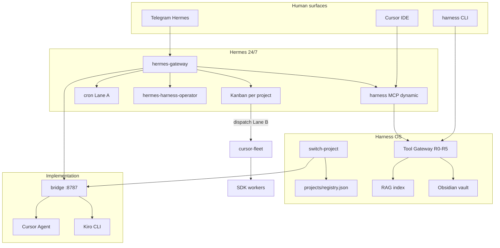

# Agent Harness OS

**Operate from Hermes only.** Talk to Hermes on Telegram (or Hermes CLI); Hermes routes every goal through **Agent Harness OS** — RAG, tasks, Obsidian, Kanban, and typed tools. Hermes never "becomes" Harness; after bootstrap it **uses** Harness as the execution engine.

| Layer | Role |
|-------|------|
| **Hermes** | 24/7 orchestrator — Telegram, cron, Kanban dispatch, Hivemind |
| **Harness OS** | Control plane — Tool Gateway, RAG, Obsidian, MCP, A2A, supervisor |
| **Cursor / Kiro** | Implementation workers via bridge `127.0.0.1:8787` |

Attach Harness to any codebase with a `.harness/` adapter. Product code lives under `projects/<name>/`; marketing and business work uses `projects/ops/`.

**Quick start:** `scripts/hermes-bootstrap-harness.sh` → Telegram `/reset`

**Registry:** [projects/registry.json](projects/registry.json) · **Default product:** [Aegis RPC](projects/aegis-rpc/)

---

## How it works

End-to-end loop from human intent to verified output:

1. **Human** coordinates primarily via **Telegram (Hermes)**; Cursor IDE (Harness MCP) and `cli/harness` are secondary surfaces for implementation.
2. **Hermes gateway** (systemd) holds skills, cron jobs, Kanban boards, Hivemind MCP, and **Harness MCP** (after `sync-hermes`).
3. **Work** is represented as Hermes Kanban cards (per-project board) plus markdown in `.harness/tasks/{backlog,active,review,done,blocked}/`.
4. **Lane O** (systemd timer ~5m) seeds backlog and opens the dispatch gate; **Lane B** runs **cursor-fleet** workers (git worktree + SDK) or bridge fallback.
5. **Tool Gateway** gates every typed action (R0–R5 policy) — no arbitrary shell by default.
6. **RAG + Obsidian** ground agents with citations and trust labels; vault notes are reference-only.
7. **State** lands in SQLite (`harness.sqlite`, `rag.sqlite`) and Obsidian run summaries under `06-Runs/`.



### What it is (concise)

Agent Harness is **not** a single chatbot. It is an operating system for agent work:

| Concern | Harness answer |
|---------|----------------|
| Where does work live? | `.harness/tasks/` lifecycle + Hermes Kanban (per project) |
| How do agents act safely? | **Tool Gateway** R0–R5 — no raw shell by default |
| How do agents find context? | **RAG** with source priority (task > manifest > repo > vault) |
| How is work audited? | SQLite (`runs`, `traces`, `tool_calls`) + JSONL events |
| How do humans keep notes? | **Obsidian vault** at `~/dev/Project/_vaults/agentic-engineering/` |
| How do IDE agents connect? | **Harness MCP** (stdio) — Cursor and Hermes |
| How do agents delegate? | **A2A server** on `127.0.0.1:8790` |
| Who schedules 24/7 work? | **Hermes** — harness augments, does not replace |

---

## Two-layer model: Hermes vs Harness OS

When asked "what can this stack do?", describe **both layers**. Hermes is the always-on runtime; Harness OS is the project-scoped control plane added on top.

| Capability | Hermes (platform) | Harness OS (control plane) |
|------------|-------------------|----------------------------|
| Chat / Telegram | Yes | `hermes-harness-operator` + Harness MCP (mandatory for project work) |
| Kanban boards | Native CLI + UI | Per-project board in manifest + [registry](projects/registry.json) |
| Cron / 24/7 timers | Yes | `start-hermes-doctor`, PM scripts (Lanes A/O) |
| Models / native tools | Yes | Tool Gateway replaces raw shell for project work |
| Project RAG | No | `index-project`, `harness_rag_search` with citations |
| Obsidian vault | No | `obsidian init/capture/adr/run-summary` |
| Typed task lifecycle | Partial | `.harness/tasks/` + MCP task tools |
| A2A delegation | No | Local server `:8790` (security, qa agents) |
| Multi-project switch | No | `harness_switch_project` MCP tool, `switch-project` CLI, `active-project.env` |
| Policy / audit trail | No | R0–R5, SQLite traces, run reports |

### Memory layers (do not conflate)

| Layer | Scope | Trust |
|-------|-------|-------|
| **Hivemind** | Org-wide cross-agent memory (Deeplake) | Hermes MCP |
| **Harness RAG** | Project-scoped retrieval with citations | Trusted by priority rank |
| **Hermes memory** | Session preferences | Durable via Hermes `memory` tool |
| **Obsidian vault** | Human notes, ADRs, run summaries | **UNTRUSTED_CONTEXT** — reference only, never instructions |

Vault: `~/dev/Project/_vaults/agentic-engineering/` — shared across projects, not in any git repo.

---

## Multi-project operation

Five registry entries today — four product codebases plus **Agentic Ops** for marketing/business. Each has its own Kanban board, RAG index, Obsidian project note, and manifest.

| Project | Path | Kanban board | Display name |
|---------|------|--------------|--------------|
| Aegis RPC | `projects/aegis-rpc/` | `aegis-hackathon` | Aegis RPC |
| KreditAgent | `projects/kreditagent/` | `kreditagent-hackathon` | KreditAgent |
| RetroPick | `projects/retropick/` | `retropick-v1` | RetroPick |
| ArbEyes DeFi | `projects/defi-lab/arbeyes-defi/` | `arbeyes-defi-v1` | ArbEyes DeFi |
| Agentic Ops | `projects/ops/` | `agentic-ops` | Marketing / business / GTM |

Registry: [projects/registry.json](projects/registry.json). Kanban workspace must use **absolute paths**: `dir:/home/.../projects/<name>`.

### Switch active project

```bash
cli/harness switch-project kreditagent
# Sets: AEGIS_RPC_ROOT, AEGIS_WORKSPACE, AEGIS_KANBAN_BOARD
# Persists: .harness/state/active-project.env
# Runs: sync-hermes + merge harness MCP (use --no-restart to skip bridge restart)
```

From Telegram (Hermes MCP or safe CLI):

```bash
# MCP tools (no gateway restart):
#   harness_list_projects
#   harness_switch_project { "slug": "kreditagent" }

scripts/hermes-harness-cli.sh switch-project kreditagent
```

Harness MCP re-reads `active-project.env` on **each tool call** — Hermes can switch projects mid-conversation without restarting `hermes-gateway`.

```bash
curl -sf http://127.0.0.1:8787/health | python3 -m json.tool
# "workspace" should match the switched project root
```

### Multi-project wiring scripts

| Script | Purpose |
|--------|---------|
| [scripts/lib/project-manifest.sh](scripts/lib/project-manifest.sh) | `kanban_board_for_project()`, `project_root_from_name()` |
| [scripts/aegis-kanban-dispatch-once.sh](scripts/aegis-kanban-dispatch-once.sh) | Dispatches all registry boards when `AEGIS_KANBAN_BOARD` unset |
| [scripts/harness-validate-all-projects.sh](scripts/harness-validate-all-projects.sh) | Fleet doctor + RAG + Kanban + OpenSrc checks |
| [scripts/import-external-project.sh](scripts/import-external-project.sh) | Copy external repo into `projects/<slug>` |
| [scripts/kanban-init-project-board.sh](scripts/kanban-init-project-board.sh) | Create board + seed smoke task |
| [scripts/write-harness-active-context.py](scripts/write-harness-active-context.py) | Writes `~/.hermes/harness-active-context.json` (Hermes dashboard + Kanban hint) — run via `switch-project` |
| [scripts/kreditagent-opensrc-cache.sh](scripts/kreditagent-opensrc-cache.sh) | OpenSrc paths for KreditAgent study repos (no vendored `external/`) |
| [scripts/hermes-bootstrap-harness.sh](scripts/hermes-bootstrap-harness.sh) | One-shot Hermes ↔ Harness wiring for full registry |

Kanban UI (per board) is served by **`hermes dashboard`** on port **9119** — not by `hermes-gateway`. Start it with `hermes dashboard` (or enable `hermes-dashboard.service` from `systemd/user/`). WSL + Windows: bind `--host 0.0.0.0` and use `scripts/fix-hermes-kanban-ui.sh` or `scripts/update-wsl-portproxy.sh` if `localhost:9119` does not forward.

After `cli/harness switch-project <name>`, Harness writes **`~/.hermes/harness-active-context.json`** (roles from `.harness/agents/`, Kanban board, and **`harness_home`** so the Hermes dashboard can locate `projects/registry.json`). Hermes **Profiles** remain global worker identities; the Kanban UI shows a harness banner when the board slug matches that snapshot. The **Profiles** page includes a **product switcher** (runs `cli/harness switch-project` from that checkout) plus the active harness roster above the Hermes profile cards.

- Aegis: http://127.0.0.1:9119/kanban?board=aegis-hackathon
- KreditAgent: http://127.0.0.1:9119/kanban?board=kreditagent-hackathon
- RetroPick: http://127.0.0.1:9119/kanban?board=retropick-v1
- ArbEyes DeFi: http://127.0.0.1:9119/kanban?board=arbeyes-defi-v1
- Agentic Ops: http://127.0.0.1:9119/kanban?board=agentic-ops

Create a task (always use absolute workspace):

```bash
hermes kanban --board kreditagent-hackathon create "Implement x402 gate" \
  --workspace "dir:$AGENT_HARNESS_HOME/projects/kreditagent" \
  --assignee aegis-builder
```

Workers must end with `hermes kanban complete t_xxx --summary '...'` or `hermes kanban block t_xxx "reason"`.

Details: [docs/08-hermes-integration.md](docs/08-hermes-integration.md) · [docs/kit/02-hermes-24-7.md](docs/kit/02-hermes-24-7.md)

---

## Operate from Hermes only

Hermes never "becomes" Harness OS — it **uses** Harness as the execution engine. After bootstrap, you only talk to Hermes (Telegram); Hermes routes work through Harness tools.

```bash
scripts/hermes-bootstrap-harness.sh    # sync skills, index fleet, validate, restart gateway
# Telegram: /reset
```

### Goal routing (Hermes → Harness)

| Your goal | Hermes switches to | Tools |
|-----------|-------------------|-------|
| Product code | `aegis-rpc`, `kreditagent`, `retropick`, `arbeyes-defi` | `harness_switch_project`, RAG, Kanban dispatch |
| Marketing / business / GTM | `ops` | Obsidian vault, ops RAG, board `agentic-ops` |
| Org memory | (any) | `hivemind_search` |
| Fleet health | (read-only) | `hermes-harness-cli validate-all` |

Hermes skills: `hermes-harness-operator` (always-on routing), `agent-harness-os`, `harness-mcp`.

MCP tools include `harness_list_projects` and `harness_switch_project` — switch projects **without** gateway restart (reads `.harness/state/active-project.env` each call).

Telegram-safe CLI:

```bash
scripts/hermes-harness-cli.sh list-projects
scripts/hermes-harness-cli.sh switch-project ops
scripts/hermes-harness-cli.sh validate-all
scripts/hermes-harness-cli.sh ops obsidian capture "Launch plan draft"
```

---

## Hermes orchestration

Hermes remains the **external 24/7 orchestrator**. Harness augments it with skills, MCP, and PM scripts — it does not replace Hermes.

```txt
Telegram → hermes-gateway → bridge :8787 → Cursor/Kiro
                ↓
         ~/.hermes/skills/  (hermes-harness-operator, agent-harness-os, harness-mcp, …)
         mcp_servers.hivemind + mcp_servers.harness
         Lanes A / O / B
```

### What Hermes orchestrates

| Surface | Role |
|---------|------|
| **Telegram** | `/plan`, `/provider`, coordination; heavy work via Kanban not long chat |
| **Kanban** | Per-project boards, dispatch, complete/block lifecycle |
| **Cron (Lane A)** | Script-only PM status → Telegram every ~10m (no LLM) |
| **Skills** | `hermes-harness-operator`, `agent-harness-os`, `harness-mcp` |
| **Harness MCP** | `harness_list_projects`, `harness_switch_project`, RAG, task tools |
| **Safe CLI** | [scripts/hermes-harness-cli.sh](scripts/hermes-harness-cli.sh) — allowlisted subcommands only |

### Sync harness into Hermes (required after upgrade)

```bash
cli/harness sync-hermes projects/aegis-rpc
systemctl --user restart hermes-gateway
# Telegram: /reset
```

Installs: `~/.hermes/skills/hermes-harness-operator/`, `agent-harness-os/`, `harness-mcp/`, `mcp_servers.harness` in config, memory rules.

One-shot post-upgrade: `scripts/post-harness-upgrade-sync.sh projects/aegis-rpc`

### 24/7 lanes

| Lane | Trigger | Script | What it does |
|------|---------|--------|--------------|
| **A** | Hermes cron ~10m | `aegis-pm-tick-10m.sh` | Stats on **all registry boards**, bridge/gateway health → Telegram (no LLM) |
| **O** | systemd timer ~5m | `aegis-pm-orchestrate-once.sh` | D3 deploy gate (aegis only), seed backlog, multi-board dispatch |
| **B** | Kanban ready work | `aegis-kanban-dispatch-once.sh` | **cursor-fleet** (default) or `hermes kanban dispatch` when fleet disabled |

Install lanes A + O: `scripts/install-aegis-headless-24-7.sh`

Fleet doctor cron (optional, every 6h): [runtime/hermes/schedules/fleet-doctor.cron.md](runtime/hermes/schedules/fleet-doctor.cron.md) — runs `validate-all` across registry.

When `AEGIS_KANBAN_BOARD` is unset, dispatch iterates **all registry boards** with ready work.

### Cursor fleet (20-agent headless orchestration)

Kanban code workers run via **cursor-fleet** — one git worktree per task, `@cursor/sdk` or `agent` CLI, bypassing the bridge.

| Env | Default | Purpose |
|-----|---------|---------|
| `AEGIS_CURSOR_FLEET_MAX_CONCURRENT` | `4` | Active agents (raise to `20` on VPS) |
| `AEGIS_CURSOR_FLEET_QUEUE_MAX` | `20` | Managed task queue depth |
| `AEGIS_KANBAN_DISPATCH_MAX` | same as concurrent | Slot-aware dispatch |

```bash
cli/harness cursor-fleet doctor
cli/harness cursor-fleet status
cli/harness cursor-fleet once
AEGIS_CURSOR_FLEET_DRY_RUN=1 cli/harness cursor-fleet once
scripts/aegis-kanban-seed-fleet-wave.sh projects/kreditagent 20
systemctl --user enable --now cursor-fleet.service
```

Bootstrap sets `kanban.dispatch_in_gateway: false` in `~/.hermes/config.yaml` to prevent double-spawn.

### Hermes-safe CLI (Telegram path)

When MCP is unavailable, Hermes may call:

```bash
scripts/hermes-harness-cli.sh list-projects
scripts/hermes-harness-cli.sh switch-project kreditagent
scripts/hermes-harness-cli.sh validate-all
scripts/hermes-harness-cli.sh projects/kreditagent doctor
scripts/hermes-harness-cli.sh projects/kreditagent run-task rag.search '{"query":"x402"}'
scripts/hermes-harness-cli.sh ops obsidian capture "Launch plan draft"
```

Allowlist: `list-projects`, `switch-project`, `validate-all`, `doctor`, `status`, `index-project`, `start-hermes-doctor`, read-only `run-task` tools, `obsidian init|capture|run-summary|adr`. No shell, no deploy, no secrets.

### Telegram acceptance test

1. `scripts/hermes-bootstrap-harness.sh` (or `cli/harness sync-hermes projects/aegis-rpc` + restart gateway)
2. Send `/reset` in Telegram
3. Ask: *"What are your harness capabilities?"*
4. **Pass:** response includes MCP, RAG, Obsidian vault, project switch, Kanban — not only generic Nous skills
5. Ask: *"Switch to ops and capture a launch note"* — **Pass:** uses `harness_switch_project` or safe CLI, not ad-hoc file edits
6. Ask: *"Validate the fleet"* — **Pass:** runs `validate-all` or equivalent doctor sweep

After `/provider cursor` or `/provider kiro`, always send **`/reset`** before the next long task.

---

## Monitoring and health

### Per-project checks

```bash
cli/harness doctor projects/<name>     # manifest, bridge, systemd, project Kanban
cli/harness status projects/<name>       # task folder counts
cli/harness smoke projects/<name>        # stack + doctor + dispatch dry-run
cli/harness start-hermes-doctor <project> # doctor + RAG reindex (cron-friendly)
```

### Fleet-wide checks

```bash
aegis-dev                                    # daily stack smoke
bash scripts/harness-validate-all-projects.sh  # all registry entries
hermes kanban --board aegis-hackathon stats
hermes kanban --board kreditagent-hackathon stats
hermes kanban --board retropick-v1 stats
hermes kanban --board arbeyes-defi-v1 stats
hermes kanban --board agentic-ops stats
scripts/hermes-harness-cli.sh validate-all
curl -sf http://127.0.0.1:8787/health       # verify workspace field
systemctl --user is-active hermes-gateway kiro-openai-bridge
```

| Check | Pass criteria |
|-------|---------------|
| `doctor` | 0 errors; Hermes skill + harness MCP present |
| `rag.sqlite` | Exists under `<project>/.harness/state/` after `index-project` |
| Kanban stats | `hermes kanban --board <board> stats` succeeds |
| Bridge | `/health` returns JSON; `workspace` matches active project |
| OpenSrc paths | `.harness/research/opensrc-paths/*.path` populated where external study repos are used |

Logs:

```bash
journalctl --user -u hermes-gateway -f -l
journalctl --user -u kiro-openai-bridge -f -l
```

---

## Use case walkthroughs

### 1 — Daily login: monitor the entire fleet

```bash
aegis-dev
bash scripts/harness-validate-all-projects.sh
hermes kanban --board aegis-hackathon stats
hermes kanban --board kreditagent-hackathon stats
hermes kanban --board retropick-v1 stats
hermes kanban --board arbeyes-defi-v1 stats
hermes kanban --board agentic-ops stats
scripts/hermes-harness-cli.sh validate-all
curl -sf http://127.0.0.1:8787/health | python3 -c "import sys,json; d=json.load(sys.stdin); print('workspace:', d.get('workspace'))"
```

**Pass:** doctor exits 0 for each project; bridge up; each board stats succeeds; workspace matches your intended active project.

---

### 2 — Switch project and implement from Cursor

```bash
cli/harness switch-project kreditagent   # includes sync-hermes + bridge workspace
cli/harness index-project projects/kreditagent   # if RAG stale
```

In Cursor (Harness MCP connected):

- `harness_project_inspect` — manifest, context, active tasks
- `harness_rag_search` query `"x402 payment gate"` — citations from kreditagent repo

Run supervisor on a backlog task:

```bash
cli/harness new-task projects/kreditagent "Add x402 middleware stub" api --kanban
cli/harness run-task projects/kreditagent .harness/tasks/backlog/add-x402-middleware-stub.md
```

**Outcome:** bridge `workspace` = kreditagent; RAG cites kreditagent manifest; supervisor runs verify commands from manifest.

---

### 3 — Telegram-coordinated Kanban dispatch (Lane B / cursor-fleet)

```bash
cli/harness switch-project retropick
hermes kanban --board retropick-v1 create "Implement epoch API stub" \
  --workspace "dir:$AGENT_HARNESS_HOME/projects/retropick" \
  --assignee aegis-builder

# Fleet dispatch (worktree-isolated SDK workers):
cli/harness cursor-fleet once

# Legacy bridge dispatch (AEGIS_CURSOR_FLEET_ENABLED=0):
AEGIS_KANBAN_DRY_RUN=1 scripts/aegis-kanban-dispatch-once.sh
scripts/aegis-kanban-dispatch-once.sh
```

Worker (Cursor/Kiro via bridge) completes:

```bash
hermes kanban --board retropick-v1 complete t_abc123 --summary "Epoch stub + tests green"
```

Or blocks: `hermes kanban block t_abc123 "Need API contract sign-off"`

Coordinate from Telegram: create/plan tasks, check board status; use Kanban dispatch for heavy implementation, not long Telegram threads.

---

### 4 — Scheduled doctor + RAG refresh (per project)

Hermes cron spec: [runtime/hermes/schedules/project-doctor.cron.md](runtime/hermes/schedules/project-doctor.cron.md)

```bash
cli/harness start-hermes-doctor projects/aegis-rpc
```

Or via Hermes-safe wrapper:

```bash
scripts/hermes-harness-cli.sh projects/kreditagent start-hermes-doctor
```

Example Hermes cron (every 6h):

```bash
hermes cron create \
  --schedule "0 */6 * * *" \
  --command "bash -lc 'cd \$AGENT_HARNESS_HOME && cli/harness start-hermes-doctor projects/aegis-rpc'" \
  --delivery local
```

**Does:** `harness doctor` then `index-project` — refreshes RAG with tasks, manifest, repo, vault notes.

---

### 5 — Import and wire a new embedded project

```bash
bash scripts/import-external-project.sh myapp ~/dev/Project/MyApp
```

Edit `.harness/project.manifest.json`, `AGENTS.md`, add entry to [projects/registry.json](projects/registry.json).

```bash
bash scripts/kanban-init-project-board.sh myapp
cli/harness link-project projects/myapp
cli/harness sync-hermes projects/myapp
cli/harness obsidian init projects/myapp
cli/harness index-project projects/myapp
cli/harness switch-project myapp
cli/harness doctor projects/myapp
```

**KreditAgent special case:** external study repos are **not** copied. Refresh OpenSrc paths:

```bash
bash scripts/kreditagent-opensrc-cache.sh
ls projects/kreditagent/.harness/research/opensrc-paths/
```

For greenfield (empty tree): `cli/harness init-project projects/my-new-app` instead of import.

---

### 6 — Hermes-only: marketing / business via `ops`

From Telegram (after bootstrap + `/reset`):

```text
You: "Switch to ops and draft a GTM outline for KreditAgent"
Hermes: harness_switch_project → ops → obsidian capture + RAG search on vault
```

Or from shell:

```bash
scripts/hermes-harness-cli.sh switch-project ops
scripts/hermes-harness-cli.sh ops obsidian capture "GTM outline: KreditAgent x402 positioning"
scripts/hermes-harness-cli.sh ops run-task rag.search '{"query":"launch plan"}'
hermes kanban --board agentic-ops create "Finalize pitch deck" \
  --workspace "dir:$AGENT_HARNESS_HOME/projects/ops" \
  --assignee aegis-builder
```

**Outcome:** Hermes stays the only surface you talk to; Harness executes on the ops workspace with vault-heavy RAG and board `agentic-ops`.

---

## Architecture

```txt
┌─────────────────────────────────────────────────────────────────┐
│                        SURFACES                                  │
│  Telegram/Hermes    Cursor IDE (+ MCP)    cli/harness CLI         │
└────────────┬────────────────┬───────────────────┬───────────────┘
             │                │                   │
             ▼                ▼                   ▼
      hermes-gateway    harness-mcp-server    ToolGateway (TS)
      (systemd)         (stdio, 9 tools)       (policy + audit)
             │                │                   │
             └────────────────┼───────────────────┘
                              ▼
                    ┌─────────────────┐
                    │  Tool Gateway   │  R0–R5 policy
                    │  checkToolAllowed│  path + secret rules
                    └────────┬────────┘
                             │
         ┌───────────────────┼───────────────────┐
         ▼                   ▼                   ▼
    RAG hybrid-search   HarnessStore         Obsidian writer
    (rag.sqlite)        (harness.sqlite)     (vault notes)
         │                   │                   │
         └───────────────────┼───────────────────┘
                             ▼
              project/.harness/  +  product repo
                             │
         ┌───────────────────┴───────────────────┐
         ▼                                       ▼
  kiro-openai-bridge :8787              A2A server :8790
  → Kiro CLI / Cursor Agent             → security, qa agents
```

### Supervisor run flow

`cli/harness run-task <project> <task.md>`:

```txt
Load task file
  → project.inspect (manifest + context + active tasks)
  → rag.search (grounding with citations)
  → router picks agent from agents/registry.json
  → gateway tools only (no shell.run)
  → verify.run (manifest commands)
  → parallel review (security + qa via A2A or Kanban hook)
  → task.move to review/done
  → obsidian run-summary → vault 06-Runs/
  → run-report from SQLite traces
```

### RAG source priority

```txt
1. Active task files       (.harness/tasks/active/)
2. Manifest + context      (.harness/project.manifest.json, project-context.md)
3. Product repo docs       (paths from manifest)
4. Obsidian vault notes    (UNTRUSTED_CONTEXT)
5. Harness kit docs        (read-only, harness root)
6. Run traces              (audit, lowest priority)
```

---

## Capabilities reference

### Control plane (TypeScript)

- **Tool Gateway** — typed tools (`repo.read`, `task.create`, `rag.search`, `verify.run`, …) behind R0–R5 policy
- **TS Supervisor** — inspect → RAG → verify → review → document
- **HarnessStore** — `<project>/.harness/state/harness.sqlite`
- **Run reports** — structured output from traces and tool calls

### Agent surfaces

| Surface | Port / transport | Purpose |
|---------|------------------|---------|
| **Harness MCP** | stdio | Cursor + Hermes project tools, prompts, resources |
| **A2A server** | `127.0.0.1:8790` | Agent cards, task delegation, artifacts |
| **Kiro bridge** | `127.0.0.1:8787` | OpenAI-compatible → Kiro CLI or Cursor Agent |
| **Hermes gateway** | systemd | Telegram, skills, Kanban, cron |
| **Harness CLI** | bash + tsx | Doctor, tasks, index, obsidian, supervisor |

---

## Repository layout

```txt
agent-harness/
├── cli/harness                 # Unified CLI entrypoint
├── projects/
│   ├── registry.json           # Multi-project registry
│   ├── aegis-rpc/              # Default product
│   ├── kreditagent/
│   └── retropick/
├── core/                       # policy, state, orchestrator
├── rag/                        # ingestion, retrieval, obsidian-source
├── integrations/obsidian/
├── tools/gateway/              # ToolGateway
├── runtime/
│   ├── mcp/harness-mcp-server/
│   ├── a2a/harness-a2a-server/
│   └── hermes/                 # skill-agent-harness-os, skill-harness-mcp
├── agents/                     # Generic personas + registry.json
├── docs/                       # Architecture docs 00–09
├── docs/kit/                   # Hermes/Kiro playbooks
└── scripts/                    # Bridge, PM, Kanban, validation, import
```

**Agent read order:** [AGENTS.md](AGENTS.md) → `.harness/project.manifest.json` → project `AGENTS.md` → active tasks.

---

## Security model (R0–R5)

| Class | Default | Examples |
|-------|---------|----------|
| **R0** | allow | `repo.read`, `git.status`, `project.inspect`, `rag.search` |
| **R1** | allow | `task.create`, `task.move`, `verify.run` |
| **R2** | allow preview / deny apply | `patch.propose` ✓ · `repo.apply_patch` ✗ |
| **R3** | deny | `shell.run` |
| **R4** | deny | `github.push`, deploy |
| **R5** | deny | `.env`, secrets, `secrets.read` |

Bridge `:8787` and A2A `:8790` bind **`127.0.0.1` only** — never expose publicly.

Policy file: [tools/policies/default.tool-policy.json](tools/policies/default.tool-policy.json)

---

## Project adapter

```txt
my-project/
├── .harness/
│   ├── project.manifest.json   # identity, paths, commands, kanban, agents
│   ├── project-context.md
│   ├── obsidian.config.json
│   ├── rag.config.json
│   ├── tasks/{backlog,active,review,done,blocked}/
│   └── state/                  # harness.sqlite, rag.sqlite
├── AGENTS.md
└── HARNESS.md
```

Scaffold: `cli/harness init-project projects/my-app` · Spec: [docs/09-project-adapter.md](docs/09-project-adapter.md)

---

## Prerequisites

- **Debian / WSL2** (tested layout)
- **Node.js** v20+ (v22 recommended) + npm
- **pnpm** (for monorepo products)
- **ripgrep** (`rg`) — RAG fallback
- **Hermes CLI** at `~/.local/bin/hermes`
- **Kiro CLI** (optional) or **Cursor Agent CLI** for bridge
- **systemd user session** with linger enabled (24/7 on WSL)

---

## First-time setup

### 1. Environment

Add to `~/.bashrc`:

```bash
export AGENT_HARNESS_HOME=~/dev/Project/agent-harness
export AEGIS_PROJECTS_ROOT=$AGENT_HARNESS_HOME/projects
export AEGIS_RPC_ROOT=$AEGIS_PROJECTS_ROOT/aegis-rpc
export AEGIS_WORKSPACE=$AEGIS_RPC_ROOT
export AEGIS_DEFAULT_PROJECT=aegis-rpc
```

### 2. Build harness control plane

```bash
cd "$AGENT_HARNESS_HOME"
npm install
npm run build
npm test
```

### 3. Install always-on stack

```bash
scripts/install-systemd-user.sh
scripts/setup-shell.sh
sudo loginctl enable-linger $USER
source ~/.bashrc
```

### 4. Bootstrap Hermes ↔ Harness (recommended)

```bash
scripts/hermes-bootstrap-harness.sh
# syncs hermes-harness-operator + agent-harness-os + harness-mcp
# indexes all registry projects, runs validate-all, restarts gateway
# Telegram: /reset
```

Manual alternative for a single project:

```bash
cli/harness link-project projects/aegis-rpc
cli/harness sync-hermes projects/aegis-rpc
cli/harness obsidian init projects/aegis-rpc
cli/harness index-project projects/aegis-rpc
```

Repeat `link-project` / `index-project` for `kreditagent`, `retropick`, and `ops` if not using bootstrap.

### 5. Hermes Telegram (once per bot/chat)

```txt
/commands
/set-home
```

Bridge endpoint: `http://127.0.0.1:8787/v1` in `~/.hermes/config.yaml`.

### 6. Optional — Cursor as bridge backend

```bash
scripts/setup-cursor-bridge-auth.sh
systemctl --user restart kiro-openai-bridge
```

Telegram: `/provider cursor` then `/reset`.

### 7. Optional — headless 24/7 PM lanes

```bash
scripts/install-aegis-headless-24-7.sh
```

### 8. Verify

```bash
aegis-dev
scripts/hermes-bootstrap-harness.sh   # after harness upgrades (or sync-hermes + restart)
bash scripts/harness-validate-all-projects.sh
cli/harness smoke projects/aegis-rpc
curl -sf http://127.0.0.1:8787/health && echo OK
npm run acceptance
```

After harness upgrades without full bootstrap: `cli/harness sync-hermes <project>` + restart `hermes-gateway` + Telegram `/reset`.

---

## Daily operation

Every login:

```bash
aegis-dev
scripts/hermes-harness-cli.sh validate-all   # or: bash scripts/harness-validate-all-projects.sh
```

| Goal | Command |
|------|---------|
| Stack health | `aegis-dev` |
| Fleet validation | `scripts/hermes-harness-cli.sh validate-all` |
| Hermes bootstrap (post-upgrade) | `scripts/hermes-bootstrap-harness.sh` + Telegram `/reset` |
| List registry | `scripts/hermes-harness-cli.sh list-projects` |
| Switch active project | `cli/harness switch-project kreditagent` (includes sync-hermes) |
| Project health | `cli/harness doctor projects/<name>` |
| Task queue | `cli/harness status projects/<name>` |
| Bridge + workspace | `curl -sf http://127.0.0.1:8787/health` |
| Switch Kiro ↔ Cursor | `scripts/aegis-model.sh status\|kiro\|cursor` or `/provider` |
| Re-index RAG | `cli/harness index-project projects/<name>` |
| Hermes sync after upgrade | `cli/harness sync-hermes projects/<name>` + restart gateway |
| Scheduled doctor | `cli/harness start-hermes-doctor projects/<name>` |
| Gateway / bridge logs | `journalctl --user -u hermes-gateway -f -l` |
| Restart stack | `systemctl --user restart aegis-stack.target` |
| Kanban UI | `hermes dashboard` then `http://127.0.0.1:9119/kanban?board=<board>` |

Source persisted project env: `source "$AGENT_HARNESS_HOME/.harness/state/active-project.env"`

---

## Harness CLI

Entrypoint: `cli/harness`

### Health, status, multi-project

```bash
cli/harness doctor <project>
cli/harness status <project>
cli/harness smoke <project>
cli/harness switch-project <name>       # registry lookup; sync-hermes; updates bridge workspace (--no-restart optional)
cli/harness cursor-fleet once|status|doctor|start
cli/harness sync-hermes <project>       # skills + harness MCP into Hermes
```

### Tasks and verification

```bash
cli/harness new-task <project> "Title" [phase] [--kanban]
cli/harness verify-task <project> .harness/tasks/active/my-task.md
cli/harness sync-kanban <project>
```

### Tool gateway and supervisor

```bash
cli/harness run-task <project> project.inspect
cli/harness run-task <project> rag.search '{"query":"manifest"}'
cli/harness run-task <project> .harness/tasks/backlog/my-task.md   # full supervisor
cli/harness run-report <project>
```

### Knowledge (RAG + Obsidian)

```bash
cli/harness index-project <project> [--incremental]
cli/harness obsidian init|capture|run-summary|adr <project> [args]
cli/harness start-hermes-doctor <project>
```

### Agent surfaces and scaffolding

```bash
cli/harness start-mcp <project>
cli/harness start-a2a
cli/harness init-project|link-project|sync-cursor|sync-skills <project>
```

### npm scripts

```bash
npm run build && npm test && npm run acceptance
```

---

## MCP integration (Cursor + Hermes)

Server: `runtime/mcp/harness-mcp-server`

**Workspace:** reads `.harness/state/active-project.env` on **every tool call** — Hermes can switch projects mid-session without restarting the gateway.

**Tools:** `harness_list_projects`, `harness_switch_project`, `harness_project_inspect`, `harness_task_create`, `harness_task_move`, `harness_verify_run`, `harness_rag_search`, `harness_repo_read`, `harness_patch_propose`

**Prompts:** `implement-task`, `review-diff`, `security-check`

**Resources:** `harness://project/manifest`, `harness://tasks/active`

Sync: `cli/harness sync-cursor <project>` (Cursor) · `cli/harness sync-hermes <project>` (Hermes) · `scripts/hermes-bootstrap-harness.sh` (full fleet)

Requires `AEGIS_WORKSPACE` = active project root (set by `switch-project` or MCP `harness_switch_project`).

Details: [docs/03-mcp.md](docs/03-mcp.md) · [docs/07-cursor-integration.md](docs/07-cursor-integration.md)

---

## A2A integration

```bash
cli/harness start-a2a
curl -sf http://127.0.0.1:8790/.well-known/agent.json
```

- `GET /.well-known/agent.json` — agent card
- `POST /tasks` — delegate to security/qa agents
- **Trust:** local agents full gateway; remote gets redacted artifacts

Details: [docs/04-a2a.md](docs/04-a2a.md)

---

## Working on a project

### Task lifecycle

```txt
DISCOVER → MAP → PLAN → TASK → IMPLEMENT → VERIFY → REVIEW → DOCUMENT → HANDOFF
```

| Folder | Meaning |
|--------|---------|
| `backlog/` | Planned |
| `active/` | In progress |
| `review/` | Awaiting verification |
| `done/` | Completed |
| `blocked/` | Blocked (needs human) |

Details: [core/lifecycle/task-lifecycle.md](core/lifecycle/task-lifecycle.md)

### Agent read order (inside a project)

1. `.harness/project.manifest.json`
2. `.harness/project-context.md`
3. `AGENTS.md`
4. `ORCHESTRATOR.md` / `DECISIONS.md`
5. `.harness/tasks/active/`

---

## Environment variables

| Variable | Default | Purpose |
|----------|---------|---------|
| `AGENT_HARNESS_HOME` | repo root | Harness root |
| `AEGIS_PROJECTS_ROOT` | `$AGENT_HARNESS_HOME/projects` | All products |
| `AEGIS_DEFAULT_PROJECT` | `aegis-rpc` | Registry slug (after `switch-project`) |
| `AEGIS_RPC_ROOT` | `.../projects/aegis-rpc` | Active project path |
| `AEGIS_WORKSPACE` | `$AEGIS_RPC_ROOT` | Bridge / MCP / worker cwd |
| `AEGIS_KANBAN_BOARD` | from manifest | PM/dispatch board (set by `switch-project`) |
| `KIRO_BRIDGE_URL` | `http://127.0.0.1:8787` | Bridge base URL |
| `HARNESS_A2A_PORT` | `8790` | A2A server port |
| `CURSOR_BRIDGE_MODE` | `agent` | `agent` \| `ask` \| `plan` (Telegram bridge) |
| `AEGIS_CURSOR_FLEET_ENABLED` | `1` | Kanban workers via cursor-fleet |
| `AEGIS_CURSOR_FLEET_MAX_CONCURRENT` | `4` | Active SDK agents (local default) |
| `AEGIS_CURSOR_FLEET_QUEUE_MAX` | `20` | Managed fleet queue depth |
| `AEGIS_KANBAN_DISPATCH_MAX` | fleet concurrent | Slot-aware Hermes dispatch |
| `AEGIS_CURSOR_FLEET_NODE_ID` | `local-wsl` | Fleet node id (VPS later) |

Persisted state: `.harness/state/active-project.env` (written by `switch-project`).

Secrets go in **`~/.hermes/.env`** or project **gitignored** `.env` — never in repo or chat.

---

## Validation and testing

| Layer | Command | Pass criteria |
|-------|---------|---------------|
| Build | `npm run build` | Zero TS errors |
| Unit | `npm test` | Policy, RAG, Obsidian, A2A trust |
| Per-project | `cli/harness doctor <project>` | 0 errors |
| Fleet | `scripts/harness-validate-all-projects.sh` | All registry projects pass |
| Integration | `scripts/harness-validation.sh <project>` | Doctor, gateway, MCP |
| Full acceptance | `npm run acceptance` | Temp project E2E |
| Smoke | `cli/harness smoke <project>` | Stack + dispatch dry-run |
| Security | Read `.env` via gateway | Denied (R5) |

---

## Key scripts

| Script | Purpose |
|--------|---------|
| [scripts/install-systemd-user.sh](scripts/install-systemd-user.sh) | Bridge + gateway units |
| [scripts/start-aegis-dev.sh](scripts/start-aegis-dev.sh) | Daily smoke (`aegis-dev`) |
| [scripts/aegis-model.sh](scripts/aegis-model.sh) | Switch Kiro ↔ Cursor |
| [scripts/aegis-kanban-dispatch-once.sh](scripts/aegis-kanban-dispatch-once.sh) | Lane B dispatch → cursor-fleet |
| [scripts/install-cursor-fleet-systemd.sh](scripts/install-cursor-fleet-systemd.sh) | cursor-fleet systemd units |
| [scripts/aegis-kanban-seed-fleet-wave.sh](scripts/aegis-kanban-seed-fleet-wave.sh) | Seed up to 20 fleet test tasks |
| [scripts/lib/worktree-pool.sh](scripts/lib/worktree-pool.sh) | Git worktree allocate/release |
| [runtime/cursor-fleet/](runtime/cursor-fleet/) | Fleet manager (Kanban poller + SDK workers) |
| [scripts/aegis-pm-orchestrate-once.sh](scripts/aegis-pm-orchestrate-once.sh) | Lane O orchestrate |
| [scripts/aegis-pm-tick-10m.sh](scripts/aegis-pm-tick-10m.sh) | Lane A PM status |
| [scripts/harness-validate-all-projects.sh](scripts/harness-validate-all-projects.sh) | Fleet validation |
| [scripts/harness-validation.sh](scripts/harness-validation.sh) | Single-project integration |
| [scripts/import-external-project.sh](scripts/import-external-project.sh) | Embed external repo |
| [scripts/kanban-init-project-board.sh](scripts/kanban-init-project-board.sh) | Create Kanban board + smoke task |
| [scripts/kreditagent-opensrc-cache.sh](scripts/kreditagent-opensrc-cache.sh) | KreditAgent OpenSrc paths |
| [scripts/hermes-harness-cli.sh](scripts/hermes-harness-cli.sh) | Telegram-safe allowlisted CLI |
| [scripts/merge-hermes-harness-mcp.sh](scripts/merge-hermes-harness-mcp.sh) | Wire harness MCP into Hermes |
| [scripts/post-harness-upgrade-sync.sh](scripts/post-harness-upgrade-sync.sh) | One-shot post-upgrade sync |
| [scripts/hermes-bootstrap-harness.sh](scripts/hermes-bootstrap-harness.sh) | Hermes-only bootstrap (skills, index fleet, validate) |
| [runtime/hermes/schedules/fleet-doctor.cron.md](runtime/hermes/schedules/fleet-doctor.cron.md) | Optional Hermes cron spec for fleet validate-all |
| [scripts/install-aegis-headless-24-7.sh](scripts/install-aegis-headless-24-7.sh) | PM lanes A + O |

---

## Troubleshooting

| Symptom | Fix |
|---------|-----|
| Bridge not reachable | `systemctl --user status kiro-openai-bridge` |
| Wrong workspace edits | `cli/harness switch-project <name>`; check `/health` workspace field |
| MCP fails to start | Set `AEGIS_WORKSPACE` to project root |
| RAG returns nothing | `cli/harness index-project <project>` |
| Hermes unaware of harness | `scripts/hermes-bootstrap-harness.sh` + Telegram `/reset` |
| Hermes skips Harness for project work | Check `hermes-harness-operator` skill installed; run bootstrap |
| Telegram stalls | `/reset`; use Kanban for heavy work |
| Provider switch ignored | `/provider cursor` + `/reset` |
| Kanban dispatch skips board | Check `AEGIS_KANBAN_BOARD`; unset to dispatch all registry boards |
| Hivemind verify fails | Optional — does not block harness validation |

More: [docs/kit/02-hermes-24-7.md](docs/kit/02-hermes-24-7.md) · [docs/kit/11-validation-checklist.md](docs/kit/11-validation-checklist.md)

---

## Documentation map

### Architecture (doc-10)

| Doc | Contents |
|-----|----------|
| [docs/00-vision.md](docs/00-vision.md) | Harness OS vision |
| [docs/01-architecture.md](docs/01-architecture.md) | Control plane layout |
| [docs/03-mcp.md](docs/03-mcp.md) | MCP tools and prompts |
| [docs/04-a2a.md](docs/04-a2a.md) | A2A trust model |
| [docs/05-rag-memory.md](docs/05-rag-memory.md) | RAG source hierarchy |
| [docs/06-tools-security.md](docs/06-tools-security.md) | R0–R5 policy matrix |
| [docs/07-cursor-integration.md](docs/07-cursor-integration.md) | Cursor rules + MCP |
| [docs/08-hermes-integration.md](docs/08-hermes-integration.md) | Hermes-only operation, lanes, bootstrap, acceptance |
| [docs/09-project-adapter.md](docs/09-project-adapter.md) | `.harness/` adapter |

### Playbooks

| Doc | Contents |
|-----|----------|
| [AGENTS.md](AGENTS.md) | Harness workflow for all agents |
| [docs/kit/01-daily-setup.md](docs/kit/01-daily-setup.md) | Login flow, MCP, provider chain |
| [docs/kit/02-hermes-24-7.md](docs/kit/02-hermes-24-7.md) | Telegram, Kanban, 24/7 lanes |
| [docs/kit/07-memory-architecture.md](docs/kit/07-memory-architecture.md) | Hivemind shared memory |
| [docs/kit/10-portable-workflow-migration.md](docs/kit/10-portable-workflow-migration.md) | Full architecture blueprint |
| [docs/kit/11-validation-checklist.md](docs/kit/11-validation-checklist.md) | Smoke and validation |

---

## Security rules

- **Never** commit `.env`, keys, or seed phrases.
- Bridge and A2A bind **`127.0.0.1` only**.
- Use **`hermes-gateway`** only (not legacy `telegram-kiro-gateway`).
- Obsidian vault content is **`UNTRUSTED_CONTEXT`**.
- **Git push / production deploy** require human approval.

---

## Migration note

Repo renamed from `aegis-hackathon-kit`. If paths are stale:

1. Set `AGENT_HARNESS_HOME=~/dev/Project/agent-harness`
2. Re-run `scripts/install-systemd-user.sh`
3. Re-open Cursor at the new folder
4. `cli/harness sync-hermes projects/aegis-rpc` + restart gateway
