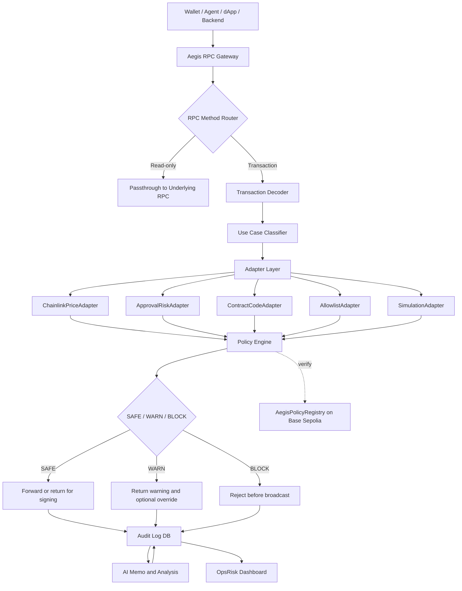
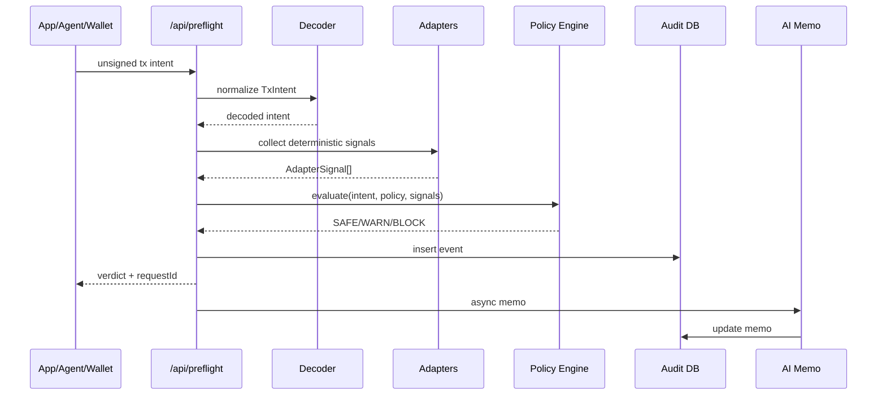

# 02 System Architecture

## Full flow

## Preflight sequence

## Component responsibilities

| Component | Responsibility |
|---|---|
| RPC Gateway | JSON-RPC endpoint, pass-through and interception |
| Preflight API | Reliable unsigned tx screening path |
| Decoder | Convert raw calldata into TxIntent |
| Adapter Layer | Collect deterministic external and local signals |
| Policy Engine | Final deterministic verdict |
| Audit DB | Persist every decision |
| AI Memo | Explain after verdict, never decide |
| Dashboard | Show evidence, timeline, signals, memos |
| Contracts | Policy commitment and demo proof |
