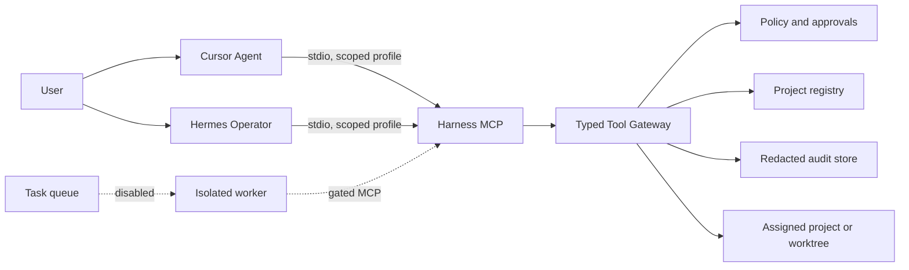

# Agent Harness v1 Architecture

Status: accepted for phased implementation. Fleet activation is not approved.

## Decisions

1. Cursor and Hermes are separate agent and model control planes. Cursor's model
   picker is not an inference API for Hermes.
2. Cursor is the primary interactive surface. Hermes is optional and may fail
   without affecting Cursor.
3. The Harness owns authorization, validation, audit, task lifecycle, and
   worktree allocation.
4. Machine-local paths and state use XDG locations. Product Git repositories
   remain independent.
5. Tool profiles are deny-by-default. Mutable project configuration may select
   trusted command IDs but cannot supply shell strings.
6. One writer owns a worktree. Failed or dirty work is retained. Initial
   profiles never merge, push, deploy, or answer permission requests.

## Operational Profiles

| Profile | State | Write authority |
|---|---|---|
| audit | available | none |
| cursor-interactive | implemented; full verification pending | task proposals only |
| hermes-operator | implemented; inactive | read-only; gated task proposal |
| isolated-worker | implemented; inactive | exact approvals in disposable canary only |
| multi-worker-fleet | disabled | gated on recovery and concurrency tests |

## Trust Boundaries

- MCP process identity selects a configured policy profile. Tool arguments
  cannot select or elevate the profile.
- Project roots are resolved from the machine-local registry. MCP request
  arguments cannot introduce paths or switch projects.
- A2A has no Agent Harness v1 activation gate and its entrypoint refuses
  unconditionally. Cursor and Hermes use separate stdio MCP processes.
- Audit and database state live outside product source trees.
- Existing SQLite state never migrates on ordinary open. An authenticated
  operator must create and verify a consistent backup before schema migration.

## Rollout Gates

Phase 1 requires fresh-clone diagnostics with no project. Phase 2 requires
authorization, approval, path, command, redaction, and protocol adversarial
tests. Hermes stays offline through the Cursor profile gate. A single worker is
allowed only after atomic leases and dirty-worktree recovery are demonstrated.
The fleet remains disabled until concurrent claim, shutdown, disk-pressure, and
restart recovery tests pass.

## Verification Status

The locked, lifecycle-disabled npm install and reviewed native rebuild pass.
Doctor, storage-path checks, policy lint, shell and Python syntax, JSON parsing,
typecheck, build, `git diff --check`, and all 52 tests pass. The disposable
single-worker test reaches `review` with a verified commit and no remote inside
a network-denied Bubblewrap sandbox.

This is not Hermes activation evidence. No Hermes profile, service, listener,
actual Hermes worker, or product write has been activated.
