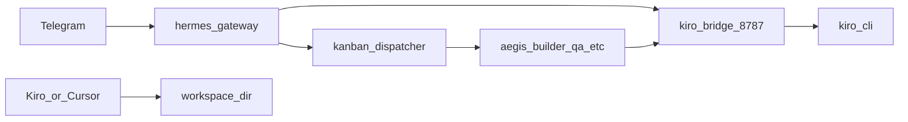

# Historical 24/7 Multi-Agent Environment Plan

> Archived and not approved for execution. The current architecture is
> Cursor-primary, Hermes-optional, and keeps workers disabled until approval,
> lease, recovery, and canary gates pass.

Operational plan for headless orchestration across Hermes (Telegram), Kiro CLI, and Cursor. Kit workspace: `~/dev/Project/aegis-hackathon-kit`.

## Runtime matrix

| Runtime | Role | Entry |
|---------|------|--------|
| **systemd `aegis-stack`** | Always-on bridge + gateway | `scripts/install-systemd-user.sh` |
| **Hermes gateway** | Telegram, cron, webhooks, Kanban dispatcher | `hermes-gateway.service` |
| **Kiro bridge :8787** | OpenAI API for Hermes Telegram only | `kiro-openai-bridge.service` |
| **Kiro CLI** | Repo coding + subagents | `kiro-cli --agent aegis-orchestrator` |
| **Cursor** | Parallel IDE (not wired to Hermes) | Same repo; `Co-authored-by: Cursor` in commits |
| **Hermes Kanban** | Durable multi-profile task queue | `hermes kanban --board <slug>` |



## Step 1 verification checklist

- [x] `scripts/install-systemd-user.sh` — units linked, bridge health OK
- [x] `scripts/start-aegis-dev.sh` — smoke passed
- [x] `hermes gateway restart` — unit refreshed
- [x] `loginctl enable-linger $USER` — Linger=yes
- [ ] Telegram once: `/commands`, `/set-home`, `/model` (expect custom → `http://127.0.0.1:8787/v1`)

**WSL:** Linger survives logout; the WSL VM must stay running for true 24/7.

## Hermes profiles (Kanban assignees)

| Profile | Maps to Kiro agent | Role |
|---------|-------------------|------|
| `aegis-orchestrator` | `aegis-orchestrator` | Decompose goals → Kanban; route, do not implement |
| `aegis-builder` | `builder` | MVP implementation |
| `aegis-security` | `security` | Policy / Web3 review |
| `aegis-qa` | `qa` | Build smoke, AI collaboration log |
| `aegis-pitch` | `pitch` | Grill-me, narrative |

All profiles use `kiro-current` via `http://127.0.0.1:8787/v1` until you add other providers in per-profile `.env`.

## Kanban boards

| Board | Purpose | Workspace |
|-------|---------|-----------|
| `aegis-kit` | Infra: systemd, bridge, MCP, docs | `dir:/home/asyam/dev/Project/aegis-hackathon-kit` |
| `aegis-hackathon` | MVP modules per `HACKATHON.md` | `dir:/home/asyam/dev/Project/Aegis/aegis-protocol-hackathon` (when scaffolded) |

```bash
hermes kanban boards switch aegis-kit
hermes kanban --board aegis-hackathon list
hermes dashboard   # http://127.0.0.1:9119
```

## Cron inventory

| Job | Schedule | Mode |
|-----|----------|------|
| `kanban-orchestrator-tick` | every 30m | Agent + `kanban-orchestrator` skill → Telegram `origin` |
| `aegis-stack-health` | 0 9 * * * | Script-only (`~/.hermes/scripts/aegis-stack-health.sh`) |

```bash
hermes cron list
hermes cron status
```

## Webhooks

Optional after app repo is on GitHub and gateway is reachable from the internet:

```bash
hermes webhook subscribe github-push \
  --events push \
  --skills kanban-orchestrator \
  --deliver origin \
  --prompt "Push to {repository.full_name} on {ref}. Comment on related aegis-hackathon board tasks."
```

Local dev: `hermes webhook test github-push` only; production needs a tunnel or hosted gateway.

## IDE split (avoid Telegram timeouts)

| Do on Telegram | Do in Kiro / Cursor / Kanban workers |
|----------------|--------------------------------------|
| `/plan`, grill-me, short status | `install-systemd-user.sh`, large refactors |
| Kanban create/unblock via orchestrator | One module per worker task |
| `/busy queue` for follow-ups | `git commit`, `git push` (with approval) |

**Never** ask Hermes Telegram to run long `kiro-cli` install + plan in one message (bridge timeout ~3–4 min).

## Teaching / goal loop

1. Source: `HACKATHON.md` checkboxes (app board) or kit prep tasks (kit board).
2. `aegis-orchestrator` decomposes with `parents=[...]` for module order.
3. Dispatcher spawns `aegis-builder` / `aegis-security` (auto `kanban-worker` skill).
4. Human: Kiro `subagent` or Cursor in same `dir:` workspace.
5. One commit per module + `docs/AI_COLLABORATION_LOG.md` + `Co-authored-by` trailers.
6. Cron summaries to Telegram; unblock with `hermes kanban unblock` or dashboard.
7. Pre-demo: `aegis-pitch` or `kiro-cli --agent pitch` → `docs/GRILL_QA.md`.

## Safety

- No private keys or mnemonics in Telegram.
- No `git push`, deploy, or Docker reset without explicit approval.
- No destructive shell via phone.

## App repo plan (when scaffolded)

Paste in Telegram after `/set-home` points at the app repo:

```text
/plan From HACKATHON.md module 1, decompose into Kanban tasks on board aegis-hackathon with parent/child deps, assignees aegis-builder and aegis-security, acceptance criteria per module, and grill-me checkpoints before demo.
```

Seed tasks example:

```bash
hermes kanban --board aegis-hackathon create "Module 1: …" \
  --assignee aegis-builder \
  --workspace "dir:/home/asyam/dev/Project/Aegis/aegis-protocol-hackathon" \
  --priority 2
```

## Telegram mirror prompt (optional)

If you want Hermes to refresh this file from chat, send **only** planning (no shell):

```text
/plan Update .hermes/plans/24-7-multi-agent-environment.md if drifted from live cron/boards/profiles. Planning only; no shell except editing that file.
```
