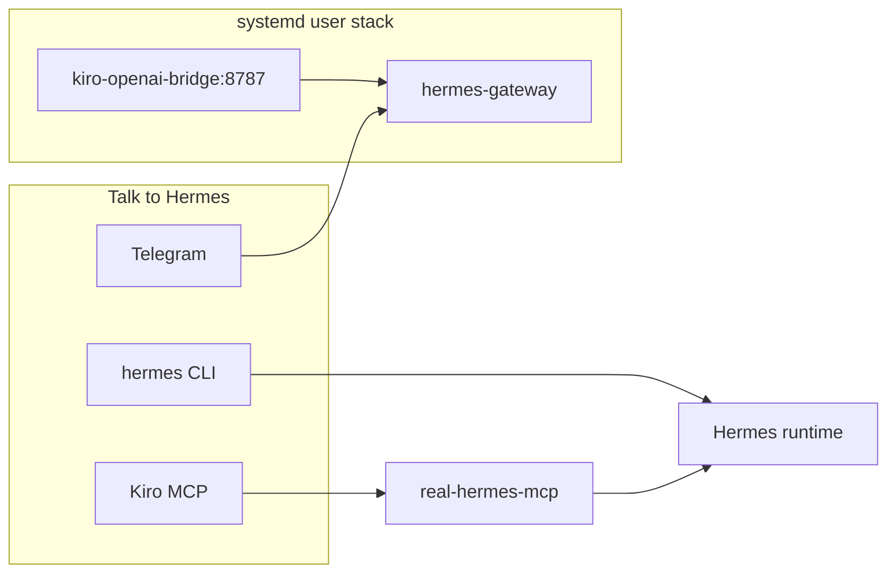

# Hermes 24/7 agent — commands and surfaces

Hermes is the Nous Research agent runtime (CLI, gateway, skills, memory). This kit runs it **always-on** via systemd and routes Telegram through the local Kiro bridge.

## Architecture



## 24/7 operations

| Action | Command |
|--------|---------|
| Start / health check | `aegis-dev` |
| Bridge health | `curl -sf http://127.0.0.1:8787/health` |
| Gateway logs | `journalctl --user -u hermes-gateway -f -l` |
| Bridge logs | `journalctl --user -u kiro-openai-bridge -f -l` |
| Restart stack | `systemctl --user restart aegis-stack.target` |
| Hermes status | `hermes gateway status` |

Enable on login (once):

```bash
~/dev/Project/agent-harness/scripts/install-systemd-user.sh
```

## Three surfaces

### 1. Telegram (phone, 24/7)

Bot name in Telegram: **Aegis Hermes** (native Hermes gateway, not the separate `telegram-kiro-gateway` tool).

Setup (once in Telegram):

```txt
/commands
/set-home
```

`/start` may not exist — use `/commands` instead.

Provider: custom OpenAI-compatible endpoint at `http://127.0.0.1:8787/v1` (multi-provider bridge: Kiro or Cursor). Requires `aegis-dev` / stack running.

**Switch inference backend (once per machine):**

1. Provider skill: installed automatically by `scripts/install-systemd-user.sh` to `~/.hermes/skills/aegis-provider-switch/`. Manual copy only if needed; then `systemctl --user restart hermes-gateway`.

2. For Cursor (headless agent — edits + shell in workspace):
   - `scripts/setup-cursor-bridge-auth.sh` (`agent login` or `CURSOR_API_KEY` in `~/.hermes/.env`)
   - Optional: `CURSOR_BRIDGE_MODE=agent` in `~/.hermes/.env` (default; use `ask` for read-only)
   - `systemctl --user restart kiro-openai-bridge`

3. In Telegram: `/provider` (status), `/provider kiro`, `/provider cursor`, `/provider codex` — then `/reset` after switching.

4. Smoke: `scripts/smoke-cursor-bridge.sh`

CLI equivalent: `scripts/aegis-model.sh status|kiro|cursor|codex`

### 2. Hermes CLI (terminal)

```bash
hermes                    # interactive session
hermes gateway status
hermes config check
hermes model
```

Plans written by `/plan` land in `.hermes/plans/` under the active workspace.

### 3. Kiro MCP (IDE / orchestrator)

Kiro calls Hermes indirectly:

| MCP tool | Purpose |
|----------|---------|
| `real_hermes_stack_health` | Fast: bridge + systemd + gateway |
| `real_hermes_status` | Full status script |
| `real_hermes_gateway_logs` | journalctl tail |
| `real_hermes_config_check` | `hermes config check` |

## Gateway slash commands

Run `/commands` in Telegram for the live list. Common commands:

| Command | Use |
|---------|-----|
| `/commands` | List available commands |
| `/set-home` | Set this chat as home channel (cron delivery) |
| `/model` | Show provider URL (custom → `http://127.0.0.1:8787/v1`) |
| `/provider` | Show active bridge backend (Kiro, Cursor, or Codex) — requires [`aegis-provider-switch` skill](templates/hermes-provider-switch/SKILL.md) |
| `/provider kiro` | Switch Hermes inference to `kiro-cli` |
| `/provider cursor` | Switch Hermes inference to headless Cursor Agent (edits + shell) |
| `/provider codex` | Switch Hermes inference to OpenAI Codex (authenticated local `codex` CLI) |
| `/plan …` | **Plan mode** — planning only; saves to `.hermes/plans/` |
| `/new`, `/reset` | Fresh session |
| `/history` | Conversation history (CLI) |
| `/save` | Save conversation (CLI) |
| `/retry` | Retry last message |
| `/undo` | Remove last exchange |

### `/plan` — technical planning

Use before large features. Hermes will not mutate your repo except the plan file.

Examples:

```txt
/plan Review Aegis MVP modules 1-9 and propose file layout for Next.js App Router.

/plan List risks for policy engine module 4: false positives, latency, and demo scope.
```

Skill source: `~/.hermes/skills/software-development/plan/SKILL.md`

## Grill me — judge Q&A + planning

**Grill me** in this kit means **both**:

1. **Technical plan** — `/plan` or Kiro orchestrator before building.
2. **Judge stress-test** — hard questions about product, Chainlink, limitations.

### Telegram / Hermes prompts

```txt
/plan Before we ship module 7 (dashboard), list acceptance criteria and test scenarios.

Grill me like a SEABW hackathon judge. Ask one hard question at a time about Aegis RPC, our Chainlink adapter, and what we cannot claim. Wait for my answer before the next question.
```

```txt
Grill me on security: unlimited ERC20 approvals, unknown spenders, and why AI does not make the BLOCK decision.
```

### Kiro pitch agent (structured grill)

```bash
cd ~/dev/Project/agent-harness   # or your app repo
kiro-cli --agent pitch
```

Prompt:

```txt
Act as a skeptical hackathon judge. Ask 10 questions about Aegis Protocol one at a time. After each answer, score clarity 1-5 and suggest a better one-liner. Save a FAQ outline for docs/GRILL_QA.md.
```

Save output to your app repo: `docs/GRILL_QA.md`.

## Skills (optional slash commands)

Installed under `~/.hermes/skills/`. Examples useful for Aegis:

```txt
/plan …
/github-pr-workflow …
/writing-plans …
```

Custom skills you may add later:

```txt
~/.hermes/skills/aegis-rpc-policy-engine/SKILL.md
~/.hermes/skills/aegis-hackathon-pitch/SKILL.md
~/.hermes/skills/aegis-security-review/SKILL.md
```

## Kanban multi-agent board

Hermes ships a shared SQLite task board at `~/.hermes/kanban.db`. Use it to fan out work across specialist agents (builder, security, qa, pitch) and track progress across sessions.

### Quick reference

| Action | Command |
|--------|---------|
| List board | `hermes kanban list` |
| Show task | `hermes kanban show <id>` |
| Create task | `hermes kanban create "title" --assignee <profile>` |
| Block task | `hermes kanban block <id> "reason"` |
| Complete task | `hermes kanban complete <id> --summary "..."` |
| Dispatch worker | `hermes kanban dispatch <id>` |

### Worker lifecycle (6 steps)

1. **Orient** — `hermes kanban show <id>` first; read prior runs and comments.
2. **Work** — stay inside `$HERMES_KANBAN_WORKSPACE`; do not touch files outside it.
3. **Heartbeat** — for long jobs, `hermes kanban heartbeat <id> --note "progress"` every few minutes.
4. **Block on ambiguity** — if you need a human decision, `hermes kanban block <id> "reason"` and stop.
5. **Complete with handoff** — `hermes kanban complete <id> --summary "..." --metadata '{...}'`.
6. **Spawn follow-ups** — create child tasks for downstream work; do not do it yourself.

### Aegis profiles

| Profile | Assigned work |
|---------|--------------|
| `aegis-builder` | MVP implementation, API routes, policy engine |
| `aegis-security` | Policy review, Web3 risk, ERC20 edge cases |
| `aegis-qa` | Demo blockers, AI collaboration proof |
| `aegis-pitch` | Narrative, judge Q&A, grill-me sessions |

### Orchestrator pattern

When a high-level goal arrives (e.g. "ship module 4 policy engine"), the orchestrator:

1. Creates one child task per specialist with `--parent <orchestrator-id>`.
2. Completes its own task with a decomposition summary.
3. Does NOT execute the work itself.

Example:

```bash
hermes kanban create "Implement policy engine core" --assignee aegis-builder --parent t_abc123
hermes kanban create "Review policy engine for false positives" --assignee aegis-security --parent t_abc123
hermes kanban complete t_abc123 --summary "Decomposed policy engine into builder + security tasks"
```

### Review-required pattern

For code changes that need human eyes before merging:

```bash
# Worker leaves a comment with structured metadata, then blocks
hermes kanban comment t_xyz --body "changed: policy.ts, tests: 12/12 pass, diff at /path/to/worktree"
hermes kanban block t_xyz "review-required: policy engine shipped, 12/12 tests — needs merge approval"
# Human reviews, then:
hermes kanban unblock t_xyz
```

## Cron and scheduled tasks

Hermes supports cron-triggered agent runs. Configure in `~/.hermes/config.yaml`:

```yaml
cron:
  - schedule: "0 9 * * *"          # 09:00 daily
    profile: aegis-builder
    task: "Daily standup: summarise open kanban tasks and post to home channel"
  - schedule: "0 */4 * * *"        # every 4 hours
    profile: aegis-qa
    task: "Health check: run aegis-dev and report stack status"
```

Cron delivery goes to the `/set-home` channel (Telegram). Run `/set-home` in your bot chat once to register it.

Useful cron tasks for Aegis hackathon:

| Schedule | Task |
|----------|------|
| Daily 09:00 | Summarise open kanban board + blockers |
| Every 4 h | Stack health check (`aegis-dev`) |
| Before demo | Run demo scenario checklist and report pass/fail |

Check cron logs:

```bash
journalctl --user -u hermes-gateway -f -l | grep cron
```

## Safety rules (Telegram)

Do not use phone messaging for:

- private keys or mnemonics
- `git push` without approval
- deploy or Docker reset without approval
- destructive shell (`rm -rf`, etc.)

### Telegram guardrails in detail

**Never send via Telegram:**

- Wallet private keys, seed phrases, or `.env` secrets
- Commands that push to `main`/`master` directly
- `docker rm`, `docker system prune`, or any container teardown
- `rm -rf` or bulk file deletion
- Production deploy commands

**Always confirm before acting on Telegram instructions that involve:**

- Any `git push` (check branch — never force-push main)
- Installing system packages (`apt`, `pip` with `--break-system-packages`)
- Modifying systemd units or `~/.hermes/config.yaml`
- Creating or dispatching kanban tasks that spawn real agent runs

**Safe Telegram use:**

- Planning (`/plan …`) — read-only, writes only to `.hermes/plans/`
- Status queries (`aegis-dev`, `hermes gateway status`)
- Grill-me Q&A sessions
- Reviewing kanban board (`hermes kanban list`)
- Asking for code explanations or architecture review

## Hermes vs Kiro (do not confuse)

| Runtime | Role |
|---------|------|
| **Kiro** (`kiro-cli --agent aegis-orchestrator`) | Primary coding in repo; subagents; MCP to inspect Hermes |
| **Hermes gateway** | 24/7 Telegram, memory, skills, cron |
| **Kiro bridge :8787** | Model backend for Hermes Telegram only |

## Troubleshooting: Telegram stall (“no chunks yet”, retries)

Symptoms in **Aegis Hermes** chat:

- `⏳ Still working... waiting for stream response (150s, no chunks yet)` — bridge not sending SSE yet (older bridge) or very slow provider start
- `⏳ Still working... receiving stream response` then `⏳ Retrying in … (attempt 1/3)` after **~9–10+ min** — keepalives work, but **Cursor/Kiro subprocess hit the bridge time limit** (`killed: SIGTERM` in bridge logs). Common with **50+ message** Telegram sessions and “orchestrate phase N” prompts.
- Long run with **iteration 1/90** and no final assistant text

**Cause:** Hermes streams from `http://127.0.0.1:8787/v1`. The bridge runs **Kiro CLI** or **Cursor Agent** locally. Large sessions get a **scaled timeout** (up to 60m); if the subprocess still exceeds it, the bridge returns **504** / `Provider command failed` and Hermes retries.

**Unblock (operator):**

1. Send `/reset` (or `/new`) in Telegram to drop the stuck turn.
2. `aegis-dev` then `curl -sf http://127.0.0.1:8787/health`
3. Check logs: `journalctl --user -u kiro-openai-bridge -n 50` and `grep timeout_error ~/.hermes/logs/errors.log | tail -5`
4. **Do not** re-orchestrate a completed hackathon phase in Telegram — use Kanban + scripts (see `aegis-rpc/ORCHESTRATOR.md`). Example: Phase 4 grill is done; Phase 5 is Vercel (human steps).

**Stack fixes (kit):**

- Bridge emits **SSE keepalives** every ~18s while the provider runs (`AEGIS_BRIDGE_SSE_HEARTBEAT_MS`).
- Provider timeouts default to **20 minutes**, scaling to **40–60 minutes** when `messageCount >= 40` or the prompt is very large (`KIRO_BRIDGE_TIMEOUT_MS`, `CURSOR_BRIDGE_TIMEOUT_MS`, `AEGIS_BRIDGE_TIMEOUT_CAP_MS` in `systemd/user/kiro-openai-bridge.service`).
- After changing bridge code or units: `systemctl --user daemon-reload && systemctl --user restart kiro-openai-bridge hermes-gateway`

**Stream smoke test:**

```bash
curl -N http://127.0.0.1:8787/v1/chat/completions \
  -H 'Content-Type: application/json' \
  -d '{"model":"cursor-composer-2","stream":true,"messages":[{"role":"user","content":"Reply with exactly: pong"}]}'
```

You should see `data: {` lines within ~20s even if the provider is still working.

**Prefer headless orchestration** for ship phases: `scripts/aegis-pm-orchestrate-once.sh` and `hermes kanban dispatch` — not long “orchestrate phase N” prompts in Telegram.

## Kanban (multi-agent, headless)

Hermes Kanban is a durable SQLite board shared across **named profiles**. This kit uses two boards:

| Board | Use |
|-------|-----|
| `aegis-kit` | Infra: systemd, bridge, MCP, docs |
| `aegis-hackathon` | App MVP modules (after scaffold) |

Profiles (create once with `hermes profile create <name> --clone`):

`aegis-orchestrator`, `aegis-builder`, `aegis-security`, `aegis-qa`, `aegis-pitch`

```bash
hermes kanban boards switch aegis-kit
hermes kanban --board aegis-kit list
hermes dashboard    # http://127.0.0.1:9119
```

Workers must use absolute workspaces: `--workspace "dir:/home/asyam/dev/Project/agent-harness"`.

Full runbook: [.hermes/plans/24-7-multi-agent-environment.md](../../.hermes/plans/24-7-multi-agent-environment.md).

## Headless 24/7 install (PM + PABTI)

Orchestration plan (product repo): `aegis-rpc/.hermes/plans/2026-05-20_201500-headless-pm-pabti-orchestrate-agent-github-10m.md`

**One-shot install:**

```bash
~/dev/Project/agent-harness/scripts/install-aegis-headless-24-7.sh
```

This chains: WSL Telegram drop-in, bridge/gateway restart, **10m PM cron** (script-only), **~5m Lane O timer** (orchestrate + dispatch + optional extra waves), and secrets health.

**Prerequisites:** `loginctl enable-linger`, Telegram `/set-home`, `~/.hermes/.env` with `TELEGRAM_BOT_TOKEN` and `CURSOR_API_KEY` or `agent login`. For D3 deploy: `DEPLOYER_PRIVATE_KEY` in **local** `aegis-rpc/.env` (gitignored).

**Telegram “execute orchestrate” is not Lane O** — chat runs health checks manually; true 24/7 orchestration is **systemd + scripts**.

| Lane | Script / unit | Role |
|------|----------------|------|
| **A** | `aegis-pm-tick-10m` (cron) | Status to Telegram every 10m; reads `DECISIONS.md` for D3/push policy |
| **O** | `aegis-pm-orchestrate-once.sh` (~5m timer) | Unblock D3 if approved, `aegis-d3-deploy-once.sh`, seed backlog, `dispatch --max 2`, then optional extra waves while `ready>0` and `running<2` |
| **B** | Kanban workers (`aegis-*` profiles) | Cursor bridge PABTI on `ready` cards; must `kanban_complete` / `kanban_block` |

**Hands-off (no daily clicks):** With `loginctl enable-linger`, gateway + bridge user units active, and `install-aegis-headless-24-7.sh` applied, Lane O and the 10m PM cron run on their own. You still need the **machine/WSL session up**, Hermes workers that **actually execute** dispatched cards (bridge `CURSOR_BRIDGE_MODE=agent`), and **human approval** for `git push`, protected merges, Vercel prod, and mainnet-style keys — automation does not override `DECISIONS.md`.

**D3 (script-only deploy):** Operator approval in `aegis-rpc/DECISIONS.md` → `scripts/aegis-d3-deploy-once.sh` (forge, no LLM) → `aegis-devops` worker **verifies only** (reads `.hermes/deploy/latest-summary.txt`).

**Seed ready tasks when board is empty:**

```bash
scripts/aegis-kanban-seed-ready.sh
scripts/aegis-kanban-seed-plan-backlog.sh   # stretch/pitch when fully idle
scripts/aegis-pm-orchestrate-once.sh        # manual Lane O run
```

**API key maintenance (authorized):** `scripts/aegis-secrets-health.sh`, `scripts/aegis-secrets-maintain.sh`, skill `aegis-secrets-maintain` — see `aegis-rpc/DECISIONS.md`. Never paste keys in Telegram.

### Validation checklist

| Check | Expected |
|-------|----------|
| Telegram PM post | Every ~10m: `=== Aegis PM status ===` |
| Credentials line | `telegram=OK cursor=OK` (no key material) |
| Bridge | `curl -sf http://127.0.0.1:8787/health` → `bridgeMode: agent`, `configured: true` |
| Lane O | `journalctl --user -u aegis-kanban-dispatch.service -n 30` shows orchestrate + dispatch |
| D3 deploy | `aegis-d3-deploy-once.sh` exit 0 + summary file; then devops worker completes card |
| WSL limits | VM must stay running; Windows sleep/shutdown stops user systemd |

## Cron (scheduled orchestration)

```bash
hermes cron list
hermes cron status
```

Kit jobs (after setup):

| Name | Schedule | Purpose |
|------|----------|---------|
| `kanban-orchestrator-tick` | every 30m | Review boards, unblock/create tasks → Telegram `origin` |
| `aegis-stack-health` | 0 9 * * * | Script-only bridge/systemd check (`~/.hermes/scripts/aegis-stack-health.sh`) |
| `aegis-pm-tick-10m` | every 10m | Script-only PM status (Kanban, bridge, credentials OK/MISSING) → Telegram `origin` — install: `scripts/install-aegis-pm-cron-10m.sh` or `scripts/install-aegis-headless-24-7.sh` |

**Lane O (user systemd):** `aegis-kanban-dispatch.timer` runs `scripts/aegis-pm-orchestrate-once.sh` about every **5m** (D3 sync, deploy script, seed, dispatch, then up to **4** extra dispatch waves every **45s** while `ready>0` and `running<2`). Defaults come from `aegis-kanban-dispatch.service` (`AEGIS_KANBAN_EXTRA_DISPATCH_WAVES`, `AEGIS_KANBAN_WAVE_SLEEP_SEC`); set `AEGIS_KANBAN_EXTRA_DISPATCH_WAVES=0` in a drop-in to match old single-wave behavior. Install: `scripts/install-aegis-kanban-dispatch-timer.sh` or meta-installer above. After upgrading units, run `systemctl --user daemon-reload && systemctl --user restart aegis-kanban-dispatch.timer`.

**Secrets (authorized):** `scripts/aegis-secrets-health.sh`, `scripts/aegis-secrets-maintain.sh`; Hermes skill `aegis-secrets-maintain`.

Requires `/set-home` in Telegram so `origin` delivery has a chat. Gateway must be running (`aegis-dev`).

Create agent cron jobs with **schedule and prompt before flags**:

```bash
hermes cron create 'every 30m' 'Your short prompt here.' \
  --name my-job --skill kanban-orchestrator --deliver origin \
  --workdir ~/dev/Project/agent-harness
```

## Telegram guardrails (avoid timeouts)

| Safe on phone | Use Kiro / Cursor / Kanban workers instead |
|---------------|---------------------------------------------|
| `/plan`, grill-me, short status | `install-systemd-user.sh`, large refactors |
| Kanban routing via orchestrator profile | Long `kiro-cli` loops through the bridge |
| `/busy queue` for follow-ups | `git push`, deploy, Docker reset |

Telegram → bridge → `kiro-cli --trust-all-tools` can stall for minutes and restart the gateway. Keep phone messages short; fan out work on the Kanban board.

## References

- [Hermes Agent GitHub](https://github.com/nousresearch/hermes-agent)
- [Slash commands](https://github.com/NousResearch/hermes-agent/blob/main/website/docs/reference/slash-commands.md)
- [Daily setup](01-daily-setup.md)
- [Kiro agents](03-kiro-agents.md)
