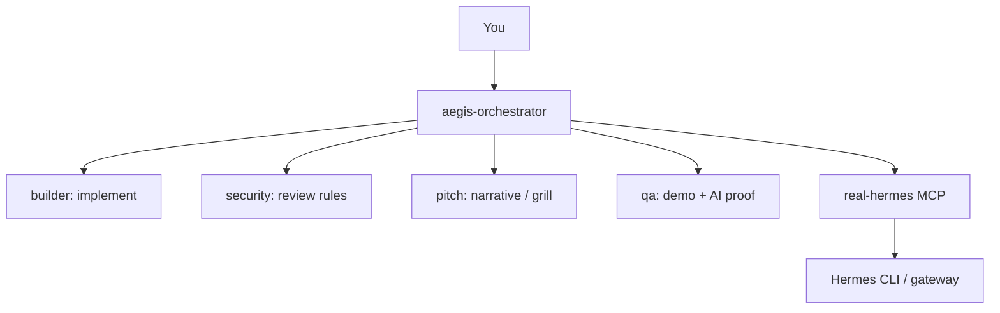

# Kiro agents — orchestrator and specialists

Agent configs live in [.kiro/agents/](../../.kiro/agents/). Steering docs: [.kiro/steering/](../../.kiro/steering/).

## Agent roster

| Agent | CLI | Role |
|-------|-----|------|
| **aegis-orchestrator** | `kiro-cli --agent aegis-orchestrator` | Default: coding, planning, delegates work, calls Hermes MCP |
| **builder** | `kiro-cli --agent builder` | Next.js MVP, APIs, dashboard |
| **security** | `kiro-cli --agent security` | Web3 risk rules, policy review |
| **pitch** | `kiro-cli --agent pitch` | Narrative, slides outline, **grill-me** judge Q&A |
| **qa** | `kiro-cli --agent qa` | Build/demo blockers, AI collaboration proof |

## Orchestrator (default)

Start from kit or app repo root:

```bash
cd ~/dev/Project/aegis-hackathon-kit   # or your hackathon app
kiro-cli --agent aegis-orchestrator
```

Capabilities:

- Kiro model for read/write/shell/grep/glob/subagent
- **@real-hermes** MCP tools (see below)
- Should delegate implementation to **builder** and policy review to **security**

Example prompts:

```txt
Use the Aegis orchestrator workflow. Implement module 2 (preflight) only. One focused commit with Co-authored-by trailers.

Call @real-hermes/real_hermes_stack_health before we start.

Delegate security review of the policy engine to the security agent, then summarize blockers.
```

Config: [.kiro/agents/aegis-orchestrator.json](../../.kiro/agents/aegis-orchestrator.json)

## real-hermes MCP tools

| Tool | When to use |
|------|-------------|
| `real_hermes_stack_health` | Quick daily check (prefer this) |
| `real_hermes_status` | Full gateway + config status |
| `real_hermes_gateway_logs` | Debug Telegram failures |
| `real_hermes_config_check` | Config validation |

## Subagent workflow



Typical hackathon flow:

1. **Orchestrator** — break down module from [HACKATHON.md](../../HACKATHON.md) checklist.
2. **Builder** — implement slice.
3. **Security** — review policy/adapter changes.
4. **QA** — verify build, demo path, `Co-authored-by` on last commits.
5. **Pitch** — grill-me before submission.

## Specialist prompts

### Builder

```txt
Build POST /api/preflight for native transfer + ERC20 approve decode only. Match .kiro/steering/aegis-product.md build order. No Docker.
```

### Security

```txt
Review policy rules for unlimited approvals, unknown spenders, and high-value BLOCK. Return implementable rules and demo limitations.
```

### Pitch (grill me)

```txt
Grill me as a hackathon judge. One question at a time about Aegis RPC and Chainlink. No fake security claims.
```

### QA

```txt
Check README, demo scenarios, last 5 commits for Co-authored-by, and docs/AI_COLLABORATION_LOG.md. Blockers first.
```

## Rules (all agents)

From [AGENTS.md](../../AGENTS.md):

- No final product in **kit** repo before official hackathon build start.
- No private keys; no fake AI usage.
- No push, deploy, or Docker without explicit approval.
- Telegram Hermes uses Kiro **bridge** (`:8787`), not Kiro IDE session model.

## MCP troubleshooting

If `/tools` does not show real-hermes:

1. Run from workspace root.
2. Confirm `mcpServers` in `aegis-orchestrator.json` with `"includeMcpJson": false`.
3. See [01-daily-setup.md](01-daily-setup.md).

## References

- [Kiro custom agents](https://kiro.dev/docs/cli/custom-agents/)
- [Hackathon lifecycle](04-hackathon-lifecycle.md)
- [Hermes 24/7](02-hermes-24-7.md)
