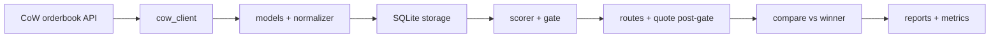

# AGENTS.md — ArbEyes DeFi Agent Contract

## Mission

Ship **Product 1**: a CoW Protocol **shadow solver** — read-only scoring validation and (post-gate) simple route candidates vs settled auctions. Output is **evidence** (gate pass-rate, competitiveness distribution), not live solver profit.

## Non-negotiable product truths

1. **Shadow only** — no driver/autopilot submission, no smart contracts in P1, no capital at risk.
2. **Scorer gate is the product spine** — if the winner’s score cannot be reproduced from public data within documented tolerance, stop before route generation (`docs/09-scorer-validation-gate.md`, `docs/18-do-not-build-yet.md`).
3. **Alloy, not ethers-rs** — align with `cowprotocol/services` and modern Rust EVM stacks.
4. **External truth** — CIP-38/65 scoring rules and pinned `openapi.yml` tags; document the pin in code comments.
5. **OpenSrc discipline** — learn from `cowprotocol/services` via `.harness/research/opensrc-paths/`; no large vendored forks.
6. **Do not overbuild** — three crates + one app until a second product genuinely shares boundaries.

## Architecture (target)

## Agent roles (see `.harness/agents/`)

- **Orchestrator** — sequencing, scope enforcement, Kanban ↔ harness tasks.
- **Rust Core** — workspace, config, models, scorer, gate loop, reporter.
- **Rust EVM** — Alloy provider, ERC-20 metadata, UniV2 quoter paths.
- **Observability** — tracing, Prometheus metrics, VPS/systemd runbook.
- **Security & Scope** — secrets hygiene, `18-do-not-build-yet` compliance.
- **QA Gate** — fixtures, serde round-trips, no network in CI, gate regression suite.
- **OpenSrc Librarian** — pinned upstream refs, path files, doc cross-links.

## Coding rules

- Rust 1.85+ / stable toolchain as in `docs/03-rust-workspace-architecture.md`.
- `cargo fmt` + `clippy -D warnings` clean before merge.
- Integration tests that hit CoW API are **opt-in** / env-gated; default tests use fixtures.

## Read order

1. `.harness/project.manifest.json`
2. `.harness/project-context.md`
3. `docs/00-decision.md` → `docs/final-implementation-decision.md`
4. `docs/17-cursor-agentic-implementation-prompt.md` (implementation order)
5. `ORCHESTRATOR.md` / `DECISIONS.md`

Harness playbooks: `$AGENT_HARNESS_HOME/docs/kit/`
