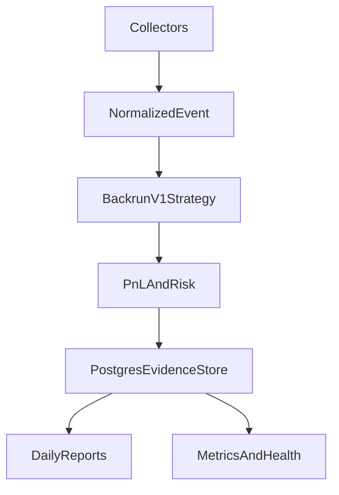

# AGENTS.md — MEV Share Backrun Flashloan Arbitrage Agent Contract

## Mission

Ship **V1**: a multi-chain **shadow** backrun / mispricing scanner in Rust. One 24/7 VPS-runnable worker that ingests Ethereum MEV-Share + Base/Arbitrum block-delta events, normalizes them, runs `backrun-v1`, prices with honest net-of-bribe PnL (flashloan fees as feasibility cost only), applies a deterministic risk gate, persists everything to Postgres, and produces daily cross-chain survival reports — **with zero live execution, zero capital at risk, and zero bundle submission**.

The product is evidence, not profit. Its job is to answer: *does a repeatable edge exist that survives realistic costs, and on which chain/pairs?*

## Non-negotiable product truths

1. **V1 is a multi-chain shadow scanner, not a live bot.** No `mev_sendBundle`, no signing, no funds, no contracts, no execution path.
2. **Ethereum uses MEV-Share SSE** (with historical hint backfill); **Base and Arbitrum use block-delta collectors** (public post-inclusion observations). No assumption of multi-chain MEV-Share.
3. **Postgres is the source of truth**; in-memory caches (dashmap/lru) are rebuildable. No Redis in V1.
4. **Risk is deterministic and authoritative.** The risk engine blocks or downgrades candidates on denylists, low liquidity, staleness, etc. Nothing overrides it.
5. **Flashloans are modeled as feasibility and fee only.** Balancer 0% first, Aave ~5bps second. No live flashloan, no executor contract.
6. **Explicitly forbidden in V1**: live bundle submission, signing, contracts, Redis, ML model training/serving, web dashboards, microservices, Kubernetes, self-hosted archives, generic public flashloan arb, v4 live strategies.
7. **One Rust worker binary** (multiple async tasks under one Tokio runtime with bounded channels), not microservices — until profiling proves otherwise.
8. **Broad scanner first.** Promote exactly one chain + one strategy to a tiny live canary only after shadow data shows coherent, repeatable `survives_75` clusters **and** accurate replay validates the fast-estimate (Day 60+ gate).

## Architecture (V1 target)

Collectors (MEV-Share SSE for Ethereum, block-delta for L2s) → decoder → `NormalizedEvent` → pluggable `Strategy` (`backrun-v1` in V1) → PnL accountant + deterministic Risk gate → batched async storage to Postgres → daily reports + Prometheus metrics + Telegram alerts.

See `docs/02-multichain-architecture.md`, `docs/03-chain-collector-model.md`, and `docs/06-event-normalization.md` for the full normalized event model and data flow.

## Agent roles (see `.harness/agents/`)

- **Orchestrator** — sequencing, scope enforcement (BUILD NOW / LATER / DO NOT BUILD YET), Kanban ↔ harness tasks, gate reviews.
- **Rust Core** — workspace, config, core types, storage writer, strategy API + backrun-v1, PnL, risk, simulator (fast-estimate), reporter, worker wiring.
- **Rust EVM** — Alloy provider, ERC-20 metadata, v2/Sushi-v2 DEX adapters (closed-form U256 math), pool registry seeding, state reader.
- **Observability** — tracing (JSON → journald), Prometheus `/metrics`, axum `/health`, Telegram alerts, VPS/systemd runbook.
- **Security & Scope** — secrets hygiene, strict adherence to `docs/19-do-not-build-yet.md` and `docs/18-ml-and-redis-later.md`.
- **QA Gate** — fixtures for collectors/strategies, serde round-trips, offline tests, gate regression on survival metrics.
- **OpenSrc Librarian** — pinned upstream refs (Flashbots MEV-Share, Alloy, Foundry), path files under `.harness/research/opensrc-paths/`, doc cross-links.

## Coding rules

- Rust 1.85+ / stable toolchain (as declared in `rust-toolchain.toml`).
- `cargo fmt` + `cargo clippy -- -D warnings` clean before merge.
- All token amounts, scores, and money are `U256` (or `NUMERIC(78,0)` in Postgres); floats only at report boundaries.
- Unit tests are offline by default (mock SSE/RPC + fixtures). Live network integration tests are env-gated.
- Event ingestion must never block on downstream work; collectors write raw + push to bounded channel; backpressure drops to DB with counter.
- Follow the exact build order and crate list in `docs/20-agentic-coding-prompt.md`. No extra crates, no placeholder folders for LATER items.

## Read order

1. `.harness/project.manifest.json`
2. `.harness/project-context.md`
3. `docs/00-executive-decision.md` → `docs/01-product-scope.md` → `docs/17-14-30-60-90-day-plan.md`
4. `docs/20-agentic-coding-prompt.md` (the hard V1 contract and build order)
5. `ORCHESTRATOR.md` / `DECISIONS.md`
6. Key technical docs: `02-multichain-architecture.md`, `03-chain-collector-model.md`, `05-postgres-schema.md`, `10-backrun-v1-strategy.md`, `11-flashloan-feasibility-model.md`, `14-risk-engine.md`

Harness playbooks: `$AGENT_HARNESS_HOME/docs/kit/`

Maintain the three-tier tagging (BUILD NOW / BUILD LATER / DO NOT BUILD YET) in every planning artifact.
