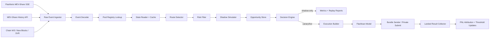
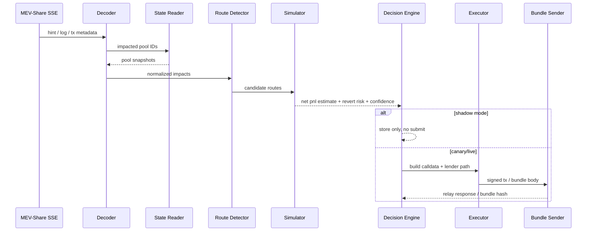
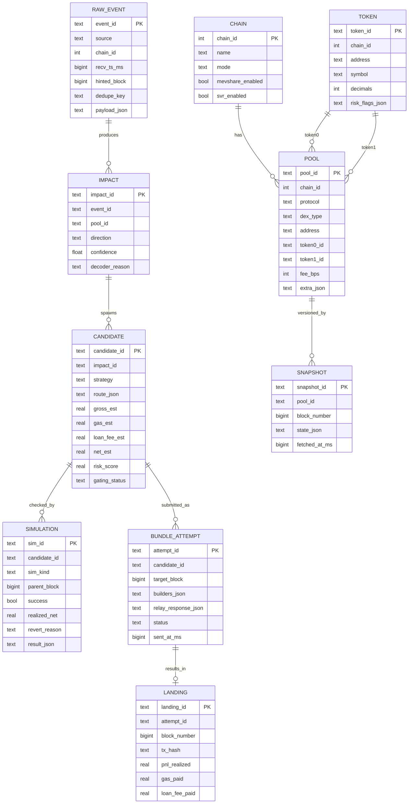
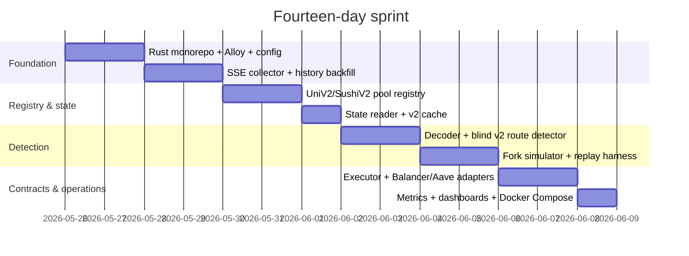

# PnL-First Technical Documentation for a Rust MEV-Share Backrun Shadow Searcher

## Executive summary

The most sensible product to build with a **PnL-first**, **low-cost**, and **moderate entry-barrier** goal is a Rust-based **broad shadow searcher** that:  
**listens to Flashbots MEV-Share on Ethereum**, **scans state/mempool across several other EVM chains**, **normalizes multiple DEX types**, and then **prioritizes live execution only on the simplest and most defensible subset of opportunities**: long-tail token backrun/mispricing on v2-style/WETH-base pairs first, then expanding to v3/v4/Balancer/Curve/Sushi v3 after shadow accuracy is high enough. This direction is most consistent with the fact that the **official Flashbots MEV-Share currently talks about Ethereum transaction events**, the main node operated by Flashbots is **Ethereum mainnet**, and the hints shared are often **partial**, which makes blind/onchain-sizing strategies relevant for v2-style blind backruns. citeturn14view0turn14view1turn14view6turn20search0

The most important implication for product scope is this: **“multi-chain scanning”** makes sense, but **“multi-chain MEV-Share execution”** must not be assumed. Officially, the Flashbots MEV-Share event stream refers to Ethereum transactions; for other chains, you need another collector, such as a public pending tx watcher, block-delta scanner, or a special auction system like **Chainlink SVR Atlas** on Base, Arbitrum, and BNB Chain. Therefore, the right design is a **broad scanner / narrow executor**: read many chains, go live on only a few chains first. citeturn14view1turn23view1turn23view2

For the Rust stack, my recommendation is **Alloy + reqwest/jsonrpsee + Tokio**, not building a new foundation on top of `ethers-rs`. The reason is simple: `ethers-rs` has been deprecated, and Alloy is positioned as the successor Rust EVM toolkit with JSON-RPC, WebSocket, `trace`, and performance features that are relevant for bot infrastructure. The `mev-share-rs` library exists and is useful as an interoperability reference, but its public examples still use `ethers_*` components, so for a new system that wants to be clean and durable, an internal thin adapter on top of Alloy is healthier. citeturn11search0turn11search1turn11search2turn11search10turn27view0

For flashloan execution, the rational priority is:  
**Balancer Vault** when the chain and asset are available, because Balancer documentation currently states a flash loan fee of **0**; **Aave v3 `flashLoanSimple()`** as a broad and gas-efficient fallback for a single reserve, with an initial fee of **0.05%**; **Aave `flashLoan()`** when you need multi-asset or a more flexible mode. **Uniswap v4 flash accounting is not an external flashloan source**; it is a delta-settlement model in the `PoolManager`, useful for reducing transfer overhead on internal v4 routes, not for borrowing arbitrage capital across protocols. citeturn16view2turn18view1turn18view2turn16view3turn16view4turn19search0

If your budget is truly limited, the best v1 product shape is:  
**Ethereum MEV-Share shadow + historical replay + canary execution for v2-style blind backruns**, with additional scanners on **Base** and **Arbitrum** as watch-only or shadow-only. Once shadow metrics are stable, you can add **BNB Chain** and **Chainlink SVR Atlas** as more structured auction/OEV paths. This is more realistic than trying to run live generic arbitrage across all chains from day one. citeturn34view0turn14view6turn23view1turn23view2

## Protocol facts that determine the product shape

### What MEV-Share provides and what it does not

Flashbots describes MEV-Share for searchers as a node that receives transactions and bundles, then selectively shares **hints** with searchers. The stream is **SSE**, the main endpoint is `mev-share.flashbots.net`, and the official documentation says that the shared events **currently refer to Ethereum transactions**. Flashbots also explicitly writes that in MEV-Share some transaction fields may be hidden; a transaction may reveal only a function selector or another partial hint. citeturn14view0turn14view1

This means the traditional offchain search design that relies on full calldata, full swap size, and full simulation of pending txs **is not always possible** on MEV-Share. For this reason, the official Flashbots tutorial for **simple blind arbitrage** uses an “onchain searching” model: arbitrage sizing is calculated inside the trade/contract, so it does not need to know the full details of the user trade from the beginning. For your product, this is an important architectural signal: **the first live phase must prioritize strategy families that are resilient to partial hints**. citeturn14view6turn20search0

### Architectural consequences for a shadow searcher

MEV-Share gives you two very useful research assets for shadow mode. First, the **historical hint API** for backfill and replay. Second, **`mev_simBundle`**, but with an important limitation: bundle simulation can only be performed for a **matched bundle**; a bundle that still contains an item like `{hash: ...}` is **unmatched** and cannot be simulated directly through that path. In practice, this means your shadow system must have **two simulation modes**:  
**local replay/fork mode** for pre-trade shadow, and **post-land verification mode** using matched simulation or a parent-block fork after the base tx actually lands. citeturn34view0turn35view0turn14view3

Flashbots also has fairly clear rate limits: `mev_sendBundle` and `eth_sendBundle` each have `1800/IP/minute`, while `mev_simBundle` has `300/IP/minute`. This is enough for a solo searcher, but it forces you to design a **scheduler**, **coalescer**, and **priority queue** so the shadow engine does not waste simulations or submissions that are clearly below the profitability threshold. citeturn22view0

### Multi-chain consequences

If your target is to “scan all chains,” I recommend treating this as **support for many collectors**, not as one universal orderflow protocol. For Ethereum, the core collector is **MEV-Share SSE**. For Base, Arbitrum, and BNB Chain, the official path closest to private/auctioned orderflow in the relevant primary sources here is **Chainlink SVR Atlas**. For other chains, the safest default is a **block-delta scanner** and, if the provider supports it, a **public pending tx watcher**. Do not assume parity in mempool behavior across L2s; the documentation available in the primary sources here does not provide enough basis to assume that pending tx semantics are identical across chains. citeturn14view1turn23view1turn23view2

## Recommended product scope

### The default I recommend if the chain scope has not been determined

Because you have not provided a fixed final target chain, my recommended default is:

| Status | Chain | Reason |
|---|---|---|
| **Live P0** | **Ethereum** | The only chain with an official Flashbots MEV-Share collector in this documentation; the most complete DEX ecosystem; an official blind backrun path exists as a reference. citeturn14view0turn14view1turn20search0 |
| **Shadow P1** | **Base** | Uniswap v2/v3/v4 exists; Sushi v2/v3 exists; Aave market exists; Chainlink SVR Atlas supports Base. citeturn17view0turn25view1turn24view1turn16view11turn10search2turn37search7turn23view1 |
| **Shadow P1** | **Arbitrum** | Uniswap v2/v3/v4 exists; Sushi v2/v3 exists; Balancer exists; Chainlink SVR Atlas supports Arbitrum. citeturn17view0turn25view0turn24view0turn16view10turn16view11turn16view12turn23view1 |
| **Shadow P2** | **BNB Chain** | Uniswap v2/v3/v4 exists; Sushi v2/v3 exists; Aave market exists; Chainlink SVR Atlas supports BNB Chain. citeturn17view0turn25view2turn24view2turn16view10turn16view11turn37search7turn23view1 |
| **Shadow P2** | **Polygon / Optimism / Avalanche** | Uniswap v2/v3/v4 exists; Balancer exists on some of these chains; Sushi v2/v3 also exists on several of these chains. citeturn17view0turn25view3turn25view4turn25view5turn24view4turn24view3turn24view5turn16view12turn16view10turn16view11 |

**Why not “all chains live” from the beginning?**  
Because your advantage is not co-location or a broad private builder network everywhere, but **coverage**, **quality filtering**, **replay discipline**, and **the ability to filter long-tail niches**. A broad scanner / narrow executor strategy is much more aligned with budget constraints and the protocol facts above. This is a design inference from the official sources above. citeturn14view1turn23view1turn23view2

### Strategy scope I recommend for three phases

**Initial live phase**:  
long-tail **Uni v2 / Sushi v2 style** blind backrun on Ethereum, especially **WETH**-based or stable-base pools that have alternative venues. This is closest to the official `simple-blind-arbitrage` strategy and most compatible with partial hints. citeturn14view6turn20search0

**Expansive shadow phase**:  
scanner for **Uniswap v3/v4, Sushi v3, Balancer, Curve**, across Ethereum/Base/Arbitrum/BNB/Polygon/Optimism/Avalanche. The goal is not to go live immediately, but to build an **opportunity dataset, error model, and token risk classifier**. Uniswap v4 in particular needs conservative treatment because it has **hooks**, **dynamic fees**, and **custom accounting**. citeturn28view0turn16view5turn19search8turn4search12

**Advanced live phase**:  
quoted-path backruns on richer hints, plus special auction paths such as **Chainlink SVR** on Ethereum and **Atlas** on Base/Arbitrum/BNB. Chainlink explicitly states that SVR now supports several parallel orderflow auctions on Ethereum mainnet, including Flashbots and Titan, as well as Atlas on Base/Arbitrum/BNB. citeturn23view2turn23view0turn23view1

## Target architecture

### Design principles

The architecture I recommend is a **modular Rust monorepo** with one main binary for the production worker and one admin/replay binary. For a thin budget, it is better for all core services to remain in **one process** with internal async channels instead of splitting into microservices too early. An external message bus only becomes worth adding after a bottleneck actually appears.

The main components:

| Component | Function | Cheap option | Higher option |
|---|---|---|---|
| `collector-mevshare` | Flashbots SSE listener + historical backfill | `reqwest`/`eventsource` + internal retry | separate collector + persistent queue |
| `collector-chain` | block watcher / pending tx watcher / SVR collector | Alloy WS/HTTP provider | dedicated provider + regional replicas |
| `registry-sync` | synchronize pool/token/registry across DEXs | on-chain reads + local cache | warm indexer + DB replica |
| `decoder` | convert hint/log into `PoolImpact` | direct ABI decode | rules engine + signature DB |
| `state-reader` | read pool/token snapshots | Alloy multicall + in-memory cache | dedicated read replica / archive RPC |
| `route-detector` | form route candidates & sizing mode | rule-based generator | heuristic solver + ML ranking |
| `simulator` | fork replay / post-land verification | Anvil fork + local eth_call | Reth/revm service + trace infra |
| `executor` | build tx calldata / flashloan path | one minimal executor contract | several executors per protocol |
| `bundle-sender` | submit bundle / private send | thin Flashbots relay client | multi-builder fanout |
| `storage` | store events, candidates, results | SQLite WAL + NDJSON/Parquet | Postgres/Timescale + object store |

### Event flow diagram



### Shadow-to-live sequence diagram



### Why I chose Rust monorepo + Alloy

This technical foundation minimizes cost while preserving quality. `ethers-rs` has been deprecated, while Alloy is positioned as the successor and supports JSON-RPC, WS, trace/debug, and more modern EVM types for new Rust systems. `mev-share-rs` remains useful as a wire-format reference and as an example for SSE/bundle RPC, but for a new product I trust a **thin internal adapter** more than depending on a crate whose public examples still show usage of `ethers_*` components. citeturn11search0turn11search1turn11search2turn27view0

## Liquidity normalization, DEX adapters, and execution model

### DEX normalization matrix

| DEX / Type | Official state source | Recommended quote / sizing | Normalization shape |
|---|---|---|---|
| **Uniswap v2** | pair reserves + factory/Router deployment | direct CPMM math | `token0, token1, reserve0, reserve1, fee_bps` citeturn17view0 |
| **Sushi v2 cpAMM** | v2-style factory/router deployment | direct CPMM math | same as Uni v2 citeturn16view10 |
| **Uniswap v3** | `slot0()`, `liquidity()`, ticks; official deployment per chain | Quoter/QuoterV2 via `eth_call` or full tick model | `sqrtPriceX96, tick, liquidity, fee, ticks` citeturn17view1turn17view2turn25view0turn25view1 |
| **Sushi v3 clAMM** | subgraph/deployment docs per chain; v3-style concentrated liquidity | initially via shadow quote + limited live path | same as Uni v3, but its own adapter | citeturn16view11 |
| **Uniswap v4** | `PoolManager`, `StateView`, `PoolKey`, `PoolId`, hooks, dynamic fee | Quoter via `callStatic`; **off-chain only**, not on-chain | `poolKey, poolId, sqrtPrice, liquidity, hook, feeMode, hookDataReq` citeturn16view5turn16view6turn28view0turn19search0turn4search12 |
| **Balancer** | `Vault.getPoolTokens()` + pool/vault registry | `queryBatchSwap` via off-chain `eth_call` | `poolId, tokens[], balances[], poolSpecialization` / quoted path | citeturn13search6turn16view7turn16view12 |
| **Curve** | `AddressProvider`/registries; `RouterNG.get_dy/get_dx` | `get_dy/get_dx` via `eth_call` | `pool/ref registry + route arrays + quoted dy/dx` | citeturn16view8turn16view9 |

### Important normalization implementation rules

For **v2/cpAMM**, I recommend storing a very explicit normalization shape: reserve pair, fee, base token class, and token flags. That enables blind onchain sizing and low latency.

For **v3/clAMM**, do not start by implementing all the math yourself unless you truly want to optimize deeply. The cheaper shadow path is **state snapshot + quoter + cached tick window**, then add an offline pricing kernel only if RPC profiling shows it is the bottleneck. The official Uniswap v3 documentation itself emphasizes fetching pool data (`slot0`, `liquidity`, full tick data) to build an accurate off-chain representation. citeturn17view1turn17view2

For **v4**, position it as **shadow-first / allowlist-live-later**. The reason is not that v4 is uninteresting, but because the official documentation shows additional complexity: singleton `PoolManager`, unlock callback, delta accounting, hook fees, dynamic fees, and a Quoter that relies on a state-changing call that must revert to return data. This is powerful, but it also means many v4 pools do not behave in a “standard” way. In the first 90 days, v4 pools with non-trivial hooks should be **blacklisted by default** until you have a good pool profile. citeturn16view3turn16view4turn19search0turn19search8turn28view0

For **Balancer** and **Curve**, the useful engineering shortcut is **using their on-chain quote primitives as off-chain `eth_call`**. Balancer officially provides `queryBatchSwap` and warns that it should **not** be used from a smart contract swap because it exposes sandwich risk; this fits your design perfectly: use it **off-chain** for pricing, build limit/slippage into the executor, and do not embed `queryBatchSwap` on-chain. Curve has `RouterNG` with `get_dy/get_dx`, so you do not need to implement every pool math family in the initial iteration. citeturn16view7turn16view8

### Flashloan source table

| Source | Coverage | Fee | Strengths | Weaknesses | My decision |
|---|---|---:|---|---|---|
| **Balancer Vault** | Chains with an official Balancer Vault | **0** | cheap capital, liquidity centralized in Vault | not available on every target chain | **First choice** when asset & chain fit citeturn16view2turn16view12 |
| **Aave `flashLoanSimple()`** | Single reserve, many v3 markets | **0.05% initial** | simple, gas-efficient, broad | single reserve, fee is not waived | **Main fallback** for single-asset arbitrage citeturn18view1turn18view2turn37search2 |
| **Aave `flashLoan()`** | Multi reserve | **0.05% initial**, can be waived for approved `flashBorrowers` | flexible, multi-asset | more complex and more gas-expensive | **Use when multi-asset is needed** citeturn18view1turn18view3 |
| **Uniswap v4 flash accounting** | Internal routes inside `PoolManager` | not a borrowing fee | saves intra-v4 transfers | **not an external lender** | **Not a flashloan replacement** citeturn16view3turn16view4turn19search14 |

### Recommended execution model

I recommend two executor families:

**Blind executor**  
for v2-style backruns on MEV-Share Ethereum. The contract calculates optimal sizing inside the callback based on actual reserves when the bundle is executed. This is most compatible with partial hints. The conceptual reference is clearly present in the `simple-blind-arbitrage` tutorial and repository. citeturn14view6turn20search0

**Quoted-path executor**  
for richer hints or non-MEV-Share paths. The off-chain engine chooses the path and amount; the contract only executes with strict guards: `minProfit`, `maxGasPrice`, `deadline`, `slippage`, and `token flags`. This fits v3/v4/Balancer/Curve, but should only be promoted to live after the shadow error is small.

## Data schema, internal API, and Rust module layout

### Minimal ER diagram



### Recommended storage schema

For a **cheap stack**, create two storage layers:

**Hot path**: SQLite WAL via `sqlx`  
Store `pool`, `token`, `candidate`, `simulation`, `bundle_attempt`, `landing`, and daily metric aggregates.

**Cold/raw path**: compressed NDJSON or Parquet per day/per chain  
Store `raw_event.payload_json`, raw snapshots, and replay artifacts. This is cheap, audit-friendly, and sufficient for re-research.

If volume grows later, move to **Postgres/Timescale** for the relational hot path and object storage for raw artifacts. You do not need an expensive broker at the beginning.

### Relevant component APIs

Here are the internal interfaces I recommend:

```rust
#[async_trait::async_trait]
pub trait Collector<E> {
    async fn run(&self, out: tokio::sync::mpsc::Sender<E>) -> eyre::Result<()>;
}

#[async_trait::async_trait]
pub trait Decoder<I, O> {
    async fn decode(&self, input: I) -> eyre::Result<Vec<O>>;
}

#[async_trait::async_trait]
pub trait StateReader {
    async fn snapshot_pool(&self, pool_id: &PoolId, block: u64) -> eyre::Result<PoolSnapshot>;
    async fn snapshot_tokens(&self, addrs: &[Address], block: u64) -> eyre::Result<Vec<TokenMeta>>;
}

#[async_trait::async_trait]
pub trait RouteDetector {
    async fn detect(&self, impact: &PoolImpact, ctx: &DetectCtx) -> eyre::Result<Vec<Candidate>>;
}

#[async_trait::async_trait]
pub trait Simulator {
    async fn simulate(&self, candidate: &Candidate, at: SimPoint) -> eyre::Result<SimResult>;
}

#[async_trait::async_trait]
pub trait BundleSender {
    async fn send_bundle(&self, req: BundleRequest) -> eyre::Result<BundleReceipt>;
}
```

### Internal message format

**Raw MEV-Share event**
```json
{
  "source": "flashbots_mevshare",
  "chain_id": 1,
  "recv_ts_ms": 1770000000000,
  "payload": {
    "hash": "0x...",
    "logs": [],
    "txs": [
      {
        "to": "0xpool_or_router",
        "functionSelector": "0x....",
        "callData": "0x...."
      }
    ]
  }
}
```

**Pool impact**
```json
{
  "impact_id": "imp_01",
  "event_id": "evt_01",
  "pool_id": "eth:univ2:0xPool",
  "direction": "token0_to_token1",
  "confidence": 0.82,
  "hint_quality": {
    "has_logs": true,
    "has_calldata": false,
    "has_function_selector": true
  }
}
```

**Candidate**
```json
{
  "candidate_id": "cand_01",
  "strategy": "blind_v2_backrun",
  "route": {
    "borrow_token": "WETH",
    "impact_pool": "eth:univ2:0xPoolA",
    "hedge_pool": "eth:sushi_v2:0xPoolB"
  },
  "gross_est": 0.043,
  "gas_est_eth": 0.0024,
  "loan_fee_eth": 0.0,
  "net_est_eth": 0.0406,
  "risk_score": 0.18
}
```

### Recommended Rust module layout

```text
crates/
  app/
    src/main.rs
    src/config.rs
    src/bootstrap.rs

  types/
    src/chain.rs
    src/events.rs
    src/pools.rs
    src/routes.rs
    src/sim.rs
    src/execution.rs

  collector-mevshare/
    src/sse_listener.rs
    src/history_backfill.rs
    src/parsers.rs

  collector-chain/
    src/block_watcher.rs
    src/pending_watcher.rs
    src/svr_atlas.rs

  registry/
    src/pool_registry.rs
    src/token_registry.rs
    src/discovery_univ2.rs
    src/discovery_univ3.rs
    src/discovery_univ4.rs
    src/discovery_balancer.rs
    src/discovery_curve.rs
    src/discovery_sushi.rs

  decoder/
    src/event_decoder.rs
    src/log_decoder.rs
    src/router_signatures.rs

  state/
    src/state_reader.rs
    src/cache.rs
    src/multicall.rs
    src/univ2.rs
    src/univ3.rs
    src/univ4.rs
    src/balancer.rs
    src/curve.rs

  detector/
    src/route_detector.rs
    src/blind_v2.rs
    src/quoted_paths.rs
    src/risk_filters.rs

  simulator/
    src/fork_simulator.rs
    src/post_land_replay.rs
    src/revm_sim.rs

  execution/
    src/flashloan_model.rs
    src/calldata_builder.rs
    src/bundle_sender.rs
    src/private_tx.rs

  storage/
    src/sqlite.rs
    src/parquet.rs
    src/repos/

  metrics/
    src/prometheus.rs
    src/tracing.rs

contracts/
  src/Executor.sol
  src/AaveAdapter.sol
  src/BalancerAdapter.sol
  src/Guards.sol
  test/
script/
infra/
  docker-compose.yml
  grafana/
  prometheus/
```

### Core pseudocode

#### SSE listener

```rust
pub async fn run_mevshare_sse(cfg: MevShareCfg, tx: Sender<RawEvent>) -> eyre::Result<()> {
    let client = reqwest::Client::builder()
        .tcp_keepalive(Duration::from_secs(20))
        .build()?;

    loop {
        let mut stream = connect_sse(&client, &cfg.stream_url).await?;
        while let Some(frame) = stream.next().await {
            match frame {
                Ok(data) => {
                    if let Some(evt) = parse_mevshare_event(&data)? {
                        tx.send(evt).await?;
                    }
                }
                Err(err) => {
                    tracing::warn!(?err, "sse disconnected");
                    break;
                }
            }
        }
        tokio::time::sleep(jittered_backoff()).await;
    }
}
```

#### Event decoder

```rust
pub async fn decode_event(
    evt: RawEvent,
    registry: &PoolRegistry,
) -> eyre::Result<Vec<PoolImpact>> {
    let mut impacts = Vec::new();

    // path A: logs reveal known pool
    for log in evt.logs() {
        if let Some(pool_id) = registry.by_log_address(log.address) {
            impacts.push(PoolImpact::from_log(evt.id(), pool_id, log));
        }
    }

    // path B: to + function selector reveals router/pool action
    for tx in evt.txs() {
        if let Some(sel) = tx.function_selector {
            let maybe = decode_router_call(tx.to, sel, tx.call_data.as_deref(), registry)?;
            impacts.extend(maybe);
        }
    }

    impacts.sort_by_confidence_desc();
    impacts.dedup_by_key(|x| x.pool_id.clone());
    Ok(impacts)
}
```

#### Pool registry

```rust
pub struct PoolRegistry {
    by_addr: DashMap<(u64, Address), PoolMeta>,
    by_token_pair: DashMap<(u64, Address, Address), SmallVec<[PoolId; 8]>>,
}

impl PoolRegistry {
    pub async fn refresh_univ2_factory(&self, chain: &ChainCfg, from_block: u64, to_block: u64) -> eyre::Result<()> {
        for created in scan_pair_created_logs(chain, from_block, to_block).await? {
            self.insert(PoolMeta::from_univ2(created));
        }
        Ok(())
    }

    pub fn alternatives_for_pair(&self, chain_id: u64, a: Address, b: Address) -> Vec<PoolId> {
        self.by_token_pair
            .get(&(chain_id, sort(a,b).0, sort(a,b).1))
            .map(|v| v.clone().into_vec())
            .unwrap_or_default()
    }
}
```

#### State reader

```rust
pub async fn read_pool_snapshot(
    pool: &PoolMeta,
    block: u64,
    rpc: &RpcRouter,
) -> eyre::Result<PoolSnapshot> {
    match pool.dex_type {
        DexType::UniV2 | DexType::SushiV2 => {
            let (r0, r1, ts) = univ2_get_reserves(rpc, pool.address, block).await?;
            Ok(PoolSnapshot::V2 { reserve0: r0, reserve1: r1, ts })
        }
        DexType::UniV3 | DexType::SushiV3 => {
            let (slot0, liq) = univ3_slot0_liquidity(rpc, pool.address, block).await?;
            Ok(PoolSnapshot::V3 { slot0, liquidity: liq })
        }
        DexType::UniV4 => {
            let state = univ4_stateview_snapshot(rpc, pool.extra.pool_key.clone(), block).await?;
            Ok(PoolSnapshot::V4(state))
        }
        DexType::Balancer => {
            let toks = balancer_get_pool_tokens(rpc, pool.extra.pool_id, block).await?;
            Ok(PoolSnapshot::Balancer { tokens: toks })
        }
        DexType::Curve => {
            let reg = curve_registry_snapshot(rpc, pool.address, block).await?;
            Ok(PoolSnapshot::Curve(reg))
        }
    }
}
```

#### Route detector

```rust
pub async fn detect_candidates(
    impact: &PoolImpact,
    snapshot: &PoolSnapshot,
    registry: &PoolRegistry,
    risk: &RiskEngine,
) -> eyre::Result<Vec<Candidate>> {
    let pair = snapshot.base_pair()?;
    let venues = registry.alternatives_for_pair(impact.chain_id, pair.0, pair.1);

    let mut out = Vec::new();
    for hedge in venues {
        if hedge == impact.pool_id { continue; }

        let token_flags = risk.token_flags_for_pair(pair.0, pair.1);
        if token_flags.block_live() { continue; }

        if snapshot.is_v2_like() {
            out.push(build_blind_v2_candidate(impact, &hedge, token_flags)?);
        } else {
            out.push(build_shadow_quote_candidate(impact, &hedge, token_flags)?);
        }
    }

    Ok(out)
}
```

#### Simulator

```rust
pub async fn simulate_candidate(
    cand: &Candidate,
    sim: &dyn SimulatorBackend,
) -> eyre::Result<SimResult> {
    let fork = sim.fork_at_parent_block(cand.parent_block).await?;

    // For shadow mode:
    // 1. apply observed or reconstructed base tx if enough info
    // 2. run our candidate tx after it
    // 3. compute net pnl in base asset
    let applied = fork.apply_base_tx(&cand.base_tx_hint).await?;
    let exec = fork.execute_backrun(&cand.execution_plan).await?;

    Ok(SimResult {
        success: exec.success && applied.ok,
        gross_out: exec.gross_out,
        gas_used: exec.gas_used,
        loan_fee: exec.loan_fee,
        net_out: exec.gross_out - exec.gas_cost - exec.loan_fee,
        revert_reason: exec.revert_reason,
    })
}
```

#### Flashloan model

```rust
pub fn choose_lender(
    chain: u64,
    borrow_token: Address,
    amount: U256,
    available: &LenderBook,
) -> Option<LenderChoice> {
    let mut choices = Vec::new();

    if available.balancer.supports(chain, borrow_token, amount) {
        choices.push(LenderChoice::Balancer { fee_bps: 0 });
    }
    if available.aave_simple.supports(chain, borrow_token, amount) {
        choices.push(LenderChoice::AaveSimple { fee_bps: 5 });
    }
    if available.aave_multi.supports(chain, &[borrow_token], &[amount]) {
        choices.push(LenderChoice::AaveMulti { fee_bps: 5 });
    }

    choices.into_iter().min_by_key(|c| (c.fee_bps(), c.estimated_gas()))
}
```

#### Bundle sender

```rust
pub async fn send_backrun_bundle(
    relay: &FlashbotsRelay,
    tx_hash_to_backrun: B256,
    signed_backrun: Bytes,
    target_block: u64,
) -> eyre::Result<BundleReceipt> {
    let req = BundleRequest {
        inclusion: Inclusion {
            block: target_block,
            max_block: Some(target_block + 2),
        },
        body: vec![
            BundleItem::Hash { hash: tx_hash_to_backrun },
            BundleItem::Tx { tx: signed_backrun, can_revert: false },
        ],
        privacy: Some(Privacy {
            builders: Some(vec!["flashbots".into(), "Titan".into()]),
            hints: None,
        }),
        ..Default::default()
    };

    relay.send_bundle(req).await
}
```

## Testing plan, fork simulation, security, and operations

### Recommended testing strategy

Your testing foundation should have four layers:

**Real data replay**  
Use the MEV-Share historical hint API to pull historical events, then replay them into the offline pipeline. This gives you a shadow dataset before going live. citeturn34view0

**Deterministic fork testing**  
Foundry/Anvil officially supports forking mainnet or a specific chain at a specific block, and recommends pinning the block number for reproducibility. For contract integration, this is the cheapest and most effective option. citeturn31search0turn31search3turn31search5turn31search12

**Matched/post-land verification**  
When the underlying tx has landed, use `mev_simBundle` on a matched bundle, or fork at the parent block and apply the base tx and your backrun to measure the error model. Flashbots itself writes that it usually does not return private bundle simulation results until the tx being backrun has landed on-chain. citeturn14view3turn35view0

**Testnet / contract integration**  
Aave provides a Sepolia test market for testing/debugging integrations, so the Aave adapter can be tested beyond forks. citeturn37search0

### Test packages I consider mandatory

| Test package | Purpose | Go/no-go |
|---|---|---|
| Decoder golden tests | log/function selector → pool impact | 0 false decodes on official fixtures |
| Pool snapshot tests | read all adapter states | 100% parity against `eth_call` fixture |
| Route detector tests | opposing venue & strategy family | no candidates on blacklisted tokens |
| Fork replay tests | net PnL and revert behavior | median absolute error < 10% of realized replay |
| Contract invariant/fuzz | repay loan, no stranded debt, owner-only, pause | 0 critical invariant breaks |
| Canary live tests | end-to-end submit without rug pull | live revert < 5%, no irrecoverable loss |

### Security checklist

These are not “nice to have”; they are the baseline for your on-chain bot.

**On the executor contract**
- Limit execution entrypoints to `owner`/`executor role`.
- The flashloan callback must verify the legitimate lender caller.
- Use base-asset `minProfit` and revert if below threshold.
- Use `deadline`, `maxBaseFeePerGas`, and `slippage` per route.
- Reset allowances when needed; do not leave unlimited approvals without a strong reason.
- Add a `pause()` and `resume()` that can be called very quickly.
- Do not store permanent funds in the Aave receiver contract; Aave documentation warns about potential griefing if funds remain there. citeturn18view1

**On the token risk engine**
- Default **deny** for tokens detected as fee-on-transfer, rebasing, pausable/blacklist-heavy, or proxies whose bytecode/implementation changes frequently.
- Uniswap v3 explicitly notes that fee-on-transfer and rebasing tokens have integration issues; use that document as the basis for the initial hard filter. citeturn32search0turn32search2

**On v4**
- Default blacklist for pools with complex hooks until you have sufficient profiles.
- Record `hook`, `dynamic fee`, and `hookData` requirements as part of `risk_flags`.
- Do not try to call the v4 Quoter on-chain; the official documentation says this quote path is expensive and intended for simulation/callStatic, not on-chain production calls. citeturn28view0turn19search8

**On L2**
- If you start going live on L2 for opportunities that depend on oracle/protocol consumers, check the **L2 Sequencer Uptime Feed**. Chainlink emphasizes that this feed should be checked on L2 to prevent bad behavior during sequencer downtime and to provide a grace period. citeturn36search0turn36search3

### Metrics that must be monitored

I recommend the following core metrics:

| Group | Metrics |
|---|---|
| Ingest | `events_in/sec`, `sse_disconnects`, `history_backfill_lag`, `decode_success_rate` |
| Pool/state | `snapshot_latency_ms`, `rpc_error_rate`, `cache_hit_rate`, `stale_snapshot_count` |
| Detection | `candidates_per_1k_events`, `filtered_by_risk`, `median_est_net`, `p95_est_net` |
| Simulation | `sim_success_rate`, `revert_rate`, `mae_pred_vs_replay`, `gas_est_error` |
| Execution | `bundle_send_rate`, `relay_reject_rate`, `land_rate`, `live_revert_rate` |
| Business | `gross_pnl`, `net_pnl`, `loan_fee_paid`, `gas_paid`, `profit_per_success`, `profit_per_bundle` |

The most important alerts:
- ingest stops for > 60 seconds,
- `rpc_error_rate > 5%` for 5 minutes,
- `sim_success_rate < 80%`,
- `live_revert_rate > 5%`,
- `pred_vs_replay_mae > 20%` on an active chain,
- rolling 24-hour `net_pnl` is negative in canary mode.

### CI/CD and deployment

For cheap infrastructure, I recommend:

- **GitHub Actions** for `cargo fmt`, `clippy`, unit tests, contract tests, and fork replay smoke tests.
- **Docker Compose** on one small VM for `searcher`, `admin-api`, `prometheus`, `grafana`, optional `loki`.
- **Simple blue/green**: run the new binary side by side, then move collector traffic one by one.
- **Feature flags** for each chain, DEX type, and strategy family.
- On-chain contracts deployed with **Foundry**, with all addresses stored in versioned config.

## Cost, shadow-to-live threshold, risk matrix, and implementation roadmap

### Cheap and higher stack options

| Layer | Cheap option | Basic cost range | Higher option |
|---|---|---:|---|
| Compute | Hetzner CX22 or CX32 | **€3.79**/month for 2 vCPU 4 GB; **€6.80**/month for 4 vCPU 8 GB citeturn33search3 | larger VM/CCX or dedicated node |
| Main RPC | Alchemy Free + Chainstack Free + dRPC overflow | Alchemy Free **30M CU/month**; Chainstack Free **3M RU/month** and up to **25 RPS**; dRPC flat-rate **$6/1M requests** after that citeturn12search4turn12search1turn12search3 | Alchemy PAYG **$0.45/M CU** or dedicated/enterprise provider citeturn12search0turn12search4 |
| Data/observability | SQLite + Prometheus + Grafana OSS | nearly no additional cost | Postgres/Timescale + object store + hosted metrics |
| Test/sim | local Foundry/Anvil | no license cost | archive node / dedicated simulation service |

With this composition, v1 shadow can begin from **single-digit to low-double-digit USD/EUR per month** for compute and observability, while RPC costs depend on `eth_call` and backfill intensity. If your shadow replay is aggressive, the main cost will be RPC, not the server. citeturn12search4turn12search1turn12search3turn33search3

### Shadow-to-canary-live decision threshold

I recommend **not moving to live** before all the following thresholds are met on the same target chain and strategy family:

| Threshold | Recommended threshold |
|---|---|
| Ingest uptime | ≥ 99.5% for 7 days |
| Decode accuracy | ≥ 98% on fixtures + replay set |
| Shadow candidate quality | ≥ 50 net-positive candidates that pass replay |
| Prediction vs replay | median error ≤ 10%; p95 ≤ 20% |
| Simulation | success ≥ 85%; reverts explained |
| Token risk | 100% of live path comes from allowlist or risk score < 0.25 |
| Contract security | 0 critical invariant failures |
| Capital safety | live canary limited to small nominal amount and only 1 strategy family |

For **canary → broader live**, add these thresholds:
- at least **20 canary landings**,
- **positive net PnL** after gas and fees,
- **live revert < 5%**,
- **no losses caused by non-standard tokens / allowance / callback mismatch**.

### Risk matrix

| Risk | Likelihood | Impact | Mitigation |
|---|---|---|---|
| Executor contract bug | Medium | Fatal | minimize surface area, fuzz, fork replay, pause switch |
| Flashloan callback mismatch | Low-Medium | Fatal | verify lender caller, integration tests per lender |
| Fee-on-transfer/rebase token | High in long-tail | High | deny-by-default, token profiler, live allowlist |
| v4 hook/custom accounting | Medium | High | shadow-only initially, hook blacklist, explicit `hookData` support |
| Stale quote / RPC inconsistency | Medium | Medium-High | block-pinned reads, per-route slippage guard, snapshot TTL |
| MEV competition / no landing | High | Medium | shadow first, limited builder fanout, focus long-tail niche |
| L2 sequencer issues | Low-Medium | High | sequencer uptime guard, temporary pause |
| Oracle/SVR auction timing | Medium | Medium | auto-reconnect, duplicate auction bidding if Atlas is used |
| Historical overfitting | High | Medium | out-of-sample replay, rolling thresholds, disable bad families quickly |

### Fourteen-day sprint plan



#### Concrete fourteen-day deliverables

| Day | Deliverable | Test | Go/no-go |
|---|---|---|---|
| 1–2 | monorepo, config, secrets, logging | compile + lint | all crates build |
| 3–4 | MEV-Share SSE + historical backfill | reconnect test, dedupe test | events survive restart |
| 5–6 | ETH UniV2/SushiV2 registry | golden fixtures pair→pool | lookup is correct |
| 7 | v2 state reader | reserve parity test | reserves match `eth_call` |
| 8–9 | decoder + blind-v2 detector | event→impact→candidate tests | ≥ 1 valid family candidate |
| 10–11 | Anvil fork replay harness | replay 20 sample events | sim pipeline consistent |
| 12–13 | Solidity executor + lender adapters | forge unit/fuzz | 0 critical failures |
| 14 | compose, metrics, admin API | smoke deploy | shadow system runs 24 hours |

**Go/no-go at the end of day 14**  
Go if the shadow pipeline can ingest, decode, and simulate at least one blind-v2 family end-to-end on Ethereum. No-go if you are still stuck on multi-DEX registry/quote/modeling; that is a sign the scope is too broad and must be narrowed to the v2-only live path first.

### Ninety-day sprint plan

#### First phase

Focus: **Ethereum blind-v2 shadow → canary**

- complete the historical replay set,
- target 100+ replay events,
- install the Balancer executor first, Aave second,
- small canary on a subset of WETH-base pools whose tokens are clean.

#### Second phase

Focus: **shadow expansion to v3/v4/Balancer/Curve**

- add v3/v4/Balancer/Curve normalizers,
- build a token profiler,
- calculate prediction error per DEX family,
- do not live-enable v4 hook pools yet.

#### Third phase

Focus: **Base/Arbitrum shadow + SVR adapter**

- integrate additional collectors for Base/Arbitrum,
- add a Chainlink SVR Atlas watcher if you want an auction/OEV path,
- evaluate whether quoted-path live on chains other than Ethereum makes sense.

#### Final ninety-day deliverables

| Phase | Deliverable |
|---|---|
| 30 days | stable ETH blind-v2 shadow, replay dashboard, executor contract ready for canary |
| 60 days | ETH canary, active v3/v4/Balancer/Curve shadow, token risk engine running |
| 90 days | explicit decision: scale ETH first, or add Base/Arbitrum + SVR |

### Implementation priority decision

The order I recommend:

1. **Ethereum MEV-Share collector + history replay**  
2. **UniV2/SushiV2 registry + blind-v2 detector**  
3. **Anvil replay + SQLite/Parquet artifact store**  
4. **Executor contract + Balancer/Aave lender adapters**  
5. **ETH canary**  
6. **Shadow v3/v4/Balancer/Curve**  
7. **Base/Arbitrum collectors**  
8. **SVR Atlas optional path**

The reason for the order is simple: items 1–5 are the fastest path to proving PnL, while items 6–8 expand the opportunity surface after you have mature shadow discipline and risk controls.

## Primary documents that must be bookmarked

- **Flashbots MEV-Share**
  - Getting Started citeturn14view0
  - Event Stream + Historical Hint API citeturn14view1turn34view0
  - Sending Bundles + Simulation Limits citeturn35view0
  - Rate Limits citeturn22view0
  - Simple Blind Arbitrage Tutorial citeturn14view6turn20search0

- **Aave**
  - Flash Loans guide citeturn16view1turn18view1turn18view3
  - Smart contracts / Pool / Address Book citeturn29search3turn29search14turn37search3
  - Testing & Debugging citeturn37search0

- **Balancer**
  - Flash Loans citeturn16view2
  - Vault API `getPoolTokens` citeturn13search6
  - `queryBatchSwap` citeturn16view7

- **Uniswap**
  - v2 deployments citeturn17view0
  - v3 deployments, pool data, quoter citeturn16view14turn17view1turn17view2
  - v4 deployments, `StateView`, flash accounting, quoter, unlock callback citeturn16view13turn16view5turn16view3turn28view0turn19search0
  - Unsupported tokens / token integration issues citeturn32search0turn32search2

- **Curve**
  - AddressProvider / registries citeturn16view9
  - RouterNG / `get_dy`, `get_dx` citeturn16view8

- **Sushi**
  - cpAMM deployments citeturn16view10
  - clAMM coverage/endpoints citeturn16view11

- **Chainlink**
  - SVR Feeds overview citeturn23view2
  - Searcher onboarding Ethereum mainnet citeturn23view0
  - Searcher onboarding Atlas Base/Arbitrum/BNB citeturn23view1turn26view2turn26view3
  - L2 Sequencer Uptime Feeds citeturn36search0turn36search3

- **Rust / Tooling**
  - Alloy docs + `ethers-rs` deprecation citeturn11search0turn11search1turn11search2
  - Foundry / Anvil fork testing citeturn31search0turn31search3turn31search5turn31search12

## Open questions and limitations

Some things were **not specified** by you, so I set the defaults that I think are healthiest:

- The **initial live chain** was not specified; I recommend **Ethereum first**, with Base/Arbitrum as shadow-first.
- The **initial live opportunity type** was not locked; I recommend **blind v2-style backrun** first, not generic multi-DEX quoted arbitrage.
- The **final RPC provider** was not determined; I recommend a combination of **Alchemy Free + Chainstack Free + dRPC overflow** at the beginning.
- **Whether you want SVR to also become a live path within 90 days** remains open. Technically it may be possible, but I would add it after the ETH blind-v2 canary is stable, not before. Chainlink SVR is very interesting, but it is an auction product that is operationally different from generic long-tail backrun. citeturn23view0turn23view1turn23view2

The final conclusion is simple:  
**build one broad research and shadow engine, but live-enable the narrow and strong path first.**  
If your target is truly PnL-first, do not start from “scan all chains and live all DEXs”; start from **Ethereum MEV-Share blind backrun** proven with replay, then use the same architecture to expand coverage with discipline.
