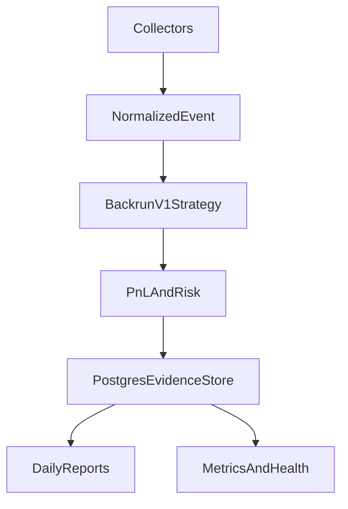

now analyze deeply @projects/defi-lab/mev_share_backrun_flashloan_arbitrage and set up config, opensrc, etc like @projects/arbeyes-defi for development harness agentic 

---
name: MEV Harness Setup
overview: Set up `projects/defi-lab/mev_share_backrun_flashloan_arbitrage` as an embedded Agent Harness project modeled on `projects/defi-lab/arbeyes-defi`, preserving its V1 shadow-searcher scope and docs-only bootstrap state.
todos:
  - id: create-manifest
    content: Create embedded harness manifest and registry entry for the MEV project.
    status: completed
  - id: write-contract
    content: Write project context, AGENTS.md, ORCHESTRATOR.md, and DECISIONS.md from the MEV docs.
    status: in_progress
  - id: opensrc-setup
    content: Create OpenSrc package tracking from the researched build-now source repositories.
    status: pending
  - id: agent-task-scaffold
    content: Add agent role files and phase backlog task files matching the V1 build order.
    status: pending
  - id: verify-script
    content: Add docs-only-tolerant harness verification script and validate JSON/shell behavior.
    status: pending
isProject: false
---

# MEV Harness Setup Plan

## Scope
Create the same harness-facing surface that `arbeyes-defi` has, adapted to the MEV project’s own docs. This is a configuration and documentation scaffold only: no Rust crates, no live execution code, no bundle sender, no Redis, no ML model, and no contracts.

Primary source docs:
- [`/home/asyam/dev/Project/agent-harness/projects/defi-lab/mev_share_backrun_flashloan_arbitrage/docs/00-executive-decision.md`](/home/asyam/dev/Project/agent-harness/projects/defi-lab/mev_share_backrun_flashloan_arbitrage/docs/00-executive-decision.md)
- [`/home/asyam/dev/Project/agent-harness/projects/defi-lab/mev_share_backrun_flashloan_arbitrage/docs/02-multichain-architecture.md`](/home/asyam/dev/Project/agent-harness/projects/defi-lab/mev_share_backrun_flashloan_arbitrage/docs/02-multichain-architecture.md)
- [`/home/asyam/dev/Project/agent-harness/projects/defi-lab/mev_share_backrun_flashloan_arbitrage/docs/03-chain-collector-model.md`](/home/asyam/dev/Project/agent-harness/projects/defi-lab/mev_share_backrun_flashloan_arbitrage/docs/03-chain-collector-model.md)
- [`/home/asyam/dev/Project/agent-harness/projects/defi-lab/mev_share_backrun_flashloan_arbitrage/docs/20-agentic-coding-prompt.md`](/home/asyam/dev/Project/agent-harness/projects/defi-lab/mev_share_backrun_flashloan_arbitrage/docs/20-agentic-coding-prompt.md)

## Files To Add Or Update
Add harness scaffold under:
- [`/home/asyam/dev/Project/agent-harness/projects/defi-lab/mev_share_backrun_flashloan_arbitrage/.harness/project.manifest.json`](/home/asyam/dev/Project/agent-harness/projects/defi-lab/mev_share_backrun_flashloan_arbitrage/.harness/project.manifest.json)
- [`/home/asyam/dev/Project/agent-harness/projects/defi-lab/mev_share_backrun_flashloan_arbitrage/.harness/project-context.md`](/home/asyam/dev/Project/agent-harness/projects/defi-lab/mev_share_backrun_flashloan_arbitrage/.harness/project-context.md)
- [`/home/asyam/dev/Project/agent-harness/projects/defi-lab/mev_share_backrun_flashloan_arbitrage/.harness/opensrc-packages.txt`](/home/asyam/dev/Project/agent-harness/projects/defi-lab/mev_share_backrun_flashloan_arbitrage/.harness/opensrc-packages.txt)
- [`/home/asyam/dev/Project/agent-harness/projects/defi-lab/mev_share_backrun_flashloan_arbitrage/.harness/research/opensrc-paths/`](/home/asyam/dev/Project/agent-harness/projects/defi-lab/mev_share_backrun_flashloan_arbitrage/.harness/research/opensrc-paths/)
- [`/home/asyam/dev/Project/agent-harness/projects/defi-lab/mev_share_backrun_flashloan_arbitrage/.harness/agents/`](/home/asyam/dev/Project/agent-harness/projects/defi-lab/mev_share_backrun_flashloan_arbitrage/.harness/agents/)
- [`/home/asyam/dev/Project/agent-harness/projects/defi-lab/mev_share_backrun_flashloan_arbitrage/.harness/tasks/backlog/`](/home/asyam/dev/Project/agent-harness/projects/defi-lab/mev_share_backrun_flashloan_arbitrage/.harness/tasks/backlog/)

Add project root contract files:
- [`/home/asyam/dev/Project/agent-harness/projects/defi-lab/mev_share_backrun_flashloan_arbitrage/AGENTS.md`](/home/asyam/dev/Project/agent-harness/projects/defi-lab/mev_share_backrun_flashloan_arbitrage/AGENTS.md)
- [`/home/asyam/dev/Project/agent-harness/projects/defi-lab/mev_share_backrun_flashloan_arbitrage/ORCHESTRATOR.md`](/home/asyam/dev/Project/agent-harness/projects/defi-lab/mev_share_backrun_flashloan_arbitrage/ORCHESTRATOR.md)
- [`/home/asyam/dev/Project/agent-harness/projects/defi-lab/mev_share_backrun_flashloan_arbitrage/DECISIONS.md`](/home/asyam/dev/Project/agent-harness/projects/defi-lab/mev_share_backrun_flashloan_arbitrage/DECISIONS.md)
- [`/home/asyam/dev/Project/agent-harness/projects/defi-lab/mev_share_backrun_flashloan_arbitrage/scripts/harness-verify.sh`](/home/asyam/dev/Project/agent-harness/projects/defi-lab/mev_share_backrun_flashloan_arbitrage/scripts/harness-verify.sh)

Update harness registry:
- [`/home/asyam/dev/Project/agent-harness/projects/registry.json`](/home/asyam/dev/Project/agent-harness/projects/registry.json)

## Manifest Shape
Use `arbeyes-defi` as the template, with MEV-specific values:
- Project slug: `mev-share-backrun-flashloan-arbitrage`
- Type: `rust-defi-research`
- Mode: `embedded`
- Kanban board: `mev-share-backrun-v1`
- Commands: `dev`, `typecheck`, `lint`, `test`, `smoke`, `verify` routed through `scripts/harness-verify.sh`
- Enabled agents: `orchestrator`, `rust-core`, `rust-evm`, `observability`, `security-scope`, `qa-gate`, `opensrc-librarian`
- Add MEV-specific skill naming such as `mev-shadow-searcher` alongside shared harness skills.

## Agent Contract
Write `AGENTS.md` around these non-negotiables:
- V1 is a multi-chain shadow scanner, not a live bot.
- Ethereum uses MEV-Share SSE; Base/Arbitrum use block-delta collectors.
- Postgres is source of truth; in-memory caches are rebuildable.
- Risk is deterministic and authoritative.
- Flashloans are modeled as feasibility and fee only.
- Explicitly forbid live bundle submission, signing, contracts, Redis, ML serving, dashboards, and microservices in V1.

Include a compact architecture diagram mirroring the docs:

## OpenSrc Setup
Create `.harness/opensrc-packages.txt` from `docs/0_opensrc_research.md`, prioritizing build-now repositories:
- `github.com/flashbots/simple-blind-arbitrage`
- `github.com/flashbots/mev-share`
- `github.com/paradigmxyz/mev-share-rs`
- `github.com/alloy-rs/alloy`
- `github.com/foundry-rs/foundry`
- Uniswap v2/v3, Sushiswap v2, Aave v3, Balancer v2 references as study sources.

Also create `research/opensrc-paths/*.path` placeholders only when local clone paths are known or can be resolved safely. If a local clone does not exist, keep the package list authoritative and avoid inventing paths.

## Orchestration Plan
Create `ORCHESTRATOR.md` with phases adapted from `docs/17-14-30-60-90-day-plan.md` and `docs/20-agentic-coding-prompt.md`:
- P0: Harness registration, OpenSrc tracking, docs-only verify.
- P1: Rust workspace skeleton and core types.
- P2: Postgres, migrations, storage writer.
- P3: v2 DEX adapters, registry, state reader.
- P4: Ethereum MEV-Share and L2 block-delta collectors.
- P5: Backrun v1 strategy API and implementation.
- P6: PnL and flashloan-fee feasibility model.
- P7: Deterministic risk engine.
- P8: Fast-estimate simulator and feature rows.
- P9: Metrics, health, Telegram alerts.
- P10: Daily reports and VPS soak.
- P11: Evidence review and live-execution gate decision.

Create matching backlog task Markdown files under `.harness/tasks/backlog/`, each with goal, acceptance, and owner.

## Decisions Log
Create `DECISIONS.md` with initial decisions already encoded by docs:
- Shadow-only V1.
- Broad scanner, narrow executor.
- One Rust worker, not microservices.
- Postgres over SQLite and Redis.
- Alloy over ethers-rs.
- MEV-Share only for Ethereum.
- Base/Arbitrum block-delta shadow collectors.
- Deterministic risk engine blocks or downgrades candidates.
- ML rows collected now, no model until later.

Add kill/pivot triggers from `00-executive-decision.md`: no repeatable `survives_75` signal after enough shadow data means no live executor.

## Verification
Add `scripts/harness-verify.sh` modeled on ArbEyes:
- If no `Cargo.toml`, print a docs/planning-phase message and exit 0.
- If Rust workspace exists, run `cargo fmt --check`, `cargo clippy -- -D warnings`, `cargo test`, and a smoke command for the future worker.

After implementation, run read/write-safe verification commands:
- `bash projects/defi-lab/mev_share_backrun_flashloan_arbitrage/scripts/harness-verify.sh all`
- `python -m json.tool projects/registry.json`
- `python -m json.tool projects/defi-lab/mev_share_backrun_flashloan_arbitrage/.harness/project.manifest.json`

## Implementation Notes
Keep edits surgical and docs/config-only. Do not create the Rust workspace yet unless explicitly asked later. This setup should make the project visible to the harness, ready for Kanban/task execution, and safe for future agents to build only the V1 shadow scanner.