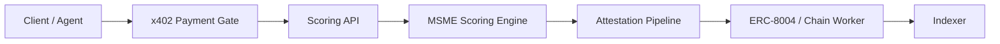

# AGENTS.md — KreditAgent Agent Contract

## Mission

Build a hackathon-ready KreditAgent MVP: MSME credit scoring with x402 pay-per-call API access, ERC-8004 agent identity, and on-chain attestation.

## Non-negotiable product truths

1. KreditAgent is the product — scoring pipeline + attestation, not a generic wallet demo.
2. x402 micropayments gate API access; payment verification is deterministic, not LLM-decided.
3. ERC-8004 provides agent identity and reputation; on-chain writes follow identity checks.
4. MSME scoring invariants are documented in `docs/` and must not be silently changed.
5. External study repos are read via OpenSrc paths — do not vendor-copy into the monorepo.
6. Deploy contracts via `script/DeployKreditProtocol.s.sol` in `contracts/`.
7. Do not overbuild; ship the smallest reliable demo loop.

## Architecture summary

## Agent roles

- **Orchestrator:** Scope, sequencing, task breakdown.
- **Backend Agent:** API, x402 middleware, scoring pipeline, attestation.
- **Frontend Agent:** Dashboard, MSME flows, payment UX.
- **Smart Contract Agent:** Kredit protocol contracts, ERC-8004 integration.
- **Security Agent:** Payment verification, PII handling, key hygiene.
- **QA Agent:** Tests, demo scripts, acceptance checklist.

## Coding rules

- TypeScript strict mode in apps/packages.
- Use `zod` for API validation.
- Never log secrets or full PII.
- Read external references from `.harness/research/opensrc-paths/` only.

## Read order

1. `.harness/project.manifest.json`
2. `.harness/project-context.md`
3. `docs/currentSmartContract.md`
4. `ORCHESTRATOR.md`
5. `DECISIONS.md` (when present)

Harness playbooks: `$AGENT_HARNESS_HOME/docs/kit/`
