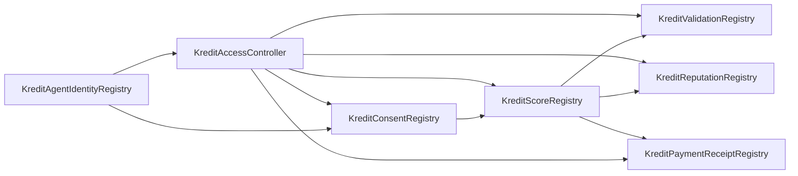

# KreditAgent Smart Contract Architecture

## Executive summary

KreditAgent's contracts are a trust and audit layer for Indonesian MSME credit attestations. They do not lend, custody funds, match borrowers and lenders, or determine credit approval. They anchor the minimum data needed for portability and auditability: agent identity, borrower consent, score attestations, validation results, disputeable reputation events, and paid-attestation receipts.

The design follows the ERC-8004 model: agent identity is a portable ERC-721-like `agentId` with an `agentURI`, and reputation/validation are separate registries that can be consumed by lenders, validators, indexers, and ForU AI-style identity layers.

## Protocol components

## Contracts

| Contract | Production responsibility |
|---|---|
| `KreditAgentIdentityRegistry` | ERC-8004-style agent identity, ownership, agent URI, agent wallet, and metadata. |
| `KreditAccessController` | Protocol owner, guardian pause, account roles, and agent roles. |
| `KreditConsentRegistry` | Consent receipts with borrower control, purpose hash, processor agent, expiry, and revocation. |
| `KreditScoreRegistry` | Issues score attestations only when active consent and issuer role are valid. |
| `KreditValidationRegistry` | Lets lender/issuer agents request independent validator checks with quorum and self-validation prevention. |
| `KreditReputationRegistry` | Records repayment/default/feedback events and allows borrower disputes. |
| `KreditPaymentReceiptRegistry` | Records x402/API payment receipts and prevents replay. |

## Agent roles

| Agent | Role constant | Controller |
|---|---|---|
| BorrowerAgent | no privileged role; agent owner controls consent/disputes | MSME wallet / delegated wallet |
| KreditAgent issuer | `ISSUER_AGENT_ROLE` | KreditAgent operator wallet / multisig |
| LenderAgent | `LENDER_AGENT_ROLE` | licensed lender wallet / agent wallet |
| ValidatorAgent | `VALIDATOR_AGENT_ROLE` | validator/auditor wallet |
| Regulator viewer | `REGULATOR_VIEWER_AGENT_ROLE` | optional read-only indexer identity |

## Core flow

1. Borrower registers or receives a BorrowerAgent identity.
2. KreditAgent issuer, lender, and validator agents are registered and role-gated.
3. Borrower grants a purpose-limited consent receipt to the issuer agent.
4. Issuer publishes a score attestation with feature/evidence/narrative hashes.
5. Lender records an x402 payment receipt for a paid attestation endpoint.
6. Lender requests validation.
7. Independent validator submits pass/fail/review result.
8. Lender posts repayment or default reputation event.
9. Borrower can dispute negative or incorrect events.

## Privacy boundary

Allowed on-chain:

- agent IDs;
- score value/band for demo and pilot transparency;
- score version hash;
- model policy hash;
- feature hash;
- evidence hash;
- narrative hash;
- consent hash;
- x402 receipt hash;
- repayment/default event type hashes;
- dispute hashes.

Forbidden on-chain:

- borrower name;
- phone number;
- address;
- NIK/KTP;
- raw QRIS records;
- Tokopedia/Shopee order rows;
- merchant IDs;
- lender private underwriting notes;
- full LLM narrative if it includes sensitive details.

## Upgrade posture

The hackathon/pilot version is non-upgradeable for audit clarity. Production has two paths:

1. deploy immutable contracts and migrate by versioned registry addresses;
2. deploy behind a governance-controlled proxy after external audit.

For OJK sandbox credibility, the recommended first pilot path is immutable contracts plus explicit version migration, because the trust and legal story is easier to explain.

## Why not implement loan custody on-chain?

KreditAgent is positioned as infrastructure, not lender. Smart contracts should not custody borrower funds, issue loans, enforce interest rates, or run collections. Those functions belong to licensed lenders. This separation reduces regulatory burden and makes the product easier to pilot.
