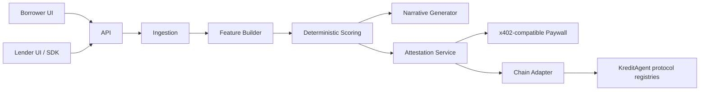

# Architecture

## Components

The chain adapter talks to the Foundry suite documented in [currentSmartContract.md](currentSmartContract.md): identity, access control, consent, score attestations, validation, reputation, and payment receipts.

## Data flow

- Raw data is uploaded or mocked.
- API sanitizes raw records and builds numeric features.
- Score is calculated deterministically.
- Narrative is generated from approved factor JSON.
- Attestation envelope is signed and optionally anchored on-chain.
- Lender API access is payment-gated.

## Chain design

The contract set is intentionally minimal and demo-safe. Deploy order and wiring are summarized in [currentSmartContract.md](currentSmartContract.md).

- `KreditAgentIdentityRegistry`: ERC-8004-style agent registration.
- `KreditAccessController`: protocol owner, guardian pause, account and agent roles.
- `KreditConsentRegistry`: borrower-controlled consent receipts.
- `KreditScoreRegistry`: consent-gated credit score attestation anchoring.
- `KreditValidationRegistry`: validation request and result tracking.
- `KreditReputationRegistry`: positive/negative reputation events and disputes.
- `KreditPaymentReceiptRegistry`: x402/API payment receipt anchoring (replay prevention).
- `KreditProtocolDeployer`: one-shot factory for the suite (hackathon and testnet demos).

## Payment design

The API returns x402-compatible responses. In mock mode, `PAYMENT-SIGNATURE: demo-paid` unlocks the route. In production mode, the middleware can be swapped with `@x402/express` or `@x402/hono`.
