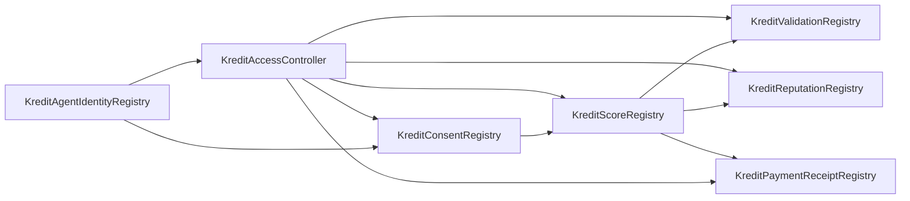

# Current smart contracts (KreditAgent)

Canonical snapshot of the Foundry package under [`contracts/`](../contracts/). Behavior and invariants are specified in [`contracts/docs/CONTRACT_SPEC.md`](../contracts/docs/CONTRACT_SPEC.md) and [`contracts/docs/SMART_CONTRACT_ARCHITECTURE.md`](../contracts/docs/SMART_CONTRACT_ARCHITECTURE.md).

## Tooling and layout

| | |
|---|---|
| Solidity | `^0.8.24` |
| Tests | [`contracts/test/`](../contracts/test/) |
| Deploy script | [`contracts/script/DeployKreditProtocol.s.sol`](../contracts/script/DeployKreditProtocol.s.sol) |
| Static audit helper | [`contracts/tools/static_contract_audit.mjs`](../contracts/tools/static_contract_audit.mjs) |

## Production contracts

Deployed in this order by [`KreditProtocolDeployer.deploy`](../contracts/src/KreditProtocolDeployer.sol):

| Contract | Source | Responsibility | Wired from deployer |
|---|---|---|---|
| `KreditAgentIdentityRegistry` | [`KreditAgentIdentityRegistry.sol`](../contracts/src/KreditAgentIdentityRegistry.sol) | ERC-8004-style `agentId`, URI, wallet, transfer | none |
| `KreditAccessController` | [`KreditAccessController.sol`](../contracts/src/KreditAccessController.sol) | Owner, pause, account/agent roles | `identity`, `owner` |
| `KreditConsentRegistry` | [`KreditConsentRegistry.sol`](../contracts/src/KreditConsentRegistry.sol) | Borrower consent receipts | `identity`, `accessController` |
| `KreditScoreRegistry` | [`KreditScoreRegistry.sol`](../contracts/src/KreditScoreRegistry.sol) | Consent-gated score attestations | `identity`, `accessController`, `consentRegistry` |
| `KreditValidationRegistry` | [`KreditValidationRegistry.sol`](../contracts/src/KreditValidationRegistry.sol) | Validator requests/results | `identity`, `accessController`, `scoreRegistry` |
| `KreditReputationRegistry` | [`KreditReputationRegistry.sol`](../contracts/src/KreditReputationRegistry.sol) | Reputation events and disputes | `identity`, `accessController`, `scoreRegistry` |
| `KreditPaymentReceiptRegistry` | [`KreditPaymentReceiptRegistry.sol`](../contracts/src/KreditPaymentReceiptRegistry.sol) | x402/API receipt anchoring | `identity`, `accessController` |

Factory-only (not a runtime dependency of the seven registries above):

| Contract | Source | Responsibility |
|---|---|---|
| `KreditProtocolDeployer` | [`KreditProtocolDeployer.sol`](../contracts/src/KreditProtocolDeployer.sol) | One-shot deploy of the full suite; emits `KreditProtocolDeployed` |

## Supporting libraries

| Library | Source | Purpose |
|---|---|---|
| `KreditRoles` | [`KreditRoles.sol`](../contracts/src/KreditRoles.sol) | Agent and account role constants; reputation/validation event type hashes |
| `KreditErrors` | [`KreditErrors.sol`](../contracts/src/KreditErrors.sol) | Shared custom errors |

## Interfaces

| Interface | Source |
|---|---|
| `IKreditAgentIdentity` | [`interfaces/IKreditAgentIdentity.sol`](../contracts/src/interfaces/IKreditAgentIdentity.sol) |
| `IKreditAccessController` | [`interfaces/IKreditAccessController.sol`](../contracts/src/interfaces/IKreditAccessController.sol) |
| `IKreditConsentRegistry` | [`interfaces/IKreditConsentRegistry.sol`](../contracts/src/interfaces/IKreditConsentRegistry.sol) |
| `IKreditScoreRegistry` | [`interfaces/IKreditScoreRegistry.sol`](../contracts/src/interfaces/IKreditScoreRegistry.sol) |

## Dependency graph

Constructor wiring for payment receipts is only `identity` and `accessController`. The edge from score to payment receipts matches the architecture doc’s product flow (attestations and paid receipts), not an additional deploy-time dependency.

## Deployment script

[`DeployKreditProtocol.s.sol`](../contracts/script/DeployKreditProtocol.s.sol) (run from [`contracts/`](../contracts/)):

1. Deploys via `new KreditProtocolDeployer()` then `deployer.deploy(deployOwner)` where `deployOwner` is `msg.sender` (broadcast account).
2. Registers demo agents: issuer, borrower, lender, validator (with demo `agentURI` strings).
3. Grants `ISSUER_AGENT_ROLE`, `LENDER_AGENT_ROLE`, and `VALIDATOR_AGENT_ROLE` on the registered agent IDs.
4. If `PROTOCOL_OWNER` is set and differs from `deployOwner`, calls `transferOwnership` on `KreditAccessController`.

Environment:

- `PROTOCOL_OWNER` (optional): defaults to broadcast account; use a multisig in production.
- `NETWORK_NAME` (optional): defaults to `"local"`; used in the output path below.
- RPC URL and private key: see [`contracts/docs/DEPLOYMENT_RUNBOOK.md`](../contracts/docs/DEPLOYMENT_RUNBOOK.md).

### Deployment artifact

Written relative to the Foundry project: `contracts/deployments/<NETWORK_NAME>.json`.

Fields: `network`, `chainId`, `deployer`, `owner`, `identity`, `accessController`, `consentRegistry`, `scoreRegistry`, `validationRegistry`, `reputationRegistry`, `paymentReceiptRegistry`, `issuerAgentId`, `borrowerAgentId`, `lenderAgentId`, `validatorAgentId`.

## Further reading

- [`contracts/README.md`](../contracts/README.md) — install, test, deploy one-liners
- [`contracts/docs/DEPLOYMENT_RUNBOOK.md`](../contracts/docs/DEPLOYMENT_RUNBOOK.md) — verify, checklist, demo sequence
- [`contracts/docs/SECURITY_REVIEW.md`](../contracts/docs/SECURITY_REVIEW.md) — invariants and threat notes
- [`contracts/docs/IMPLEMENTATION_REPORT.md`](../contracts/docs/IMPLEMENTATION_REPORT.md) — suite rationale and tests
