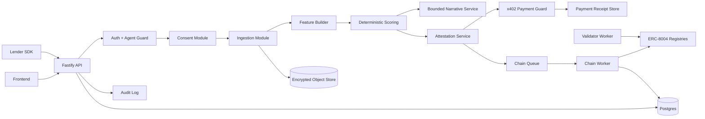

# 02 — Service Architecture and Boundaries

## Recommended architecture style

Use a **modular monolith first**, not microservices. The system has regulated workflows and strong consistency requirements. A modular monolith gives faster hackathon delivery while preserving boundaries for later extraction.

```text
apps/api
  src/
    modules/
      auth/
      borrowers/
      consents/
      ingestion/
      features/
      scoring/
      narratives/
      attestations/
      payments-x402/
      validators/
      lenders/
      reputation/
      chain/
      foru/
      audit/
      admin/
    workers/
      ingestion.worker.ts
      chain.worker.ts
      validation.worker.ts
      reputation.worker.ts
    lib/
      logger.ts
      db.ts
      env.ts
      crypto.ts
      errors.ts
      openapi.ts
```

## Backend components



## Module responsibilities

### `auth`

- Wallet signature verification.
- API key authentication for lender/validator partners.
- Session tokens for demo users.
- Agent role resolution from database and/or ERC-8004 identity.
- Request-scoped actor context.

### `borrowers`

- Borrower profile.
- ForU DID binding.
- BorrowerAgent mapping.
- Consent status and data-source summary.

### `consents`

- Grant consent.
- Revoke consent.
- Consent expiry.
- Consent receipts.
- Source/purpose/scope enforcement.

### `ingestion`

- CSV/JSON upload.
- Canonical parsing.
- Prompt-injection-like string detection.
- Duplicate detection.
- Raw file hashing.
- Normalized record creation.
- Data-quality warnings.

### `features`

- Aggregates normalized records into scoring features.
- Writes `featureSnapshot`.
- Computes `featureHash`.

### `scoring`

- Deterministic score version.
- Score bands.
- Risk factors and positive factors.
- Score expiry policy.
- No LLM calls.

### `narratives`

- Receives only whitelisted score facts.
- Generates borrower-friendly and lender-facing explanation.
- Output schema validation.
- Fallback deterministic template.

### `attestations`

- Attestation envelope.
- EIP-712 or server signature.
- Score hash, evidence hash, narrative hash.
- Public/private payload split.
- Paid-tier payload filtering.

### `payments-x402`

- Returns `402 Payment Required`.
- Builds payment terms.
- Verifies payment header/signature/receipt.
- Binds receipt to resource path, lenderAgentId, attestationId, and expiry.
- Stores receipt hash.

### `validators`

- Validation request lifecycle.
- Validator assignment.
- Recompute/check result ingestion.
- Chain submission.

### `lenders`

- LenderAgent registration.
- Paid requests.
- Underwriting decision capture.
- Repayment/default event submission.

### `reputation`

- Reputation timeline.
- Repayment event normalization.
- Dispute lifecycle.
- Chain anchoring.

### `chain`

- ERC-8004 identity calls.
- Attestation ledger calls.
- Reputation registry calls.
- Validation registry calls.
- Payment receipt anchoring.
- Retry/backoff/dead letter.

### `audit`

- Append-only audit logs.
- Request ID correlation.
- Actor/action/resource/result.
- Hash of payload, not raw sensitive payload.

## Service boundaries

| Boundary | Rule |
|---|---|
| API -> DB | All writes happen in transactions where state consistency matters. |
| API -> Queue | Long-running work must be queued: chain writes, validation, ingestion for large files. |
| Scoring -> Narrative | Narrative can only read normalized score facts, never raw uploaded rows. |
| Payment -> Attestation | Paid tier data is never returned until payment is verified. |
| Chain Worker -> Contracts | Workers are the only server-side component with transaction-sending keys. |
| Frontend -> Backend | Frontend never receives private keys, raw secrets, or direct privileged chain write credentials. |

## Deployment topology

### Hackathon

```text
apps/api       -> Railway/Fly/Render/local
Postgres       -> Supabase/local Docker
Redis          -> Upstash/local Docker
Object storage -> local filesystem or S3-compatible
Chain          -> Base Sepolia / Sepolia
```

### Production

```text
API Gateway / WAF
  -> API service pods
  -> Worker service pods
  -> Postgres primary + read replica
  -> Redis queue
  -> Object store with KMS
  -> Secrets manager
  -> Observability stack
  -> Chain RPC provider fallback set
```

## Queue design

| Queue | Producer | Consumer | Purpose |
|---|---|---|---|
| `ingestion.parse` | API upload | ingestion worker | Parse and normalize large source files. |
| `features.build` | ingestion worker | feature worker | Generate score feature snapshot. |
| `score.generate` | API/feature worker | scoring worker | Compute score and risk reasons. |
| `attestation.publish` | API/scoring | chain worker | Publish score hash to chain. |
| `validation.request` | API/lender | validation worker | Assign validators and create request. |
| `chain.tx` | modules | chain worker | Send contract txs with retries. |
| `reputation.post` | repayment/lender | reputation worker | Normalize and anchor reputation events. |
| `webhook.deliver` | modules | webhook worker | Notify lender/admin systems. |

## Retry strategy

- Chain tx: exponential backoff, idempotency key, nonce management.
- x402 verification: short retries only; never double-serve a paid resource on ambiguous payment state.
- Ingestion: retry parse errors only for transient storage/read errors, not schema errors.
- Webhooks: retry with signed payload and replay nonce.
