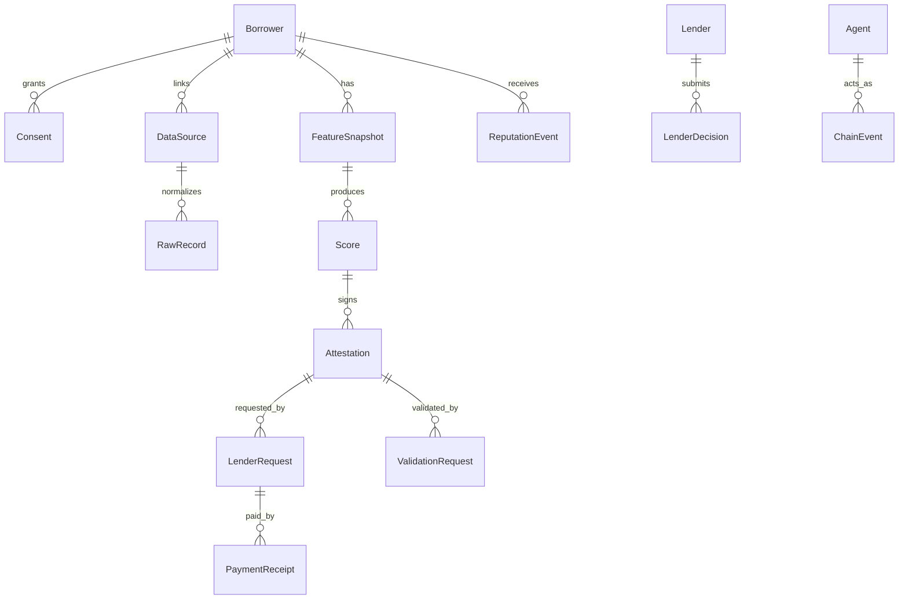

# 03 — Domain Model and Database Schema

## Core entities



## Prisma schema draft

```prisma
model Borrower {
  id              String   @id @default(cuid())
  displayName     String
  walletAddress   String?  @unique
  foruDid          String?
  borrowerAgentId  String?
  status           BorrowerStatus @default(CREATED)
  createdAt        DateTime @default(now())
  updatedAt        DateTime @updatedAt

  consents         Consent[]
  dataSources      DataSource[]
  featureSnapshots FeatureSnapshot[]
  scores           Score[]
  reputationEvents ReputationEvent[]
}

enum BorrowerStatus {
  CREATED
  CONSENT_GRANTED
  DATA_LINKED
  FEATURES_READY
  SCORED
  ATTESTED
  SHARED_WITH_LENDER
  REPUTATION_UPDATED
  BLOCKED
}

model Agent {
  id              String   @id @default(cuid())
  chainId          Int
  registryAddress  String
  agentId          String
  ownerAddress     String
  agentWallet      String?
  role             AgentRole
  agentUri         String
  active           Boolean @default(true)
  createdAt        DateTime @default(now())

  @@unique([chainId, registryAddress, agentId])
}

enum AgentRole {
  BORROWER
  ISSUER
  LENDER
  VALIDATOR
  REGULATOR_VIEWER
  ADMIN
}

model Consent {
  id             String   @id @default(cuid())
  borrowerId     String
  source          String
  scope           String[]
  purpose         String
  purposeHash     String
  status          ConsentStatus @default(ACTIVE)
  grantedAt       DateTime @default(now())
  expiresAt       DateTime?
  revokedAt       DateTime?
  signature       String?
  receiptHash     String

  borrower        Borrower @relation(fields: [borrowerId], references: [id])

  @@index([borrowerId, status])
}

enum ConsentStatus {
  ACTIVE
  EXPIRED
  REVOKED
}

model DataSource {
  id              String   @id @default(cuid())
  borrowerId       String
  consentId        String
  type             DataSourceType
  status           DataSourceStatus @default(UPLOADED)
  rawObjectKey     String?
  rawHash          String
  evidenceHash     String?
  recordsAccepted  Int @default(0)
  recordsRejected  Int @default(0)
  warnings         Json?
  createdAt        DateTime @default(now())

  borrower         Borrower @relation(fields: [borrowerId], references: [id])
  records          RawRecord[]
}

enum DataSourceType {
  QRIS_CSV
  TOKOPEDIA_CSV
  SHOPEE_CSV
  BANK_CSV
  WALLET_JSON
  REPAYMENT_JSON
}

enum DataSourceStatus {
  UPLOADED
  PARSING
  PARSED
  FAILED
  REVOKED
}

model RawRecord {
  id              String   @id @default(cuid())
  dataSourceId     String
  borrowerId       String
  source           String
  recordType       String
  transactionAt    DateTime?
  amountIdr        Decimal?
  direction        String?
  status           String?
  category         String?
  canonicalHash    String
  redactedPayload   Json
  createdAt        DateTime @default(now())

  dataSource       DataSource @relation(fields: [dataSourceId], references: [id])

  @@index([borrowerId])
  @@unique([dataSourceId, canonicalHash])
}

model FeatureSnapshot {
  id                 String   @id @default(cuid())
  borrowerId          String
  scoreVersion        String
  featureSchemaVersion String
  features            Json
  featureHash         String
  evidenceHash        String
  dataFreshnessDays   Int
  coverageDays        Int
  createdAt           DateTime @default(now())

  borrower            Borrower @relation(fields: [borrowerId], references: [id])
  scores              Score[]
}

model Score {
  id                String @id @default(cuid())
  borrowerId         String
  featureSnapshotId  String
  value              Int
  band               String
  scoreVersion       String
  modelPolicyVersion String
  scoreHash          String
  positiveFactors    Json
  riskFactors        Json
  expiresAt          DateTime
  status             ScoreStatus @default(ACTIVE)
  createdAt          DateTime @default(now())

  borrower           Borrower @relation(fields: [borrowerId], references: [id])
  featureSnapshot    FeatureSnapshot @relation(fields: [featureSnapshotId], references: [id])
  attestations       Attestation[]
}

enum ScoreStatus {
  ACTIVE
  EXPIRED
  REVOKED
  SUPERSEDED
}

model Attestation {
  id                  String @id @default(cuid())
  scoreId              String
  borrowerId           String
  borrowerAgentRef     String
  issuerAgentRef       String
  tier                 AttestationTier
  scoreHash            String
  featureHash          String
  evidenceHash         String
  narrativeHash        String?
  publicPayload        Json
  encryptedPayloadKey  String?
  signature            String
  chainAttestationId   String?
  chainTxHash          String?
  status               AttestationStatus @default(SIGNED)
  expiresAt            DateTime
  createdAt            DateTime @default(now())

  score                Score @relation(fields: [scoreId], references: [id])
  lenderRequests       LenderRequest[]
  validationRequests   ValidationRequest[]

  @@index([borrowerId, status])
}

enum AttestationTier {
  STANDARD
  AUDIT
  UNDERWRITER
}

enum AttestationStatus {
  DRAFT
  SIGNED
  PUBLISH_PENDING
  PUBLISHED
  VALIDATION_PENDING
  VALIDATED
  VALIDATION_FAILED
  EXPIRED
  REVOKED
}

model Lender {
  id             String @id @default(cuid())
  name           String
  lenderAgentRef String @unique
  walletAddress  String?
  apiKeyHash     String?
  status         PartnerStatus @default(ACTIVE)
  createdAt      DateTime @default(now())

  requests       LenderRequest[]
  decisions      LenderDecision[]
}

enum PartnerStatus {
  ACTIVE
  SUSPENDED
  PENDING
}

model LenderRequest {
  id              String @id @default(cuid())
  lenderId        String
  attestationId   String
  resourcePath    String
  tier            AttestationTier
  status          LenderRequestStatus @default(PAYMENT_REQUIRED)
  requestHash     String
  deliveredAt     DateTime?
  createdAt       DateTime @default(now())

  lender          Lender @relation(fields: [lenderId], references: [id])
  attestation     Attestation @relation(fields: [attestationId], references: [id])
  payments        PaymentReceipt[]
}

enum LenderRequestStatus {
  REQUESTED
  PAYMENT_REQUIRED
  PAYMENT_SUBMITTED
  PAYMENT_VERIFIED
  ATTESTATION_DELIVERED
  DENIED
  EXPIRED
}

model PaymentReceipt {
  id              String @id @default(cuid())
  lenderRequestId String
  protocol        String @default("x402")
  network         String
  token           String
  amount          Decimal
  currency        String
  payTo           String
  payer           String?
  receiptHash     String @unique
  paymentPayloadHash String
  verifiedAt      DateTime?
  status          PaymentStatus @default(PENDING)
  createdAt       DateTime @default(now())

  lenderRequest   LenderRequest @relation(fields: [lenderRequestId], references: [id])
}

enum PaymentStatus {
  PENDING
  VERIFIED
  SETTLED
  FAILED
  EXPIRED
}

model ValidationRequest {
  id              String @id @default(cuid())
  attestationId   String
  requesterAgentRef String
  requiredQuorum  Int
  deadlineAt      DateTime
  status          ValidationStatus @default(PENDING)
  chainRequestId  String?
  chainTxHash     String?
  createdAt       DateTime @default(now())

  attestation     Attestation @relation(fields: [attestationId], references: [id])
  results         ValidationResult[]
}

model ValidationResult {
  id                 String @id @default(cuid())
  validationRequestId String
  validatorAgentRef   String
  result              String
  recomputedScore     Int?
  evidenceHash        String
  notesHash           String?
  signature           String
  chainTxHash         String?
  createdAt           DateTime @default(now())

  validationRequest   ValidationRequest @relation(fields: [validationRequestId], references: [id])

  @@unique([validationRequestId, validatorAgentRef])
}

enum ValidationStatus {
  PENDING
  PASSED
  FAILED
  EXPIRED
  DISPUTED
}

model LenderDecision {
  id             String @id @default(cuid())
  lenderId       String
  attestationId  String
  borrowerId     String
  decision       String
  principalIdr   Decimal?
  termDays       Int?
  aprBps         Int?
  decisionBy     String @default("lender")
  payloadHash    String
  createdAt      DateTime @default(now())

  lender         Lender @relation(fields: [lenderId], references: [id])
}

model ReputationEvent {
  id               String @id @default(cuid())
  borrowerId        String
  subjectAgentRef   String
  issuerAgentRef    String
  eventType         String
  evidenceHash      String
  scoreDelta        Int
  status            ReputationEventStatus @default(ACTIVE)
  disputeId         String?
  chainEventId      String?
  chainTxHash       String?
  createdAt         DateTime @default(now())

  borrower          Borrower @relation(fields: [borrowerId], references: [id])
}

enum ReputationEventStatus {
  ACTIVE
  DISPUTED
  RESOLVED_VALID
  RESOLVED_INVALID
  REVOKED
}

model ChainEvent {
  id          String @id @default(cuid())
  chainId     Int
  contract    String
  eventName   String
  txHash      String
  blockNumber BigInt?
  payload     Json
  createdAt   DateTime @default(now())

  @@unique([chainId, txHash, eventName])
}

model AuditLog {
  id             String @id @default(cuid())
  requestId       String?
  actorType       String
  actorId         String?
  action          String
  resourceType    String
  resourceId      String?
  result          String
  payloadHash     String?
  ipHash          String?
  userAgentHash   String?
  createdAt       DateTime @default(now())

  @@index([actorId, createdAt])
  @@index([resourceType, resourceId])
}
```

## Idempotency model

Any endpoint that creates state must accept or derive an idempotency key:

| Action | Idempotency key |
|---|---|
| grant consent | `borrowerId + source + purpose + scope + expiresAt` |
| upload data | `borrowerId + source + rawHash` |
| generate score | `borrowerId + featureHash + scoreVersion` |
| publish attestation | `scoreId + tier + issuerAgentRef` |
| verify payment | `paymentPayloadHash + resourcePath` |
| post reputation | `subjectAgentRef + issuerAgentRef + eventType + evidenceHash` |
| submit validation | `validationRequestId + validatorAgentRef` |

## Hashing rules

Use canonical JSON before hashing.

```ts
canonicalJson(value)
  -> stable key order
  -> no undefined
  -> normalized timestamps
  -> normalized integer/decimal strings
  -> keccak256 or sha256 depending target
```

Suggested hashes:

| Hash | Input |
|---|---|
| `rawHash` | raw uploaded file bytes |
| `canonicalHash` | normalized record JSON |
| `evidenceHash` | source summaries + normalized record hashes |
| `featureHash` | exact scoring feature object |
| `scoreHash` | score value + score version + feature hash + expiry |
| `narrativeHash` | redacted narrative payload |
| `payloadHash` | endpoint body or signed event body |
| `receiptHash` | x402 receipt/payment proof hash |

## Sensitive data posture

Store raw records encrypted and access-controlled. In normal API responses:

- return score band, factors, hashes, status;
- never return raw QRIS rows to lenders;
- never return personal phone/address/tax IDs;
- never publish merchant/customer identifiers on-chain;
- preserve audit logs without storing raw sensitive payloads.
