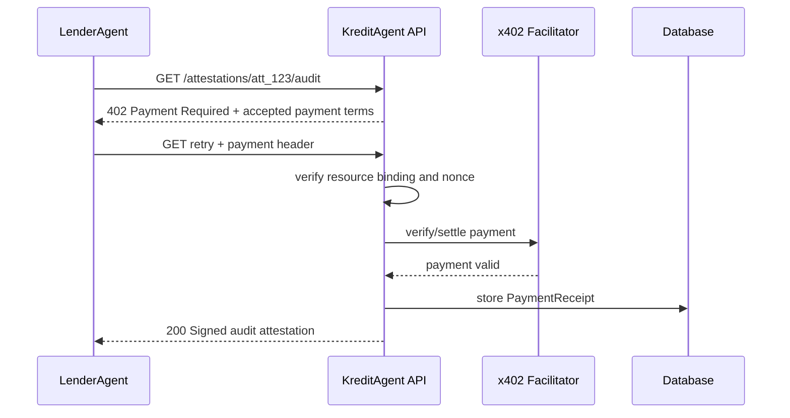

# 06 — x402 Payment and Access Control

## Backend responsibility

The backend must make paid access enforceable. A lender cannot receive audit-grade or underwriter-grade attestation data until payment is verified or a production contract/invoice entitlement exists.

## Resources to protect

| Resource | Suggested tier | Price |
|---|---|---:|
| `GET /v1/attestations/:id/standard` | standard | `$0.05` |
| `GET /v1/attestations/:id/audit` | audit | `$0.25` |
| `GET /v1/attestations/:id/underwriter` | underwriter | `$0.50` |
| `POST /v1/validations` | validation request | `$1.00` |
| `GET /v1/monitoring/:borrowerId/risk-delta` | monitoring | `$0.05` |

## x402 request lifecycle



## Payment terms builder

```ts
type X402PaymentTerms = {
  x402Version: 1;
  accepts: Array<{
    scheme: "exact";
    network: "eip155:84532";
    price: "$0.25";
    payTo: `0x${string}`;
    resource: string;
    description: string;
    mimeType: "application/json";
    maxTimeoutSeconds: number;
  }>;
};
```

## Resource binding

Payment must bind to:

- exact URL path;
- HTTP method;
- attestation ID;
- lender agent ID;
- tier;
- expiry/nonce;
- payee address;
- network ID;
- amount.

A receipt for `/attestations/att_1/audit` must not unlock `/attestations/att_2/audit`.

## Middleware flow

```ts
async function paidAttestationGuard(req, reply) {
  const resource = canonicalResource(req);
  const attestation = await attestations.get(req.params.id);

  await assertLenderAgent(req.actor);
  await assertAttestationActive(attestation);
  await assertConsentActive(attestation.borrowerId);

  const paymentHeader = req.headers["payment-signature"];

  if (!paymentHeader) {
    return reply.code(402).send(buildX402Terms(resource, attestation.tier));
  }

  const payment = await x402.verify({
    paymentHeader,
    resource,
    expectedPayTo: env.X402_PAY_TO,
    expectedNetwork: env.X402_NETWORK,
    expectedAmount: priceForTier(attestation.tier),
    expectedPayerAgentRef: req.actor.agentRef,
  });

  await payments.assertNotReplay(payment.receiptHash);
  await payments.storeReceipt(payment, resource, req.actor.agentRef);

  req.payment = payment;
}
```

## Access-control matrix

| Action | Borrower | Issuer | Lender | Validator | Admin |
|---|---:|---:|---:|---:|---:|
| create borrower | yes | yes | no | no | yes |
| grant consent | yes | no | no | no | admin override only for demo |
| upload data | yes | yes with consent | no | no | yes |
| generate score | yes/request | yes | no | no | yes |
| publish attestation | no | yes | no | no | yes |
| request paid attestation | no | no | yes | no | yes |
| request validation | no | yes | yes | no | yes |
| submit validation | no | no | no | yes | yes |
| submit decision | no | no | yes | no | yes |
| submit repayment/default | no | no | yes | no | yes |
| open dispute | yes | no | no | no | yes |

## Partner entitlement fallback

Production lenders may not use x402 for every request. The backend should support entitlement modes:

```ts
type AccessMode =
  | "x402_pay_per_request"
  | "monthly_invoice"
  | "pilot_free_allowlist"
  | "admin_demo";
```

Even for invoice mode, the backend should still record a virtual payment receipt or entitlement receipt so audit logs preserve why access was granted.

## Mock mode

Environment:

```bash
X402_MOCK_MODE=true
X402_MOCK_PAYMENT_HEADER=demo-paid
```

Behavior:

- If no payment header: return real-looking `402`.
- If `PAYMENT-SIGNATURE: demo-paid`: store mock payment receipt.
- Response must include `"mock": true` in payment metadata.

Never claim mock mode is production settlement.

## Security controls

| Risk | Control |
|---|---|
| Payment replay | Unique `receiptHash`; resource binding; nonce expiry. |
| Payee replacement | Payee loaded only from server env, never from prompt/frontend. |
| Over-serving paid data | Paid guard wraps the route before handler. |
| Underpayment | Strict expected amount/tier check. |
| Wrong network | Check `network` equals `eip155:84532` for Base Sepolia or configured network. |
| Arbitrary lender access | Agent role check + borrower consent + rate limit. |
| Ambiguous settlement | Do not return paid payload until verified or entitlement confirmed. |

## Audit log events

- `payment.terms_issued`
- `payment.submitted`
- `payment.verified`
- `payment.replayed_rejected`
- `attestation.delivered_paid`
- `attestation.denied_unpaid`

Each event includes:

- `requestId`;
- `lenderAgentRef`;
- `attestationId`;
- `resourceHash`;
- `receiptHash` where available;
- result.
