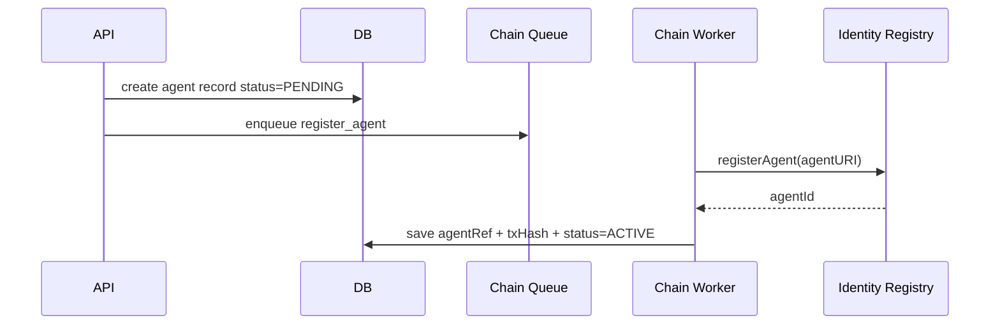
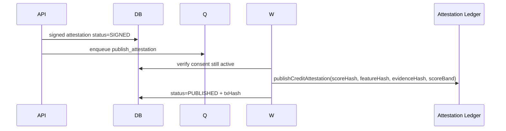

# 07 — ERC-8004 Chain Worker and Indexer

## Goal

The backend must connect off-chain scoring and payments to on-chain trust primitives without putting sensitive borrower data on-chain.

ERC-8004 provides the trust layer:

- Identity Registry — who is the agent?
- Reputation Registry — what has happened before?
- Validation Registry — who checked the result?

KreditAgent adds application-level ledgers for consent, score attestations, payment receipts, and disputeable credit reputation if the official registries do not cover the full application semantics.

## Chain worker responsibilities

| Task | Trigger | Contract action |
|---|---|---|
| register agent | borrower/lender/admin setup | Identity Registry registration/update |
| publish attestation | score attested | Score/attestation ledger write or Reputation Registry signal |
| request validation | lender/issuer request | Validation Registry request |
| submit validation | validator result | Validation Registry result |
| post repayment | lender repayment webhook | Reputation Registry signal |
| post dispute | borrower dispute | Reputation/dispute contract write |
| anchor x402 receipt | paid access | PaymentReceipt registry write or reputation signal |

## Chain job schema

```ts
type ChainJob = {
  idempotencyKey: string;
  chainId: number;
  kind:
    | "register_agent"
    | "publish_attestation"
    | "request_validation"
    | "submit_validation"
    | "post_reputation"
    | "anchor_payment_receipt";
  contractAddress: `0x${string}`;
  functionName: string;
  args: unknown[];
  actorAgentRef?: string;
  localResourceId: string;
  maxAttempts: number;
};
```

## Nonce management

For hackathon:

- one worker process;
- one signer per role;
- sequential tx sending per signer.

For production:

- dedicated signer service;
- nonce lock per signer;
- tx replacement policy;
- RPC failover;
- chain reorg handling.

## Idempotency

Before sending any chain tx, the worker checks:

1. local DB state;
2. existing chain tx hash for resource;
3. contract read if available;
4. idempotency key.

Never send duplicate reputation/attestation events for the same hash.

## Agent registration flow



## Attestation publish flow



## Indexer responsibilities

The indexer reads contract events and reconciles DB state.

Events to index:

- `AgentRegistered`
- `AgentURIUpdated`
- `CreditAttestationPublished`
- `ReputationPosted`
- `ValidationRequested`
- `ValidationSubmitted`
- `PaymentReceiptAnchored`
- `DisputeOpened`
- `DisputeResolved`

## Reconciliation states

| Local status | Chain event | Action |
|---|---|---|
| `PUBLISH_PENDING` | found matching tx/event | mark `PUBLISHED` |
| `PUBLISH_PENDING` | tx failed | mark `CHAIN_FAILED`, retry if safe |
| `VALIDATION_PENDING` | quorum reached | mark `VALIDATED` |
| `REPUTATION_PENDING` | event found | mark active reputation event |
| unknown chain event | event not linked | store as orphan event for review |

## Chain event payload

```ts
type IndexedChainEvent = {
  chainId: number;
  contract: string;
  eventName: string;
  txHash: `0x${string}`;
  blockNumber: bigint;
  logIndex: number;
  args: Record<string, unknown>;
  localMatchStatus: "matched" | "orphan" | "ignored";
};
```

## Privacy boundary

On-chain fields allowed:

- agent IDs;
- score band or score commitment;
- score hash;
- feature hash;
- evidence hash;
- consent receipt hash;
- validation result code;
- event type;
- timestamp;
- payment receipt hash.

On-chain fields forbidden:

- borrower real name;
- phone number;
- KTP/NIK;
- address;
- QRIS merchant ID;
- customer IDs;
- raw transaction rows;
- order IDs unless hashed/salted;
- lender private underwriting notes.

## Chain environments

| Environment | Chain | Use |
|---|---|---|
| local | Anvil | Development and tests. |
| testnet | Base Sepolia `84532` | x402-friendly hackathon deployment. |
| alt testnet | Sepolia `11155111` | ERC-8004 ecosystem compatibility if needed. |
| production | Base or other ERC-8004-aligned chain | Low-cost anchoring and x402 settlement. |

## RPC strategy

Production must support:

- primary RPC;
- fallback RPC;
- per-chain health check;
- tx resubmission;
- gas cap;
- alert when pending tx exceeds threshold.

## Backend contract client interface

```ts
interface ProtocolChainClient {
  registerAgent(input: RegisterAgentInput): Promise<ChainTxResult>;
  publishAttestation(input: PublishAttestationInput): Promise<ChainTxResult>;
  requestValidation(input: RequestValidationInput): Promise<ChainTxResult>;
  submitValidation(input: SubmitValidationInput): Promise<ChainTxResult>;
  postReputation(input: PostReputationInput): Promise<ChainTxResult>;
  anchorPaymentReceipt(input: AnchorPaymentReceiptInput): Promise<ChainTxResult>;
}
```

## Demo command

```bash
pnpm backend:seed-agents
pnpm backend:demo-flow
pnpm backend:print-timeline bor_demo_bu_siti
```

Expected final timeline:

```text
AgentRegistered(KreditAgent)
AgentRegistered(BorrowerAgent)
ConsentGranted(hash)
ScoreIssued(scoreHash)
CreditAttestationPublished(tx)
PaymentReceiptVerified(receiptHash)
ValidationSubmitted(tx)
LenderDecisionRecorded(hash)
ReputationPosted(repayment_on_time, tx)
```
