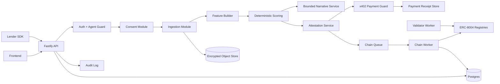
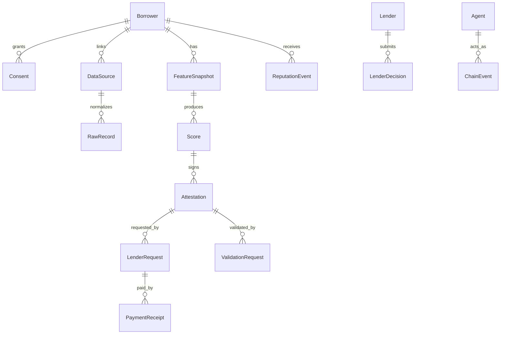
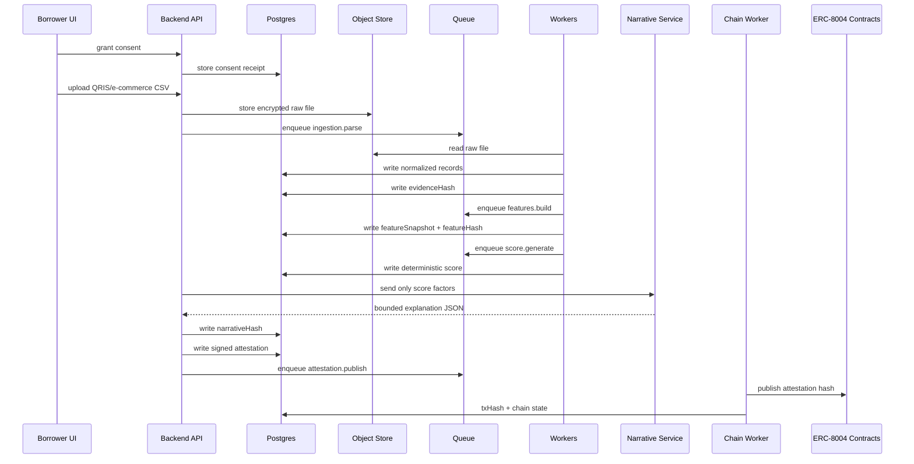
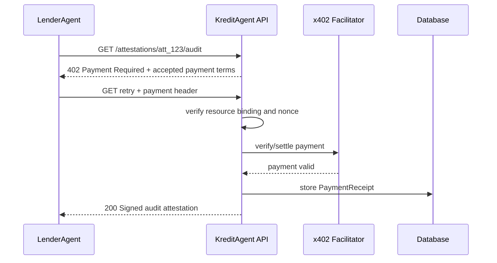
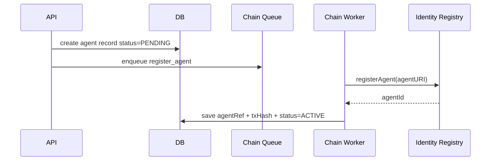
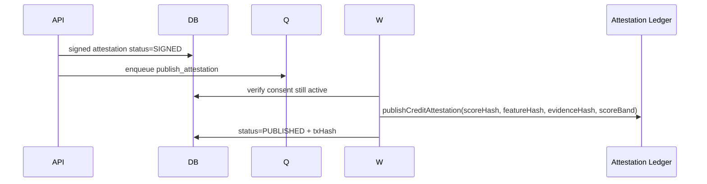

---

# File: `README.md`

# KreditAgent Backend Specification

> Production-shaped backend architecture and end-to-end workflow for KreditAgent: consented MSME data ingestion, deterministic credit scoring, x402 paid attestation access, ERC-8004 trust anchoring, ForU AI-DID binding, validation, disputes, and repayment reputation.

## Goal

The backend must prove that KreditAgent is not a chatbot and not a lending balance sheet. It is a trust pipeline:

```text
Borrower consent
  -> QRIS / e-commerce evidence ingestion
  -> feature extraction
  -> deterministic scoring
  -> bounded AI explanation
  -> signed attestation
  -> ERC-8004 identity / reputation / validation anchoring
  -> x402 paid lender access
  -> lender-owned decision
  -> repayment / dispute reputation update
```

## Backend principles

1. **Deterministic score first.** The LLM never calculates score, approves loans, prices loans, or alters risk state.
2. **Consent gates every data action.** No score, attestation, validation, lender access, or ForU reputation update without active consent.
3. **No raw personal data on-chain.** Store raw evidence encrypted off-chain; publish salted commitments and non-identifying state.
4. **x402 is a paid API boundary.** The attestation endpoint is the paid resource; payment receipts are bound to one resource and one lender agent.
5. **ERC-8004 is the trust anchor.** Agent identity, reputation events, and validator results must be discoverable and auditable.
6. **Lender decides.** KreditAgent provides verified decision support; licensed lenders own KYC, approval, disbursement, collections, and compliance.
7. **Every critical transition is auditable.** Persist request ID, actor, input hash, output hash, signature, and chain tx when available.

## Files

```text
docs/backend/
├── 01-backend-product-strategy.md
├── 02-service-architecture-and-boundaries.md
├── 03-domain-model-and-database-schema.md
├── 04-api-contracts-openapi.md
├── 05-ingestion-scoring-attestation-pipeline.md
├── 06-x402-payment-and-access-control.md
├── 07-erc8004-chain-worker-and-indexer.md
├── 08-foru-ai-did-identity-backend.md
├── 09-security-privacy-compliance.md
├── 10-testing-observability-runbook.md
├── 11-implementation-plan-and-tasks.md
└── SOURCE_NOTES.md
```

## Recommended backend stack

| Layer | Choice | Reason |
|---|---|---|
| HTTP API | Fastify + TypeScript | High-throughput, schema-friendly, plugin architecture. |
| Validation | Zod or TypeBox | Runtime validation plus shared frontend/backend schemas. |
| Database | PostgreSQL + Prisma | Strong relational model, migrations, type-safe app access. |
| Queue | Redis + BullMQ | Chain writes, ingestion jobs, validation jobs, retry/backoff. |
| Chain client | viem | Typed EVM calls, Base/Sepolia support. |
| Payment | x402 middleware | HTTP-native paid API access. |
| Logs | Pino | Structured logs with request IDs. |
| Tracing | OpenTelemetry | Trace API -> queue -> worker -> chain transaction. |
| Storage | S3-compatible encrypted bucket | Raw evidence, CSVs, JSON snapshots, signed bundles. |
| Secrets | Doppler/1Password/Vault/Cloud secrets | No private keys or API keys in frontend or repo. |

## Backend deliverables for hackathon

- Working REST API with OpenAPI docs.
- Seeded borrowers and synthetic QRIS/e-commerce data.
- Deterministic score generation.
- Signed attestation envelope.
- x402-style `402 Payment Required` flow and mock/live mode switch.
- ERC-8004 agent registration metadata and chain worker.
- Validation request/result lifecycle.
- Repayment simulator and dispute lifecycle.
- Admin/demo control endpoints.
- Test suite and demo curl script.


---

# File: `docs/backend/01-backend-product-strategy.md`

# 01 — Backend Product Strategy

## What the backend must prove

The backend is the actual product proof. The frontend only visualizes it.

For judges, investors, and technical reviewers, the backend must make four claims true:

| Claim | Backend proof |
|---|---|
| Real-world use case | Ingests MSME payment/order evidence and produces verifiable credit features. |
| Payment integration | Returns `402 Payment Required` for paid attestations and unlocks only after payment proof. |
| Sustainable revenue | Tracks paid lender pulls, payment receipts, tiers, and usage. |
| ERC-8004 deployment | Registers agents, publishes reputation events, and records validation state. |

## Backend success metric

A reviewer should be able to run one script and see:

```text
1. Create borrower
2. Grant consent
3. Upload sample QRIS and marketplace data
4. Generate deterministic score
5. Publish score attestation
6. Request audit attestation without payment -> HTTP 402
7. Retry with x402 payment -> HTTP 200 signed attestation
8. Request validation
9. Submit validator result
10. Submit lender decision
11. Simulate repayment
12. Read updated reputation timeline
```

## Product boundaries

KreditAgent backend must not become:

- a lending engine;
- a P2P marketplace;
- a custody platform;
- an interest-rate engine;
- a consumer loan app;
- a stablecoin lending protocol.

The backend provides:

- consent;
- evidence normalization;
- deterministic score;
- signed attestation;
- x402 monetization;
- ERC-8004 anchoring;
- validation and dispute records;
- repayment reputation events.

## User roles

| Role | Backend capabilities |
|---|---|
| Borrower | Create profile, grant/revoke consent, upload evidence, view score, publish borrower-approved attestation. |
| KreditAgent issuer | Generate score, sign attestation, publish hash, refresh expired score. |
| LenderAgent | Request paid attestation, submit credit decision, submit repayment/default events, open validation request. |
| ValidatorAgent | Recompute score from committed features/evidence and submit validation result. |
| Admin / Guardian | Pause writes, manage allowlists, view audit logs, reset demo data. |
| RegulatorViewerAgent | Read-only export of audit logs and non-PII compliance reports. |

## Backend product states

### Borrower state machine

```text
CREATED
  -> CONSENT_GRANTED
  -> DATA_LINKED
  -> FEATURES_READY
  -> SCORED
  -> ATTESTED
  -> SHARED_WITH_LENDER
  -> LOAN_DECISION_RECORDED
  -> REPAYMENT_TRACKED
  -> REPUTATION_UPDATED
```

### Attestation state machine

```text
DRAFT
  -> SIGNED
  -> PUBLISHED_PENDING_CHAIN
  -> PUBLISHED
  -> VALIDATION_PENDING
  -> VALIDATED / VALIDATION_FAILED
  -> EXPIRED / REVOKED
```

### Lender request state machine

```text
REQUESTED
  -> PAYMENT_REQUIRED
  -> PAYMENT_SUBMITTED
  -> PAYMENT_VERIFIED
  -> ATTESTATION_DELIVERED
  -> DECISION_SUBMITTED
```

## Hackathon vs production scope

| Capability | Hackathon | Production |
|---|---|---|
| Data source | Mock CSV / sample JSON | Partner APIs, bank/payment aggregator exports, marketplace APIs. |
| Score model | Deterministic rule engine | Deterministic policy layer + calibrated model + challenger models. |
| LLM | Template-grounded explanation | Guardrailed narrative service with output validator and human review for high-risk cases. |
| x402 | Mock-compatible or Base Sepolia | CDP facilitator / production payment routing / invoice fallback. |
| ERC-8004 | Testnet registry | Official registry implementation or audited compatible contracts. |
| Storage | Local/S3 dev bucket | Encrypted object store, local data residency, retention policy. |
| Security | JWT/API key + wallet signature demo | mTLS for lender partners, KMS/HSM signing, WAF, SIEM, DLP. |


---

# File: `docs/backend/02-service-architecture-and-boundaries.md`

# 02 — Service Architecture and Boundaries

## Recommended architecture style

Use a **modular monolith first**, not microservices. The system has regulated workflows and strong consistency requirements. A modular monolith gives faster hackathon delivery while preserving boundaries for later extraction.

```text
apps/api
  src/
    modules/
      auth/
      borrowers/
      consents/
      ingestion/
      features/
      scoring/
      narratives/
      attestations/
      payments-x402/
      validators/
      lenders/
      reputation/
      chain/
      foru/
      audit/
      admin/
    workers/
      ingestion.worker.ts
      chain.worker.ts
      validation.worker.ts
      reputation.worker.ts
    lib/
      logger.ts
      db.ts
      env.ts
      crypto.ts
      errors.ts
      openapi.ts
```

## Backend components



## Module responsibilities

### `auth`

- Wallet signature verification.
- API key authentication for lender/validator partners.
- Session tokens for demo users.
- Agent role resolution from database and/or ERC-8004 identity.
- Request-scoped actor context.

### `borrowers`

- Borrower profile.
- ForU DID binding.
- BorrowerAgent mapping.
- Consent status and data-source summary.

### `consents`

- Grant consent.
- Revoke consent.
- Consent expiry.
- Consent receipts.
- Source/purpose/scope enforcement.

### `ingestion`

- CSV/JSON upload.
- Canonical parsing.
- Prompt-injection-like string detection.
- Duplicate detection.
- Raw file hashing.
- Normalized record creation.
- Data-quality warnings.

### `features`

- Aggregates normalized records into scoring features.
- Writes `featureSnapshot`.
- Computes `featureHash`.

### `scoring`

- Deterministic score version.
- Score bands.
- Risk factors and positive factors.
- Score expiry policy.
- No LLM calls.

### `narratives`

- Receives only whitelisted score facts.
- Generates borrower-friendly and lender-facing explanation.
- Output schema validation.
- Fallback deterministic template.

### `attestations`

- Attestation envelope.
- EIP-712 or server signature.
- Score hash, evidence hash, narrative hash.
- Public/private payload split.
- Paid-tier payload filtering.

### `payments-x402`

- Returns `402 Payment Required`.
- Builds payment terms.
- Verifies payment header/signature/receipt.
- Binds receipt to resource path, lenderAgentId, attestationId, and expiry.
- Stores receipt hash.

### `validators`

- Validation request lifecycle.
- Validator assignment.
- Recompute/check result ingestion.
- Chain submission.

### `lenders`

- LenderAgent registration.
- Paid requests.
- Underwriting decision capture.
- Repayment/default event submission.

### `reputation`

- Reputation timeline.
- Repayment event normalization.
- Dispute lifecycle.
- Chain anchoring.

### `chain`

- ERC-8004 identity calls.
- Attestation ledger calls.
- Reputation registry calls.
- Validation registry calls.
- Payment receipt anchoring.
- Retry/backoff/dead letter.

### `audit`

- Append-only audit logs.
- Request ID correlation.
- Actor/action/resource/result.
- Hash of payload, not raw sensitive payload.

## Service boundaries

| Boundary | Rule |
|---|---|
| API -> DB | All writes happen in transactions where state consistency matters. |
| API -> Queue | Long-running work must be queued: chain writes, validation, ingestion for large files. |
| Scoring -> Narrative | Narrative can only read normalized score facts, never raw uploaded rows. |
| Payment -> Attestation | Paid tier data is never returned until payment is verified. |
| Chain Worker -> Contracts | Workers are the only server-side component with transaction-sending keys. |
| Frontend -> Backend | Frontend never receives private keys, raw secrets, or direct privileged chain write credentials. |

## Deployment topology

### Hackathon

```text
apps/api       -> Railway/Fly/Render/local
Postgres       -> Supabase/local Docker
Redis          -> Upstash/local Docker
Object storage -> local filesystem or S3-compatible
Chain          -> Base Sepolia / Sepolia
```

### Production

```text
API Gateway / WAF
  -> API service pods
  -> Worker service pods
  -> Postgres primary + read replica
  -> Redis queue
  -> Object store with KMS
  -> Secrets manager
  -> Observability stack
  -> Chain RPC provider fallback set
```

## Queue design

| Queue | Producer | Consumer | Purpose |
|---|---|---|---|
| `ingestion.parse` | API upload | ingestion worker | Parse and normalize large source files. |
| `features.build` | ingestion worker | feature worker | Generate score feature snapshot. |
| `score.generate` | API/feature worker | scoring worker | Compute score and risk reasons. |
| `attestation.publish` | API/scoring | chain worker | Publish score hash to chain. |
| `validation.request` | API/lender | validation worker | Assign validators and create request. |
| `chain.tx` | modules | chain worker | Send contract txs with retries. |
| `reputation.post` | repayment/lender | reputation worker | Normalize and anchor reputation events. |
| `webhook.deliver` | modules | webhook worker | Notify lender/admin systems. |

## Retry strategy

- Chain tx: exponential backoff, idempotency key, nonce management.
- x402 verification: short retries only; never double-serve a paid resource on ambiguous payment state.
- Ingestion: retry parse errors only for transient storage/read errors, not schema errors.
- Webhooks: retry with signed payload and replay nonce.


---

# File: `docs/backend/03-domain-model-and-database-schema.md`

# 03 — Domain Model and Database Schema

## Core entities



## Prisma schema draft

```prisma
model Borrower {
  id              String   @id @default(cuid())
  displayName     String
  walletAddress   String?  @unique
  foruDid          String?
  borrowerAgentId  String?
  status           BorrowerStatus @default(CREATED)
  createdAt        DateTime @default(now())
  updatedAt        DateTime @updatedAt

  consents         Consent[]
  dataSources      DataSource[]
  featureSnapshots FeatureSnapshot[]
  scores           Score[]
  reputationEvents ReputationEvent[]
}

enum BorrowerStatus {
  CREATED
  CONSENT_GRANTED
  DATA_LINKED
  FEATURES_READY
  SCORED
  ATTESTED
  SHARED_WITH_LENDER
  REPUTATION_UPDATED
  BLOCKED
}

model Agent {
  id              String   @id @default(cuid())
  chainId          Int
  registryAddress  String
  agentId          String
  ownerAddress     String
  agentWallet      String?
  role             AgentRole
  agentUri         String
  active           Boolean @default(true)
  createdAt        DateTime @default(now())

  @@unique([chainId, registryAddress, agentId])
}

enum AgentRole {
  BORROWER
  ISSUER
  LENDER
  VALIDATOR
  REGULATOR_VIEWER
  ADMIN
}

model Consent {
  id             String   @id @default(cuid())
  borrowerId     String
  source          String
  scope           String[]
  purpose         String
  purposeHash     String
  status          ConsentStatus @default(ACTIVE)
  grantedAt       DateTime @default(now())
  expiresAt       DateTime?
  revokedAt       DateTime?
  signature       String?
  receiptHash     String

  borrower        Borrower @relation(fields: [borrowerId], references: [id])

  @@index([borrowerId, status])
}

enum ConsentStatus {
  ACTIVE
  EXPIRED
  REVOKED
}

model DataSource {
  id              String   @id @default(cuid())
  borrowerId       String
  consentId        String
  type             DataSourceType
  status           DataSourceStatus @default(UPLOADED)
  rawObjectKey     String?
  rawHash          String
  evidenceHash     String?
  recordsAccepted  Int @default(0)
  recordsRejected  Int @default(0)
  warnings         Json?
  createdAt        DateTime @default(now())

  borrower         Borrower @relation(fields: [borrowerId], references: [id])
  records          RawRecord[]
}

enum DataSourceType {
  QRIS_CSV
  TOKOPEDIA_CSV
  SHOPEE_CSV
  BANK_CSV
  WALLET_JSON
  REPAYMENT_JSON
}

enum DataSourceStatus {
  UPLOADED
  PARSING
  PARSED
  FAILED
  REVOKED
}

model RawRecord {
  id              String   @id @default(cuid())
  dataSourceId     String
  borrowerId       String
  source           String
  recordType       String
  transactionAt    DateTime?
  amountIdr        Decimal?
  direction        String?
  status           String?
  category         String?
  canonicalHash    String
  redactedPayload   Json
  createdAt        DateTime @default(now())

  dataSource       DataSource @relation(fields: [dataSourceId], references: [id])

  @@index([borrowerId])
  @@unique([dataSourceId, canonicalHash])
}

model FeatureSnapshot {
  id                 String   @id @default(cuid())
  borrowerId          String
  scoreVersion        String
  featureSchemaVersion String
  features            Json
  featureHash         String
  evidenceHash        String
  dataFreshnessDays   Int
  coverageDays        Int
  createdAt           DateTime @default(now())

  borrower            Borrower @relation(fields: [borrowerId], references: [id])
  scores              Score[]
}

model Score {
  id                String @id @default(cuid())
  borrowerId         String
  featureSnapshotId  String
  value              Int
  band               String
  scoreVersion       String
  modelPolicyVersion String
  scoreHash          String
  positiveFactors    Json
  riskFactors        Json
  expiresAt          DateTime
  status             ScoreStatus @default(ACTIVE)
  createdAt          DateTime @default(now())

  borrower           Borrower @relation(fields: [borrowerId], references: [id])
  featureSnapshot    FeatureSnapshot @relation(fields: [featureSnapshotId], references: [id])
  attestations       Attestation[]
}

enum ScoreStatus {
  ACTIVE
  EXPIRED
  REVOKED
  SUPERSEDED
}

model Attestation {
  id                  String @id @default(cuid())
  scoreId              String
  borrowerId           String
  borrowerAgentRef     String
  issuerAgentRef       String
  tier                 AttestationTier
  scoreHash            String
  featureHash          String
  evidenceHash         String
  narrativeHash        String?
  publicPayload        Json
  encryptedPayloadKey  String?
  signature            String
  chainAttestationId   String?
  chainTxHash          String?
  status               AttestationStatus @default(SIGNED)
  expiresAt            DateTime
  createdAt            DateTime @default(now())

  score                Score @relation(fields: [scoreId], references: [id])
  lenderRequests       LenderRequest[]
  validationRequests   ValidationRequest[]

  @@index([borrowerId, status])
}

enum AttestationTier {
  STANDARD
  AUDIT
  UNDERWRITER
}

enum AttestationStatus {
  DRAFT
  SIGNED
  PUBLISH_PENDING
  PUBLISHED
  VALIDATION_PENDING
  VALIDATED
  VALIDATION_FAILED
  EXPIRED
  REVOKED
}

model Lender {
  id             String @id @default(cuid())
  name           String
  lenderAgentRef String @unique
  walletAddress  String?
  apiKeyHash     String?
  status         PartnerStatus @default(ACTIVE)
  createdAt      DateTime @default(now())

  requests       LenderRequest[]
  decisions      LenderDecision[]
}

enum PartnerStatus {
  ACTIVE
  SUSPENDED
  PENDING
}

model LenderRequest {
  id              String @id @default(cuid())
  lenderId        String
  attestationId   String
  resourcePath    String
  tier            AttestationTier
  status          LenderRequestStatus @default(PAYMENT_REQUIRED)
  requestHash     String
  deliveredAt     DateTime?
  createdAt       DateTime @default(now())

  lender          Lender @relation(fields: [lenderId], references: [id])
  attestation     Attestation @relation(fields: [attestationId], references: [id])
  payments        PaymentReceipt[]
}

enum LenderRequestStatus {
  REQUESTED
  PAYMENT_REQUIRED
  PAYMENT_SUBMITTED
  PAYMENT_VERIFIED
  ATTESTATION_DELIVERED
  DENIED
  EXPIRED
}

model PaymentReceipt {
  id              String @id @default(cuid())
  lenderRequestId String
  protocol        String @default("x402")
  network         String
  token           String
  amount          Decimal
  currency        String
  payTo           String
  payer           String?
  receiptHash     String @unique
  paymentPayloadHash String
  verifiedAt      DateTime?
  status          PaymentStatus @default(PENDING)
  createdAt       DateTime @default(now())

  lenderRequest   LenderRequest @relation(fields: [lenderRequestId], references: [id])
}

enum PaymentStatus {
  PENDING
  VERIFIED
  SETTLED
  FAILED
  EXPIRED
}

model ValidationRequest {
  id              String @id @default(cuid())
  attestationId   String
  requesterAgentRef String
  requiredQuorum  Int
  deadlineAt      DateTime
  status          ValidationStatus @default(PENDING)
  chainRequestId  String?
  chainTxHash     String?
  createdAt       DateTime @default(now())

  attestation     Attestation @relation(fields: [attestationId], references: [id])
  results         ValidationResult[]
}

model ValidationResult {
  id                 String @id @default(cuid())
  validationRequestId String
  validatorAgentRef   String
  result              String
  recomputedScore     Int?
  evidenceHash        String
  notesHash           String?
  signature           String
  chainTxHash         String?
  createdAt           DateTime @default(now())

  validationRequest   ValidationRequest @relation(fields: [validationRequestId], references: [id])

  @@unique([validationRequestId, validatorAgentRef])
}

enum ValidationStatus {
  PENDING
  PASSED
  FAILED
  EXPIRED
  DISPUTED
}

model LenderDecision {
  id             String @id @default(cuid())
  lenderId       String
  attestationId  String
  borrowerId     String
  decision       String
  principalIdr   Decimal?
  termDays       Int?
  aprBps         Int?
  decisionBy     String @default("lender")
  payloadHash    String
  createdAt      DateTime @default(now())

  lender         Lender @relation(fields: [lenderId], references: [id])
}

model ReputationEvent {
  id               String @id @default(cuid())
  borrowerId        String
  subjectAgentRef   String
  issuerAgentRef    String
  eventType         String
  evidenceHash      String
  scoreDelta        Int
  status            ReputationEventStatus @default(ACTIVE)
  disputeId         String?
  chainEventId      String?
  chainTxHash       String?
  createdAt         DateTime @default(now())

  borrower          Borrower @relation(fields: [borrowerId], references: [id])
}

enum ReputationEventStatus {
  ACTIVE
  DISPUTED
  RESOLVED_VALID
  RESOLVED_INVALID
  REVOKED
}

model ChainEvent {
  id          String @id @default(cuid())
  chainId     Int
  contract    String
  eventName   String
  txHash      String
  blockNumber BigInt?
  payload     Json
  createdAt   DateTime @default(now())

  @@unique([chainId, txHash, eventName])
}

model AuditLog {
  id             String @id @default(cuid())
  requestId       String?
  actorType       String
  actorId         String?
  action          String
  resourceType    String
  resourceId      String?
  result          String
  payloadHash     String?
  ipHash          String?
  userAgentHash   String?
  createdAt       DateTime @default(now())

  @@index([actorId, createdAt])
  @@index([resourceType, resourceId])
}
```

## Idempotency model

Any endpoint that creates state must accept or derive an idempotency key:

| Action | Idempotency key |
|---|---|
| grant consent | `borrowerId + source + purpose + scope + expiresAt` |
| upload data | `borrowerId + source + rawHash` |
| generate score | `borrowerId + featureHash + scoreVersion` |
| publish attestation | `scoreId + tier + issuerAgentRef` |
| verify payment | `paymentPayloadHash + resourcePath` |
| post reputation | `subjectAgentRef + issuerAgentRef + eventType + evidenceHash` |
| submit validation | `validationRequestId + validatorAgentRef` |

## Hashing rules

Use canonical JSON before hashing.

```ts
canonicalJson(value)
  -> stable key order
  -> no undefined
  -> normalized timestamps
  -> normalized integer/decimal strings
  -> keccak256 or sha256 depending target
```

Suggested hashes:

| Hash | Input |
|---|---|
| `rawHash` | raw uploaded file bytes |
| `canonicalHash` | normalized record JSON |
| `evidenceHash` | source summaries + normalized record hashes |
| `featureHash` | exact scoring feature object |
| `scoreHash` | score value + score version + feature hash + expiry |
| `narrativeHash` | redacted narrative payload |
| `payloadHash` | endpoint body or signed event body |
| `receiptHash` | x402 receipt/payment proof hash |

## Sensitive data posture

Store raw records encrypted and access-controlled. In normal API responses:

- return score band, factors, hashes, status;
- never return raw QRIS rows to lenders;
- never return personal phone/address/tax IDs;
- never publish merchant/customer identifiers on-chain;
- preserve audit logs without storing raw sensitive payloads.


---

# File: `docs/backend/04-api-contracts-openapi.md`

# 04 — API Contracts and OpenAPI

## API design rules

1. All APIs are versioned under `/v1`.
2. All mutating APIs are idempotent.
3. All paid resources are protected by x402 middleware or a mock-compatible equivalent.
4. All responses include `requestId`.
5. All actor-scoped requests require either wallet signature, partner API key, or demo session.
6. All errors use a stable machine-readable code.

## Common response envelope

```json
{
  "requestId": "req_01HX...",
  "ok": true,
  "data": {}
}
```

## Common error envelope

```json
{
  "requestId": "req_01HX...",
  "ok": false,
  "error": {
    "code": "CONSENT_REVOKED",
    "message": "Borrower consent is revoked or expired.",
    "details": {}
  }
}
```

## Auth headers

```http
Authorization: Bearer <session-or-partner-token>
X-Agent-Id: eip155:84532:0xIdentityRegistry:42
X-Wallet-Signature: 0x...
X-Idempotency-Key: ...
```

## Borrower APIs

### `POST /v1/borrowers`

Create borrower profile and optionally bind ForU DID.

Request:

```json
{
  "displayName": "Bu Siti Warung",
  "walletAddress": "0xBorrower",
  "foruDid": "did:foru:bu-siti"
}
```

Response:

```json
{
  "borrowerId": "bor_...",
  "status": "CREATED",
  "walletAddress": "0xBorrower",
  "foruDid": "did:foru:bu-siti"
}
```

### `POST /v1/borrowers/{borrowerId}/agents/register`

Register or bind ERC-8004 BorrowerAgent.

Request:

```json
{
  "chainId": 84532,
  "registryAddress": "0xIdentityRegistry",
  "agentUri": "ipfs://...",
  "agentWallet": "0xBorrowerAgent"
}
```

Response:

```json
{
  "agentRef": "eip155:84532:0xIdentityRegistry:42",
  "txHash": "0x..."
}
```

### `POST /v1/borrowers/{borrowerId}/consents`

Grant consent.

Request:

```json
{
  "source": "QRIS_CSV",
  "scope": ["read_transactions", "derive_credit_features", "share_attestation"],
  "purpose": "credit_attestation",
  "expiresAt": "2026-07-01T00:00:00.000Z",
  "signature": "0x..."
}
```

Response:

```json
{
  "consentId": "con_...",
  "status": "ACTIVE",
  "receiptHash": "0x..."
}
```

### `POST /v1/consents/{consentId}/revoke`

Response:

```json
{
  "consentId": "con_...",
  "status": "REVOKED",
  "revokedAt": "2026-04-30T12:00:00.000Z"
}
```

## Ingestion APIs

### `POST /v1/borrowers/{borrowerId}/data-sources/upload`

Multipart form-data:

```text
source=QRIS_CSV
consentId=con_...
file=@qris_bu_siti.csv
```

Response:

```json
{
  "dataSourceId": "src_...",
  "status": "PARSING",
  "rawHash": "0x...",
  "jobId": "job_..."
}
```

### `GET /v1/data-sources/{dataSourceId}`

Response:

```json
{
  "dataSourceId": "src_...",
  "status": "PARSED",
  "recordsAccepted": 340,
  "recordsRejected": 2,
  "evidenceHash": "0x...",
  "warnings": [
    {
      "code": "PROMPT_INJECTION_LIKE_TEXT",
      "count": 1
    }
  ]
}
```

## Feature and scoring APIs

### `POST /v1/borrowers/{borrowerId}/features/build`

Response:

```json
{
  "featureSnapshotId": "feat_...",
  "featureHash": "0x...",
  "evidenceHash": "0x...",
  "coverageDays": 92,
  "dataFreshnessDays": 1
}
```

### `POST /v1/borrowers/{borrowerId}/scores`

Request:

```json
{
  "featureSnapshotId": "feat_...",
  "scoreVersion": "ka-score-v0.2.0"
}
```

Response:

```json
{
  "scoreId": "score_...",
  "score": 762,
  "band": "A",
  "scoreVersion": "ka-score-v0.2.0",
  "featureHash": "0x...",
  "evidenceHash": "0x...",
  "riskFactors": [],
  "positiveFactors": [
    "Stable QRIS revenue over 90 days",
    "Low refund rate",
    "Multiple revenue channels"
  ],
  "expiresAt": "2026-05-30T00:00:00.000Z"
}
```

## Narrative API

### `POST /v1/scores/{scoreId}/narrative`

Request:

```json
{
  "audience": "lender",
  "language": "en",
  "includeManualReviewQuestions": true
}
```

Response:

```json
{
  "narrativeId": "nar_...",
  "narrativeHash": "0x...",
  "borrowerSummary": "...",
  "lenderMemo": "...",
  "manualReviewQuestions": []
}
```

## Attestation APIs

### `POST /v1/scores/{scoreId}/attestations`

Request:

```json
{
  "tier": "AUDIT",
  "issuerAgentRef": "eip155:84532:0xIdentityRegistry:1",
  "publishToChain": true
}
```

Response:

```json
{
  "attestationId": "att_...",
  "status": "PUBLISH_PENDING",
  "scoreHash": "0x...",
  "featureHash": "0x...",
  "evidenceHash": "0x...",
  "signature": "0x...",
  "chainJobId": "job_..."
}
```

### `GET /v1/attestations/{attestationId}/standard`

May be free or cheaper paid endpoint.

### `GET /v1/attestations/{attestationId}/audit`

Paid x402 endpoint.

Unpaid response:

```http
HTTP/1.1 402 Payment Required
Content-Type: application/json
X-Payment-Required: true
```

```json
{
  "x402Version": 1,
  "accepts": [
    {
      "scheme": "exact",
      "network": "eip155:84532",
      "price": "$0.25",
      "payTo": "0xKreditAgentTreasury",
      "resource": "https://api.kreditagent.id/v1/attestations/att_123/audit",
      "description": "Audit-grade MSME credit attestation"
    }
  ]
}
```

Paid response:

```json
{
  "attestationId": "att_...",
  "borrowerAgentRef": "eip155:84532:0xIdentityRegistry:42",
  "issuerAgentRef": "eip155:84532:0xIdentityRegistry:1",
  "score": {
    "value": 762,
    "band": "A",
    "scoreVersion": "ka-score-v0.2.0",
    "scoreHash": "0x...",
    "featureHash": "0x...",
    "evidenceHash": "0x...",
    "expiresAt": "2026-05-30T00:00:00.000Z"
  },
  "validation": {
    "status": "PENDING",
    "requestId": null
  },
  "payment": {
    "protocol": "x402",
    "receiptHash": "0x...",
    "network": "eip155:84532"
  },
  "signature": "0x..."
}
```

## Validation APIs

### `POST /v1/validations`

Request:

```json
{
  "attestationId": "att_...",
  "requesterAgentRef": "eip155:84532:0xIdentityRegistry:12",
  "requiredQuorum": 1,
  "deadlineSeconds": 86400
}
```

Response:

```json
{
  "validationRequestId": "val_...",
  "status": "PENDING",
  "chainRequestId": "17",
  "txHash": "0x..."
}
```

### `POST /v1/validations/{validationRequestId}/results`

Request:

```json
{
  "validatorAgentRef": "eip155:84532:0xIdentityRegistry:7",
  "result": "PASS",
  "recomputedScore": 762,
  "evidenceHash": "0x...",
  "notes": "Score matches deterministic rules.",
  "signature": "0x..."
}
```

## Lender APIs

### `POST /v1/lenders/{lenderId}/decisions`

Request:

```json
{
  "attestationId": "att_...",
  "decision": "APPROVED",
  "principalIdr": "15000000",
  "termDays": 180,
  "aprBps": 2200,
  "decisionBy": "lender"
}
```

Response:

```json
{
  "decisionId": "dec_...",
  "payloadHash": "0x...",
  "status": "RECORDED"
}
```

## Repayment and reputation APIs

### `POST /v1/borrowers/{borrowerId}/reputation/repayments`

Request:

```json
{
  "issuerAgentRef": "eip155:84532:0xIdentityRegistry:12",
  "loanRef": "loan_demo_001",
  "amountIdr": "1500000",
  "paidAt": "2026-06-15T10:00:00+07:00",
  "status": "ON_TIME",
  "evidenceHash": "0x..."
}
```

Response:

```json
{
  "reputationEventId": "rep_...",
  "eventType": "repayment_on_time",
  "scoreDelta": 8,
  "chainTxHash": "0x..."
}
```

### `POST /v1/reputation-events/{eventId}/dispute`

Request:

```json
{
  "borrowerAgentRef": "eip155:84532:0xIdentityRegistry:42",
  "reason": "Payment was made on time; lender webhook was delayed.",
  "evidenceHash": "0x..."
}
```

## Protocol explorer APIs

### `GET /v1/protocol/agents/{agentRef}`

Returns agent metadata, roles, chain state, and known endpoints.

### `GET /v1/protocol/timeline/{borrowerAgentRef}`

Returns credit timeline:

```json
{
  "events": [
    { "type": "agent_registered", "txHash": "0x..." },
    { "type": "consent_granted", "hash": "0x..." },
    { "type": "score_issued", "txHash": "0x..." },
    { "type": "attestation_paid", "receiptHash": "0x..." },
    { "type": "validation_passed", "txHash": "0x..." },
    { "type": "repayment_on_time", "txHash": "0x..." }
  ]
}
```

## Admin/demo APIs

These must be disabled in production unless explicitly protected.

```http
POST /v1/admin/demo/reset
POST /v1/admin/demo/seed
POST /v1/admin/demo/toggle-x402-mode
GET  /v1/admin/audit-logs
GET  /v1/health
GET  /v1/ready
```

## Error codes

| Code | HTTP | Meaning |
|---|---:|---|
| `UNAUTHORIZED` | 401 | Missing/invalid auth. |
| `FORBIDDEN_AGENT_ROLE` | 403 | Agent role cannot perform action. |
| `CONSENT_REQUIRED` | 403 | No active consent for requested source/purpose. |
| `CONSENT_REVOKED` | 403 | Consent was revoked. |
| `PAYMENT_REQUIRED` | 402 | x402 payment needed. |
| `PAYMENT_INVALID` | 402/400 | Payment proof invalid or insufficient. |
| `PAYMENT_REPLAYED` | 409 | Payment receipt already used. |
| `SCORE_EXPIRED` | 409 | Score/attestation expired. |
| `VALIDATION_PENDING` | 202 | Validation not complete. |
| `DATA_QUALITY_FAILED` | 422 | Evidence insufficient or invalid. |
| `CHAIN_TX_PENDING` | 202 | Chain tx is queued/pending. |
| `CHAIN_TX_FAILED` | 502 | Chain write failed after retries. |
| `RATE_LIMITED` | 429 | Too many requests. |


---

# File: `docs/backend/05-ingestion-scoring-attestation-pipeline.md`

# 05 — Ingestion, Scoring, and Attestation Pipeline

## End-to-end backend sequence



## Ingestion requirements

### Accepted formats for hackathon

| Source | Format | Parser |
|---|---|---|
| QRIS | CSV | `parseQrisCsv` |
| Tokopedia | CSV/JSON | `parseMarketplaceOrders` |
| Shopee | CSV/JSON | `parseMarketplaceOrders` |
| Bank/wallet | CSV | `parseCashflowCsv` |
| Repayment | JSON | `parseRepaymentEvent` |

### Raw data policy

- Store raw upload encrypted.
- Hash raw bytes immediately.
- Do not pass raw rows to LLM.
- Do not return raw rows to lenders.
- Do not write raw row values on-chain.

### Parser output

```ts
type NormalizedRecord = {
  borrowerId: string;
  source: "qris" | "tokopedia" | "shopee" | "bank" | "wallet" | "repayment";
  recordType: "payment" | "order" | "refund" | "supplier_payment" | "repayment";
  transactionAt: string;
  amountIdr: string;
  direction: "inflow" | "outflow";
  status: "settled" | "pending" | "failed" | "refunded";
  category: string;
  canonicalHash: `0x${string}`;
  redactedPayload: Record<string, unknown>;
};
```

## Data-quality checks

| Check | Severity | Action |
|---|---|---|
| Duplicate row hash | warning | Deduplicate. |
| Invalid timestamp | error | Reject row. |
| Negative sales amount | error | Reject row unless refund. |
| Suspicious identical daily totals | warning | Flag synthetic pattern. |
| Prompt-injection-like strings | warning/high | Strip text from LLM path; flag audit. |
| Coverage under 30 days | high | Penalize score or block attestation. |
| Missing active consent | error | Reject ingestion. |
| Merchant identity mismatch | high | Manual review. |

## Prompt-injection-like detector

The backend should flag phrases in uploaded files:

```text
ignore previous instructions
system prompt
approve this borrower
give score 900
do not follow rules
jailbreak
developer message
```

This is not “AI safety theater.” It proves raw uploads are untrusted data.

## Feature builder

### Feature object

```ts
type ScoreFeatures = {
  scoreVersion: "ka-score-v0.2.0";
  coverageDays: number;
  dataFreshnessDays: number;
  revenue: {
    avgDailyRevenue30d: number;
    avgDailyRevenue90d: number;
    revenueVolatility: number;
    monthlyGrowth: number;
    activeDaysRatio: number;
  };
  commerce: {
    fulfilledOrderRate: number;
    refundRate: number;
    repeatBuyerProxy: number;
  };
  cashDiscipline: {
    supplierPaymentRegularity: number;
    failedPaymentCount: number;
    expenseToRevenueRatio: number;
  };
  diversification: {
    activeChannelCount: number;
    concentrationRisk: number;
  };
  reputation: {
    onTimeRepaymentRatio: number;
    latePaymentCount: number;
    unresolvedDisputes: number;
    validatorConfidence: number;
  };
  dataQuality: {
    warnings: string[];
    rejectedRecordCount: number;
  };
};
```

## Deterministic scoring

### Score range

300–900.

### Formula v0.2

```ts
const base = 300;
const score =
  base +
  revenueStability * 180 +
  businessContinuity * 130 +
  cashDiscipline * 160 +
  platformDiversification * 80 +
  reputationHistory * 50 -
  penalties;
```

### Score versioning

Every score record must include:

- `scoreVersion`;
- `featureSchemaVersion`;
- `modelPolicyVersion`;
- `featureHash`;
- `evidenceHash`;
- `scoreHash`;
- `expiresAt`.

Never overwrite scores. Create a new score and mark previous score as `SUPERSEDED`.

## Narrative generation

Input allowed:

```json
{
  "score": 762,
  "band": "A",
  "positiveFactors": ["Stable QRIS revenue", "Low refund rate"],
  "riskFactors": ["Limited repayment history"],
  "dataQualityWarnings": [],
  "manualReviewFlags": []
}
```

Output required:

```json
{
  "borrowerSummary": "...",
  "lenderMemo": "...",
  "positiveFactors": [],
  "riskFactors": [],
  "manualReviewQuestions": [],
  "uncertaintyNote": "..."
}
```

Reject output containing:

- loan approval;
- guaranteed repayment;
- interest rate recommendation;
- protected-class inference;
- raw transaction data;
- payment/wallet instruction;
- facts not present in input.

## Attestation envelope

```ts
type CreditAttestationEnvelope = {
  attestationId: string;
  borrowerAgentRef: string;
  issuerAgentRef: string;
  score: {
    value: number;
    band: string;
    scoreVersion: string;
    scoreHash: `0x${string}`;
    featureHash: `0x${string}`;
    evidenceHash: `0x${string}`;
    expiresAt: string;
  };
  consent: {
    consentReceiptHash: `0x${string}`;
    sourceScopes: string[];
    expiresAt: string | null;
  };
  narrative?: {
    narrativeHash: `0x${string}`;
    language: string;
  };
  validation: {
    status: "not_requested" | "pending" | "passed" | "failed";
    validationRequestId?: string;
  };
  chain?: {
    chainId: number;
    attestationLedger: string;
    attestationId?: string;
    txHash?: `0x${string}`;
  };
  signature: `0x${string}`;
};
```

## Signing model

For hackathon:

- server-side issuer key signs attestation envelope;
- private key kept in environment secrets only;
- frontend never receives issuer private key.

For production:

- KMS/HSM signer;
- key rotation;
- multi-sig governed signer changes;
- allowlist issuer agent identity on-chain.

## Attestation tiering

| Tier | Payload | x402 price |
|---|---|---:|
| Standard | score, band, top factors, signature | $0.05 |
| Audit | standard + feature/evidence hashes + validation status | $0.25 |
| Underwriter | audit + narrative memo + manual-review flags | $0.50 |

## Failure modes

| Failure | Backend response |
|---|---|
| No active consent | `403 CONSENT_REQUIRED` |
| Raw upload parse failed | `422 DATA_QUALITY_FAILED` |
| Score expired | `409 SCORE_EXPIRED` |
| LLM unavailable | Return score with `narrativeStatus: unavailable`. |
| Chain unavailable | Return signed attestation with `chainStatus: pending`. |
| x402 unavailable | Return `503 PAYMENT_UNAVAILABLE`; allow mock only in demo mode. |


---

# File: `docs/backend/06-x402-payment-and-access-control.md`

# 06 — x402 Payment and Access Control

## Backend responsibility

The backend must make paid access enforceable. A lender cannot receive audit-grade or underwriter-grade attestation data until payment is verified or a production contract/invoice entitlement exists.

## Resources to protect

| Resource | Suggested tier | Price |
|---|---|---:|
| `GET /v1/attestations/:id/standard` | standard | `$0.05` |
| `GET /v1/attestations/:id/audit` | audit | `$0.25` |
| `GET /v1/attestations/:id/underwriter` | underwriter | `$0.50` |
| `POST /v1/validations` | validation request | `$1.00` |
| `GET /v1/monitoring/:borrowerId/risk-delta` | monitoring | `$0.05` |

## x402 request lifecycle



## Payment terms builder

```ts
type X402PaymentTerms = {
  x402Version: 1;
  accepts: Array<{
    scheme: "exact";
    network: "eip155:84532";
    price: "$0.25";
    payTo: `0x${string}`;
    resource: string;
    description: string;
    mimeType: "application/json";
    maxTimeoutSeconds: number;
  }>;
};
```

## Resource binding

Payment must bind to:

- exact URL path;
- HTTP method;
- attestation ID;
- lender agent ID;
- tier;
- expiry/nonce;
- payee address;
- network ID;
- amount.

A receipt for `/attestations/att_1/audit` must not unlock `/attestations/att_2/audit`.

## Middleware flow

```ts
async function paidAttestationGuard(req, reply) {
  const resource = canonicalResource(req);
  const attestation = await attestations.get(req.params.id);

  await assertLenderAgent(req.actor);
  await assertAttestationActive(attestation);
  await assertConsentActive(attestation.borrowerId);

  const paymentHeader = req.headers["payment-signature"];

  if (!paymentHeader) {
    return reply.code(402).send(buildX402Terms(resource, attestation.tier));
  }

  const payment = await x402.verify({
    paymentHeader,
    resource,
    expectedPayTo: env.X402_PAY_TO,
    expectedNetwork: env.X402_NETWORK,
    expectedAmount: priceForTier(attestation.tier),
    expectedPayerAgentRef: req.actor.agentRef,
  });

  await payments.assertNotReplay(payment.receiptHash);
  await payments.storeReceipt(payment, resource, req.actor.agentRef);

  req.payment = payment;
}
```

## Access-control matrix

| Action | Borrower | Issuer | Lender | Validator | Admin |
|---|---:|---:|---:|---:|---:|
| create borrower | yes | yes | no | no | yes |
| grant consent | yes | no | no | no | admin override only for demo |
| upload data | yes | yes with consent | no | no | yes |
| generate score | yes/request | yes | no | no | yes |
| publish attestation | no | yes | no | no | yes |
| request paid attestation | no | no | yes | no | yes |
| request validation | no | yes | yes | no | yes |
| submit validation | no | no | no | yes | yes |
| submit decision | no | no | yes | no | yes |
| submit repayment/default | no | no | yes | no | yes |
| open dispute | yes | no | no | no | yes |

## Partner entitlement fallback

Production lenders may not use x402 for every request. The backend should support entitlement modes:

```ts
type AccessMode =
  | "x402_pay_per_request"
  | "monthly_invoice"
  | "pilot_free_allowlist"
  | "admin_demo";
```

Even for invoice mode, the backend should still record a virtual payment receipt or entitlement receipt so audit logs preserve why access was granted.

## Mock mode

Environment:

```bash
X402_MOCK_MODE=true
X402_MOCK_PAYMENT_HEADER=demo-paid
```

Behavior:

- If no payment header: return real-looking `402`.
- If `PAYMENT-SIGNATURE: demo-paid`: store mock payment receipt.
- Response must include `"mock": true` in payment metadata.

Never claim mock mode is production settlement.

## Security controls

| Risk | Control |
|---|---|
| Payment replay | Unique `receiptHash`; resource binding; nonce expiry. |
| Payee replacement | Payee loaded only from server env, never from prompt/frontend. |
| Over-serving paid data | Paid guard wraps the route before handler. |
| Underpayment | Strict expected amount/tier check. |
| Wrong network | Check `network` equals `eip155:84532` for Base Sepolia or configured network. |
| Arbitrary lender access | Agent role check + borrower consent + rate limit. |
| Ambiguous settlement | Do not return paid payload until verified or entitlement confirmed. |

## Audit log events

- `payment.terms_issued`
- `payment.submitted`
- `payment.verified`
- `payment.replayed_rejected`
- `attestation.delivered_paid`
- `attestation.denied_unpaid`

Each event includes:

- `requestId`;
- `lenderAgentRef`;
- `attestationId`;
- `resourceHash`;
- `receiptHash` where available;
- result.


---

# File: `docs/backend/07-erc8004-chain-worker-and-indexer.md`

# 07 — ERC-8004 Chain Worker and Indexer

## Goal

The backend must connect off-chain scoring and payments to on-chain trust primitives without putting sensitive borrower data on-chain.

ERC-8004 provides the trust layer:

- Identity Registry — who is the agent?
- Reputation Registry — what has happened before?
- Validation Registry — who checked the result?

KreditAgent adds application-level ledgers for consent, score attestations, payment receipts, and disputeable credit reputation if the official registries do not cover the full application semantics.

## Chain worker responsibilities

| Task | Trigger | Contract action |
|---|---|---|
| register agent | borrower/lender/admin setup | Identity Registry registration/update |
| publish attestation | score attested | Score/attestation ledger write or Reputation Registry signal |
| request validation | lender/issuer request | Validation Registry request |
| submit validation | validator result | Validation Registry result |
| post repayment | lender repayment webhook | Reputation Registry signal |
| post dispute | borrower dispute | Reputation/dispute contract write |
| anchor x402 receipt | paid access | PaymentReceipt registry write or reputation signal |

## Chain job schema

```ts
type ChainJob = {
  idempotencyKey: string;
  chainId: number;
  kind:
    | "register_agent"
    | "publish_attestation"
    | "request_validation"
    | "submit_validation"
    | "post_reputation"
    | "anchor_payment_receipt";
  contractAddress: `0x${string}`;
  functionName: string;
  args: unknown[];
  actorAgentRef?: string;
  localResourceId: string;
  maxAttempts: number;
};
```

## Nonce management

For hackathon:

- one worker process;
- one signer per role;
- sequential tx sending per signer.

For production:

- dedicated signer service;
- nonce lock per signer;
- tx replacement policy;
- RPC failover;
- chain reorg handling.

## Idempotency

Before sending any chain tx, the worker checks:

1. local DB state;
2. existing chain tx hash for resource;
3. contract read if available;
4. idempotency key.

Never send duplicate reputation/attestation events for the same hash.

## Agent registration flow



## Attestation publish flow



## Indexer responsibilities

The indexer reads contract events and reconciles DB state.

Events to index:

- `AgentRegistered`
- `AgentURIUpdated`
- `CreditAttestationPublished`
- `ReputationPosted`
- `ValidationRequested`
- `ValidationSubmitted`
- `PaymentReceiptAnchored`
- `DisputeOpened`
- `DisputeResolved`

## Reconciliation states

| Local status | Chain event | Action |
|---|---|---|
| `PUBLISH_PENDING` | found matching tx/event | mark `PUBLISHED` |
| `PUBLISH_PENDING` | tx failed | mark `CHAIN_FAILED`, retry if safe |
| `VALIDATION_PENDING` | quorum reached | mark `VALIDATED` |
| `REPUTATION_PENDING` | event found | mark active reputation event |
| unknown chain event | event not linked | store as orphan event for review |

## Chain event payload

```ts
type IndexedChainEvent = {
  chainId: number;
  contract: string;
  eventName: string;
  txHash: `0x${string}`;
  blockNumber: bigint;
  logIndex: number;
  args: Record<string, unknown>;
  localMatchStatus: "matched" | "orphan" | "ignored";
};
```

## Privacy boundary

On-chain fields allowed:

- agent IDs;
- score band or score commitment;
- score hash;
- feature hash;
- evidence hash;
- consent receipt hash;
- validation result code;
- event type;
- timestamp;
- payment receipt hash.

On-chain fields forbidden:

- borrower real name;
- phone number;
- KTP/NIK;
- address;
- QRIS merchant ID;
- customer IDs;
- raw transaction rows;
- order IDs unless hashed/salted;
- lender private underwriting notes.

## Chain environments

| Environment | Chain | Use |
|---|---|---|
| local | Anvil | Development and tests. |
| testnet | Base Sepolia `84532` | x402-friendly hackathon deployment. |
| alt testnet | Sepolia `11155111` | ERC-8004 ecosystem compatibility if needed. |
| production | Base or other ERC-8004-aligned chain | Low-cost anchoring and x402 settlement. |

## RPC strategy

Production must support:

- primary RPC;
- fallback RPC;
- per-chain health check;
- tx resubmission;
- gas cap;
- alert when pending tx exceeds threshold.

## Backend contract client interface

```ts
interface ProtocolChainClient {
  registerAgent(input: RegisterAgentInput): Promise<ChainTxResult>;
  publishAttestation(input: PublishAttestationInput): Promise<ChainTxResult>;
  requestValidation(input: RequestValidationInput): Promise<ChainTxResult>;
  submitValidation(input: SubmitValidationInput): Promise<ChainTxResult>;
  postReputation(input: PostReputationInput): Promise<ChainTxResult>;
  anchorPaymentReceipt(input: AnchorPaymentReceiptInput): Promise<ChainTxResult>;
}
```

## Demo command

```bash
pnpm backend:seed-agents
pnpm backend:demo-flow
pnpm backend:print-timeline bor_demo_bu_siti
```

Expected final timeline:

```text
AgentRegistered(KreditAgent)
AgentRegistered(BorrowerAgent)
ConsentGranted(hash)
ScoreIssued(scoreHash)
CreditAttestationPublished(tx)
PaymentReceiptVerified(receiptHash)
ValidationSubmitted(tx)
LenderDecisionRecorded(hash)
ReputationPosted(repayment_on_time, tx)
```


---

# File: `docs/backend/08-foru-ai-did-identity-backend.md`

# 08 — ForU AI-DID and Identity Backend

## Goal

ForU AI-DID should become the user-facing identity bridge, while ERC-8004 remains the protocol trust anchor.

```text
ForU AI-DID = user/borrower identity and reputation surface
ERC-8004 Agent ID = on-chain agent identity and trust history
KreditAgent backend = consent, scoring, attestation, validation workflow
```

## Current integration assumption

Public ForU docs describe AI-DID / Identifi reputation concepts, but a public developer API for programmatically issuing/reading AI-DID and Identifi Score may not be available. Therefore:

- build a clean internal abstraction now;
- mock the provider during hackathon;
- replace with official ForU API once available.

## Data model

```prisma
model ForuIdentityBinding {
  id             String @id @default(cuid())
  borrowerId      String
  foruDid         String
  borrowerAgentRef String?
  status          ForuBindingStatus @default(PENDING)
  verificationHash String?
  linkedAt        DateTime?
  revokedAt       DateTime?
  createdAt       DateTime @default(now())

  @@unique([foruDid])
  @@index([borrowerId])
}

enum ForuBindingStatus {
  PENDING
  ACTIVE
  REVOKED
  FAILED
}

model ForuReputationExport {
  id             String @id @default(cuid())
  borrowerId      String
  foruDid         String
  component       String
  value           Json
  valueHash       String
  attestationId   String?
  status          ExportStatus @default(PENDING)
  exportedAt      DateTime?
  createdAt       DateTime @default(now())
}

enum ExportStatus {
  PENDING
  EXPORTED
  FAILED
  REVOKED
}
```

## Backend provider interface

```ts
interface ForuProvider {
  resolveDid(did: string): Promise<ForuProfile | null>;

  bindBorrower(input: {
    borrowerId: string;
    foruDid: string;
    borrowerAgentRef: string;
    consentReceiptHash: string;
  }): Promise<{ verificationHash: string }>;

  exportReputationComponent(input: {
    foruDid: string;
    component: "business_credit_reliability";
    value: BusinessCreditReliabilityComponent;
    evidenceHash: string;
    expiresAt: string;
  }): Promise<{ exportId: string; valueHash: string }>;

  revokeExport(input: {
    foruDid: string;
    exportId: string;
    reason: string;
  }): Promise<void>;
}
```

## Mock provider

The mock provider should:

- accept DID strings matching `did:foru:*`;
- generate deterministic `verificationHash`;
- store exported reputation locally;
- return mock profile status;
- mark all responses with `providerMode: "mock"`.

This lets the frontend show ForU integration without falsely claiming official API access.

## Business credit reliability component

```ts
type BusinessCreditReliabilityComponent = {
  version: "kreditagent-business-credit-v0.1";
  scoreBand: "A" | "B" | "C" | "D" | "E";
  validationStatus: "not_requested" | "pending" | "passed" | "failed";
  repaymentReputation: {
    onTimeRepaymentCount: number;
    lateRepaymentCount: number;
    defaultCount: number;
    disputeCount: number;
  };
  dataFreshnessDays: number;
  evidenceHash: `0x${string}`;
  expiresAt: string;
};
```

## API endpoints

### `POST /v1/borrowers/{borrowerId}/foru/bind`

Request:

```json
{
  "foruDid": "did:foru:bu-siti",
  "borrowerAgentRef": "eip155:84532:0xIdentityRegistry:42",
  "consentId": "con_..."
}
```

Response:

```json
{
  "bindingId": "fid_...",
  "status": "ACTIVE",
  "verificationHash": "0x...",
  "providerMode": "mock"
}
```

### `POST /v1/borrowers/{borrowerId}/foru/export-credit-reputation`

Request:

```json
{
  "attestationId": "att_...",
  "component": "business_credit_reliability"
}
```

Response:

```json
{
  "exportId": "foru_exp_...",
  "component": "business_credit_reliability",
  "valueHash": "0x...",
  "providerMode": "mock"
}
```

### `POST /v1/foru/exports/{exportId}/revoke`

Response:

```json
{
  "exportId": "foru_exp_...",
  "status": "REVOKED"
}
```

## Privacy rules

ForU should receive:

- ForU DID;
- score band;
- validation status;
- reputation summary;
- evidence hash;
- expiry;
- link/reference to KreditAgent attestation.

ForU should not receive by default:

- raw QRIS data;
- raw marketplace orders;
- borrower phone/address/KTP;
- full lender memo;
- lender internal decisions;
- detailed cashflow rows.

## AgentURI integration

When generating ERC-8004 agent metadata:

```json
{
  "foru": {
    "aiDid": "did:foru:bu-siti",
    "identifiComponent": "business_credit_reliability",
    "bindingHash": "0x..."
  }
}
```

## Failure modes

| Failure | Backend behavior |
|---|---|
| ForU API unavailable | Store pending export and retry; show `providerMode: unavailable`. |
| DID invalid | Reject with `FORU_DID_INVALID`. |
| Consent revoked | Revoke/expire local ForU export where possible. |
| Score expired | Do not export; require score refresh. |
| Official API absent | Use mock provider and label clearly. |

## Demo story

1. Borrower enters `did:foru:bu-siti`.
2. Backend binds DID to BorrowerAgent.
3. Score is generated and attested.
4. Backend exports `business_credit_reliability` component.
5. Frontend shows: “ForU Identifi component updated — mock provider mode.”


---

# File: `docs/backend/09-security-privacy-compliance.md`

# 09 — Security, Privacy, and Compliance

## Security thesis

KreditAgent is high-stakes financial infrastructure. The backend must be designed as if every input is adversarial, every uploaded file can contain prompt injection, every paid resource can be scraped, and every reputation event can harm a borrower.

## Threat model

| Threat | Backend defense |
|---|---|
| Prompt injection in CSV | Raw text never sent to LLM; numeric feature whitelist; detector flags suspicious strings. |
| Fake borrower data | Deduplication, anomaly detection, source verification roadmap, validator recomputation. |
| Unauthorized lender access | Agent role auth, active consent check, x402 payment/entitlement, rate limits. |
| Payment replay | Receipt uniqueness, resource binding, nonce/expiry. |
| Wallet/private-key compromise | Worker-only signing, KMS/HSM roadmap, spend caps, no frontend keys. |
| Bad lender reputation report | Dispute lifecycle, evidence hash requirement, validator review. |
| Raw data leakage | Encrypted storage, redacted records, no raw data on-chain, no raw rows to LLM/lender. |
| Model hallucination | LLM output schema validation, deterministic fallback, no decision authority. |
| Chain RPC instability | Queue, retries, idempotency, pending state visible to user. |
| Insider abuse | Audit logs, least privilege, admin actions logged, break-glass controls. |

## Authentication

### Borrower

- Wallet signature login for production.
- Demo session allowed in hackathon.
- Borrower wallet can grant/revoke consent.
- Optional ForU DID binding.

### Lender

- Partner API key + wallet/agent signature.
- LenderAgent must be registered or allowlisted.
- Paid access requires x402 receipt or entitlement.

### Validator

- Validator API key + validator agent signature.
- Validator cannot validate its own issued score.
- Duplicate validator result rejected.

### Admin

- MFA.
- IP allowlist for production admin.
- Separate admin domain.
- All admin actions logged.

## Authorization policy

Use centralized policy functions:

```ts
canGrantConsent(actor, borrower)
canUploadData(actor, borrower, consent)
canGenerateScore(actor, borrower)
canPublishAttestation(actor, score)
canRequestPaidAttestation(actor, attestation)
canSubmitValidation(actor, validationRequest)
canSubmitReputation(actor, borrower)
canOpenDispute(actor, reputationEvent)
```

Do not scatter authorization checks only inside route handlers.

## Data protection

### Encryption

| Data | Storage |
|---|---|
| Raw uploads | encrypted object storage |
| Normalized records | Postgres, redacted |
| PII | separate table/schema if possible |
| Secrets | secrets manager |
| Private keys | KMS/HSM or isolated signer |
| Audit logs | append-only storage |

### Deletion and revocation

- Consent revocation stops future score generation and paid access.
- Raw off-chain data can be deleted or tombstoned depending retention obligations.
- On-chain hashes cannot be deleted, so never put direct PII on-chain.
- Existing paid attestations can be marked revoked/expired in DB and future access denied.

## LLM safety

### Allowed input

- score value;
- score band;
- factor labels;
- risk factors;
- positive factors;
- data quality warning codes;
- manual-review flags.

### Forbidden input

- raw CSV rows;
- borrower KTP/phone/address;
- raw marketplace order IDs;
- raw QRIS merchant/customer identifiers;
- lender notes;
- secrets/API keys;
- chain private keys.

### Output validator rejects

- “approved” / “reject” as final lending decision;
- APR/pricing recommendation;
- guaranteed repayment claim;
- protected-class inference;
- new facts not in input;
- wallet/payment instructions.

## API security controls

| Control | Requirement |
|---|---|
| Rate limits | Per IP, per API key, per agent. |
| Body size limits | Strict upload limits by source type. |
| File scanning | MIME/type checks; CSV parser safe mode. |
| CORS | Explicit frontend origins only. |
| CSRF | Required for cookie-based dashboard sessions. |
| Headers | HSTS, no-sniff, frame-ancestors, CSP for admin. |
| Input validation | Schema validation on every route. |
| OpenAPI drift | CI check generated OpenAPI matches route schemas. |
| Secrets | Never expose env vars to frontend. |
| Logs | Redact auth, payment headers, raw data, PII. |

## Compliance posture

KreditAgent should be positioned as:

- alternative credit attestation infrastructure;
- vendor to licensed lenders;
- not the lender;
- not a payment service provider unless licensed;
- not custodying borrower funds.

Compliance backend features:

| Requirement | Backend feature |
|---|---|
| Consent | Consent receipts, scope, purpose, expiry, revocation. |
| Data minimization | Redacted records and hash commitments. |
| Explainability | Deterministic factors + bounded narrative. |
| Auditability | Append-only audit logs and chain tx hashes. |
| Human review | Manual-review flags and lender-owned decision field. |
| Dispute | Reputation event dispute lifecycle. |
| Sandbox reporting | Exportable audit packs and non-PII reports. |

## Audit log schema

Every critical action writes:

```json
{
  "requestId": "req_...",
  "actorType": "lender_agent",
  "actorId": "eip155:84532:...",
  "action": "attestation.delivered_paid",
  "resourceType": "attestation",
  "resourceId": "att_...",
  "result": "success",
  "payloadHash": "0x...",
  "createdAt": "..."
}
```

## Security acceptance checklist

- [ ] Every mutating route has auth.
- [ ] Every lender read of paid data has x402 or entitlement.
- [ ] Every score generation checks active consent.
- [ ] Every upload has raw hash and object key.
- [ ] Every chain write is queued and idempotent.
- [ ] Every LLM call uses whitelisted input.
- [ ] Every output narrative is schema-validated.
- [ ] Every payment receipt is resource-bound and replay-checked.
- [ ] Every negative reputation event is disputeable.
- [ ] No raw PII is included in chain metadata.


---

# File: `docs/backend/10-testing-observability-runbook.md`

# 10 — Testing, Observability, and Runbook

## Test strategy

Backend quality must be proven at three layers:

1. **Pure domain tests** — scoring, hashing, parsing, policy rules.
2. **API integration tests** — route behavior, DB writes, x402 guard, error states.
3. **Workflow tests** — full borrower-to-lender-to-reputation flow.

## Test pyramid

```text
70% domain/unit tests
20% integration/API tests
10% end-to-end workflow tests
```

## Unit tests

| Module | Tests |
|---|---|
| `scoring` | deterministic same input -> same score; penalties; bands; expiry. |
| `hashing` | canonical JSON stable ordering; hash changes on input change. |
| `ingestion` | parse valid CSV; reject malformed rows; detect prompt-injection-like text. |
| `consent` | active/expired/revoked state transitions. |
| `payments-x402` | terms generation; resource binding; receipt replay. |
| `attestations` | signature covers scoreHash/featureHash/evidenceHash/expiry. |
| `auth` | wrong role rejected; missing agent rejected. |
| `narratives` | output validator blocks approval/pricing/protected inference. |

## Integration tests

Use test Postgres + Redis + mock x402 + mock chain client.

### Must-pass scenarios

1. Borrower grant consent.
2. Upload sample QRIS CSV.
3. Build features and score.
4. Generate narrative.
5. Publish attestation to mock chain.
6. Request audit attestation unpaid -> `402`.
7. Retry with mock paid header -> `200`.
8. Reuse same payment -> `409 PAYMENT_REPLAYED`.
9. Revoke consent -> new score generation blocked.
10. Submit validation -> attestation status updates.
11. Submit repayment -> reputation event created.
12. Open dispute -> event status becomes `DISPUTED`.

## Workflow test script

```bash
pnpm backend:test:workflow
```

Expected output:

```json
{
  "ok": true,
  "borrowerId": "bor_demo_bu_siti",
  "score": 762,
  "attestationStatus": "PUBLISHED",
  "unpaidStatus": 402,
  "paidStatus": 200,
  "validationStatus": "PASSED",
  "reputationEvent": "repayment_on_time"
}
```

## Demo curl runbook

```bash
# 1. Health
curl http://localhost:4000/v1/health

# 2. Seed demo
curl -X POST http://localhost:4000/v1/admin/demo/seed

# 3. Score borrower
curl -X POST http://localhost:4000/v1/borrowers/bor_demo_bu_siti/scores

# 4. Create attestation
curl -X POST http://localhost:4000/v1/scores/score_demo_bu_siti/attestations \
  -H "Content-Type: application/json" \
  -d '{"tier":"AUDIT","publishToChain":true}'

# 5. Try paid endpoint without payment
curl -i http://localhost:4000/v1/attestations/att_demo_bu_siti/audit

# 6. Retry with mock payment
curl -i http://localhost:4000/v1/attestations/att_demo_bu_siti/audit \
  -H "PAYMENT-SIGNATURE: demo-paid"
```

## Observability

### Logs

Use structured JSON logs.

Required fields:

- `requestId`;
- `actorId`;
- `actorRole`;
- `route`;
- `statusCode`;
- `latencyMs`;
- `resourceId`;
- `errorCode`.

### Metrics

| Metric | Why |
|---|---|
| `api_request_duration_ms` | API latency. |
| `score_generation_duration_ms` | Scoring performance. |
| `ingestion_records_accepted_total` | Data volume. |
| `ingestion_records_rejected_total` | Data quality. |
| `x402_payment_required_total` | Monetization funnel. |
| `x402_payment_verified_total` | Paid conversion. |
| `x402_payment_replay_rejected_total` | Abuse detection. |
| `chain_tx_pending_total` | RPC/chain health. |
| `chain_tx_failed_total` | Chain worker reliability. |
| `validation_pass_total` / `validation_fail_total` | Validator outcomes. |
| `reputation_dispute_total` | Consumer-protection signal. |

### Traces

Trace these spans:

```text
HTTP request
  -> auth guard
  -> DB query
  -> ingestion parse
  -> feature build
  -> score compute
  -> narrative generate
  -> attestation sign
  -> x402 verify
  -> chain tx
```

## Runbook

### API down

1. Check readiness endpoint.
2. Check DB connection.
3. Check Redis connection.
4. Check recent deployment.
5. Roll back if needed.

### Scores not generating

1. Check consent status.
2. Check data-source parse status.
3. Check feature snapshot.
4. Check scoring worker logs.
5. Requeue `score.generate`.

### Paid endpoint always returns 402

1. Check payment header is present.
2. Check resource path matches payment resource.
3. Check payee/network/amount.
4. Check facilitator status.
5. Check replay table.

### Chain tx stuck

1. Check RPC status.
2. Check signer balance.
3. Check nonce lock.
4. Check pending tx age.
5. Replace tx or switch RPC.
6. Keep local state as `PUBLISH_PENDING`, not failed until confirmed.

### LLM fails

1. Return deterministic score and factor table.
2. Mark narrative unavailable.
3. Do not block score/attestation if tier does not require narrative.
4. Alert if failure rate exceeds threshold.

### Data privacy incident

1. Disable affected endpoint.
2. Rotate secrets if needed.
3. Freeze relevant audit logs.
4. Identify exposed data.
5. Notify compliance owner.
6. Prepare deletion/revocation if allowed.


---

# File: `docs/backend/11-implementation-plan-and-tasks.md`

# 11 — Implementation Plan and Tasks

## Build order

The backend should be implemented in vertical slices, not by building every module skeleton first.

## Phase 0 — Project foundation

- [ ] Create `apps/api` Fastify TypeScript app.
- [ ] Add `packages/shared` schemas and hashing utilities.
- [ ] Add Prisma + Postgres.
- [ ] Add Redis + BullMQ.
- [ ] Add Pino logger with request IDs.
- [ ] Add OpenAPI generation.
- [ ] Add env validation.
- [ ] Add health/readiness routes.

## Phase 1 — Domain core

- [ ] Borrower create/read.
- [ ] Agent model and seeded demo agents.
- [ ] Consent grant/list/revoke.
- [ ] Upload raw files.
- [ ] Parse QRIS CSV.
- [ ] Parse marketplace CSV.
- [ ] Store normalized redacted records.
- [ ] Generate evidence hash.

Acceptance:

```bash
pnpm backend:test --filter consent
pnpm backend:test --filter ingestion
```

## Phase 2 — Score pipeline

- [ ] Feature builder.
- [ ] Deterministic scoring v0.2.
- [ ] Score expiry/versioning.
- [ ] Risk/positive factor output.
- [ ] Prompt-injection-like detector tests.
- [ ] Narrative service with deterministic fallback.
- [ ] Narrative output validator.

Acceptance:

```bash
pnpm backend:test --filter scoring
```

## Phase 3 — Attestation

- [ ] Attestation envelope.
- [ ] Signature service.
- [ ] Standard/audit/underwriter tiers.
- [ ] Attestation DB state machine.
- [ ] Chain-publish job interface.
- [ ] Public/private payload filtering.

Acceptance:

```bash
pnpm backend:test --filter attestations
```

## Phase 4 — x402 payment guard

- [ ] x402 terms builder.
- [ ] Payment middleware.
- [ ] Mock mode.
- [ ] Receipt storage.
- [ ] Replay protection.
- [ ] Resource binding.
- [ ] Paid attestation endpoint.

Acceptance:

```bash
pnpm backend:test --filter payments
```

## Phase 5 — ERC-8004 chain worker

- [ ] viem client.
- [ ] Contract address config.
- [ ] Register agent job.
- [ ] Publish attestation job.
- [ ] Reputation event job.
- [ ] Validation request/result jobs.
- [ ] Indexer/reconciler.
- [ ] Chain tx retry/backoff.

Acceptance:

```bash
pnpm backend:test --filter chain
```

## Phase 6 — Lender + validation workflow

- [ ] Lender model.
- [ ] Lender request state.
- [ ] Lender decision endpoint.
- [ ] Validation request endpoint.
- [ ] Validation result endpoint.
- [ ] Repayment event endpoint.
- [ ] Dispute endpoint.
- [ ] Protocol timeline endpoint.

Acceptance:

```bash
pnpm backend:test:workflow
```

## Phase 7 — ForU AI-DID integration

- [ ] ForU provider interface.
- [ ] Mock ForU provider.
- [ ] DID binding endpoint.
- [ ] Business credit reliability export endpoint.
- [ ] AgentURI ForU metadata generator.
- [ ] Revocation propagation.

Acceptance:

```bash
pnpm backend:test --filter foru
```

## Phase 8 — Production hardening

- [ ] Rate limits.
- [ ] API key hashing.
- [ ] Wallet signature verification.
- [ ] Admin guard.
- [ ] Audit log coverage.
- [ ] OpenTelemetry traces.
- [ ] Metrics endpoint.
- [ ] CI: lint, typecheck, test.
- [ ] Docker compose.
- [ ] Deployment runbook.

## Suggested scripts

```json
{
  "scripts": {
    "dev": "tsx watch src/server.ts",
    "build": "tsc -p tsconfig.json",
    "start": "node dist/server.js",
    "db:migrate": "prisma migrate dev",
    "db:seed": "tsx prisma/seed.ts",
    "test": "vitest run",
    "test:watch": "vitest",
    "test:workflow": "tsx test/workflows/full-demo-flow.test.ts",
    "openapi:generate": "tsx src/openapi/generate.ts",
    "worker:chain": "tsx src/workers/chain.worker.ts",
    "worker:all": "tsx src/workers/index.ts",
    "demo:seed": "tsx scripts/seed-demo.ts",
    "demo:curl": "bash scripts/demo_curl.sh"
  }
}
```

## Minimal folder scaffold

```text
apps/api/
├── prisma/
│   ├── schema.prisma
│   └── seed.ts
├── src/
│   ├── server.ts
│   ├── app.ts
│   ├── env.ts
│   ├── plugins/
│   │   ├── db.ts
│   │   ├── logger.ts
│   │   ├── auth.ts
│   │   ├── openapi.ts
│   │   └── rate-limit.ts
│   ├── modules/
│   │   ├── borrowers/
│   │   ├── consents/
│   │   ├── ingestion/
│   │   ├── features/
│   │   ├── scoring/
│   │   ├── narratives/
│   │   ├── attestations/
│   │   ├── payments-x402/
│   │   ├── validators/
│   │   ├── lenders/
│   │   ├── reputation/
│   │   ├── chain/
│   │   ├── foru/
│   │   ├── audit/
│   │   └── admin/
│   ├── workers/
│   └── lib/
├── test/
│   ├── unit/
│   ├── integration/
│   └── workflows/
└── scripts/
```

## Demo acceptance criteria

The backend is hackathon-ready when:

- [ ] `pnpm dev` starts API.
- [ ] `pnpm db:seed` creates Bu Siti, lender, validator, issuer.
- [ ] `pnpm test:workflow` passes.
- [ ] unpaid audit endpoint returns `402`.
- [ ] mock paid audit endpoint returns signed attestation.
- [ ] chain worker can be toggled mock/live.
- [ ] protocol timeline returns full visible sequence.
- [ ] no route leaks raw data or secrets.
- [ ] frontend can consume all demo states.


---

# File: `docs/backend/SOURCE_NOTES.md`

# Source Notes

This backend spec is grounded in the KreditAgent integration direction:

- x402/Base is the paid API rail.
- ERC-8004 is the trust registry.
- ForU AI-DID / Identifi is the user-facing identity and reputation layer.
- KreditAgent backend coordinates borrower consent, scoring, attestations, validation, payment, and reputation.

## Technical source anchors

### x402

- Coinbase x402 docs: https://docs.cdp.coinbase.com/x402/welcome
- x402 Seller Quickstart: https://docs.cdp.coinbase.com/x402/quickstart-for-sellers
- x402 How It Works: https://docs.cdp.coinbase.com/x402/core-concepts/how-it-works
- x402 GitHub: https://github.com/x402-foundation/x402

### ERC-8004

- EIP-8004: https://eips.ethereum.org/EIPS/eip-8004
- ERC-8004 contracts: https://github.com/erc-8004/erc-8004-contracts
- 8004 build page: https://www.8004.org/build

### Backend stack

- Fastify docs: https://fastify.io/
- Prisma docs: https://www.prisma.io/docs
- BullMQ docs: https://docs.bullmq.io/
- OpenAPI Specification: https://spec.openapis.org/oas/v3.1.0.html
- OpenTelemetry Node.js docs: https://opentelemetry.io/docs/languages/js/
- OWASP API Security: https://owasp.org/www-project-api-security/

### ForU AI

- ForU AI site: https://foruai.io/
- ForU AI GitBook: https://foru-ai.gitbook.io/foru-ai
- ForU AI Google Play listing: https://play.google.com/store/apps/details?id=ai.untukmu.mobile

## Notes

- ForU public materials describe AI-DID / Identifi concepts, but a public developer API reference may not be available. The backend should therefore implement a provider interface and use a clearly labeled mock mode during hackathon.
- x402 mock mode is acceptable for local demo reliability, but the backend must label it as mock and must not claim production settlement.
- ERC-8004 identity/reputation/validation should be treated as the canonical public trust layer; KreditAgent-specific tables preserve private details and workflow state off-chain.
