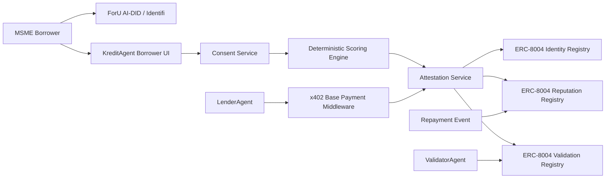

# 05 — KreditAgent Integration Architecture

## Target architecture

## End-to-end sequence

1. Borrower links ForU AI-DID.
2. Borrower grants consent for QRIS/e-commerce evidence.
3. KreditAgent computes deterministic score.
4. KreditAgent publishes score attestation hash.
5. BorrowerAgent/KreditAgent identity is discoverable through ERC-8004.
6. LenderAgent requests `/v1/attestations/:id/audit`.
7. API returns HTTP `402 Payment Required`.
8. LenderAgent pays on Base Sepolia using x402.
9. API verifies payment and returns signed attestation.
10. ValidatorAgent recomputes score and posts validation.
11. Lender submits decision outside KreditAgent.
12. Repayment/late/default outcome posts reputation event.
13. ForU Identifi component displays safe summary, not raw data.

## On-chain mapping (this repo)

The diagram labels `ERC-8004 * Registry` map to the Foundry contracts in [`contracts/src/`](../../contracts/src/) — see [07 — Monorepo on-chain surface](07-monorepo-onchain-surface.md). Identity, reputation, and validation are separate Solidity contracts; x402 payment verification stays in the API; paid access is **anchored** with `KreditPaymentReceiptRegistry`.

## What to show judges

- Agent registration tx.
- `agentURI` JSON with x402 support.
- API request returning `402`.
- Payment retry returning signed attestation.
- Validation event.
- Repayment reputation event.
- ForU AI-DID binding screen.
