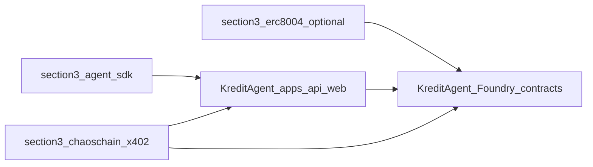

# Innovation map: runbook §3 clones → KreditAgent

This note ties **[§3 of the clone runbook](../06-clone-and-study-runbook.md)** (“Clone the three repos you explicitly requested”) to **KreditAgent**’s on-chain layout and API. It complements the §2-focused map in [INNOVATION_MAP_X402_ERC8004.md](INNOVATION_MAP_X402_ERC8004.md).

**On-chain inventory:** [`docs/currentSmartContract.md`](../../currentSmartContract.md). **Concept → contract quick table:** [07 — Monorepo on-chain surface](../07-monorepo-onchain-surface.md). **System architecture:** [`docs/ARCHITECTURE.md`](../../ARCHITECTURE.md).

## Repos from §3

| Upstream | Local path | What to study after clone |
|----------|------------|---------------------------|
| [0xgasless/agent-sdk](https://github.com/0xgasless/agent-sdk) | [`external/0xgasless-agent-sdk`](../../../external/0xgasless-agent-sdk) | Root `README`, `package.json`, main `src/` or `packages/` entrypoints; look for agent orchestration, wallet or session patterns, any x402 or HTTP client examples. |
| [ChaosChain/chaoschain-x402](https://github.com/ChaosChain/chaoschain-x402) | [`external/chaoschain-x402`](../../../external/chaoschain-x402) | Root `README`, examples, and any middleware or SDK folders that show **402 → pay → retry** flows; compare with [`external/x402`](../../../external/x402) (runbook §2) for alignment. |
| [erc-8004/erc-8004-contracts](https://github.com/erc-8004/erc-8004-contracts) | [`external/erc-8004-contracts`](../../../external/erc-8004-contracts) | **Same repo as §2** — if you already cloned in §2, skip §3’s duplicate. All ERC-8004 reference mapping lives in [INNOVATION_MAP_X402_ERC8004.md](INNOVATION_MAP_X402_ERC8004.md); no duplicate table here. |

If `external/0xgasless-agent-sdk` or `external/chaoschain-x402` does not exist yet, run the §3 block in [06](../06-clone-and-study-runbook.md), then revisit the paths above.

## ERC-8004 duplicate (§3 third line)

§3 repeats `erc-8004-contracts` only so teams that skip §2 still get the reference. **One clone suffices.** On-chain parity and gap notes for `IdentityRegistryUpgradeable`, `ValidationRegistryUpgradeable`, and `ReputationRegistryUpgradeable` vs KreditAgent are documented under:

- `KreditAgentIdentityRegistry`
- `KreditValidationRegistry`
- `KreditReputationRegistry`

… in [INNOVATION_MAP_X402_ERC8004.md](INNOVATION_MAP_X402_ERC8004.md) and [`docs/currentSmartContract.md`](../../currentSmartContract.md).

## Demand → KreditAgent mapping

| Stakeholder need | §3 clone (role) | Where KreditAgent implements it |
|------------------|-----------------|----------------------------------|
| Agent UX: orchestration, tooling, optional gasless or wallet abstractions | 0xgasless **agent-sdk** | Mostly **off-chain:** [`apps/api`](../../../apps/api), [`apps/web`](../../../apps/web), future agent clients. On-chain identity and roles stay in [`KreditAgentIdentityRegistry`](../../../contracts/src/KreditAgentIdentityRegistry.sol) and [`KreditAccessController`](../../../contracts/src/KreditAccessController.sol). |
| Another x402-shaped integration reference (ChaosChain stack) | **chaoschain-x402** | Same product story as canonical x402: **HTTP 402** in the API, settlement via facilitator; **anchor** paid access with [`KreditPaymentReceiptRegistry`](../../../contracts/src/KreditPaymentReceiptRegistry.sol). See also [x402/01-x402-base-docs-and-integration.md](../x402/01-x402-base-docs-and-integration.md). |
| Portable trust primitives | **erc-8004-contracts** (if not done in §2) | Full mapping in [INNOVATION_MAP_X402_ERC8004.md](INNOVATION_MAP_X402_ERC8004.md); contracts listed in [`currentSmartContract.md`](../../currentSmartContract.md). |

## Gap and roadmap

1. **Clone §3** when you need agent-sdk or ChaosChain-specific examples; confirm folders exist under `external/` before citing paths in demos.
2. **Diff middleware:** Compare ChaosChain x402 helpers with `external/x402` TypeScript packages so adoption does not hard-code two incompatible payment shapes.
3. **SDK adoption:** Use 0xgasless only as **reference or dev dependency** after license and security review; do not treat external clones as audited production deps by default.
4. **Subgraph / events:** If either §3 repo demonstrates indexer patterns, align event consumer field names with Kredit registries ([`contracts/docs/SMART_CONTRACT_ARCHITECTURE.md`](../../../contracts/docs/SMART_CONTRACT_ARCHITECTURE.md)).

## Traceability

| Topic | Document |
|--------|----------|
| §2 canonical x402 + erc-8004 deep map | [INNOVATION_MAP_X402_ERC8004.md](INNOVATION_MAP_X402_ERC8004.md) |
| Contract behaviour | [`contracts/docs/CONTRACT_SPEC.md`](../../../contracts/docs/CONTRACT_SPEC.md) |
| Security / invariants | [`contracts/docs/SECURITY_REVIEW.md`](../../../contracts/docs/SECURITY_REVIEW.md) |
