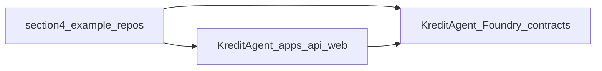

# Innovation map: runbook §4 clones → KreditAgent

This note ties **[§4 of the clone runbook](../06-clone-and-study-runbook.md)** (“Clone best combined x402 + ERC-8004 references”) to **KreditAgent**. These are **ecosystem example apps** — useful for **patterns** (agent + paid HTTP + identity), not as replacements for canonical **[§2](../06-clone-and-study-runbook.md)** sources [`external/x402`](../../../external/x402) and [`external/erc-8004-contracts`](../../../external/erc-8004-contracts).

**On-chain inventory:** [`docs/currentSmartContract.md`](../../currentSmartContract.md). **§2 deep map:** [INNOVATION_MAP_X402_ERC8004.md](INNOVATION_MAP_X402_ERC8004.md). **§3 map:** [INNOVATION_MAP_RUNBOOK_SECTION3.md](INNOVATION_MAP_RUNBOOK_SECTION3.md). **Concept table:** [07 — Monorepo on-chain surface](../07-monorepo-onchain-surface.md).

## Repos from §4

After `git clone` per §4, each repo typically exposes a README, scripts, and either Solidity under `contracts/` or agent/bootstrap code. Scan for **x402 client/middleware**, **facilitator config**, and **ERC-8004-style registration** calls.

| Upstream | Local path | What to study first |
|----------|------------|---------------------|
| [OnChainMee/x402-erc8004-agent](https://github.com/OnChainMee/x402-erc8004-agent) | [`external/onchainmee-x402-erc8004-agent`](../../../external/onchainmee-x402-erc8004-agent) | Full-stack wiring of x402 + agent; compare HTTP flow to [`apps/api`](../../../apps/api) and receipt anchoring. |
| [panditdhamdhere/x402-erc8004-agent](https://github.com/panditdhamdhere/x402-erc8004-agent) | [`external/pandit-x402-erc8004-agent`](../../../external/pandit-x402-erc8004-agent) | Alternate implementation of the same theme; diff error handling and env vars vs OnChainMee. |
| [Eversmile12/create-8004-agent](https://github.com/Eversmile12/create-8004-agent) | [`external/create-8004-agent`](../../../external/create-8004-agent) | Scaffold / CLI patterns for “8004 agent” creation; extract DX ideas, not contract ABI truth. |
| [nuwa-protocol/nuwa-8004](https://github.com/nuwa-protocol/nuwa-8004) | [`external/nuwa-8004`](../../../external/nuwa-8004) | Nuwa stack and agent flows; compare onboarding and chain config to [`contracts/docs/DEPLOYMENT_RUNBOOK.md`](../../../contracts/docs/DEPLOYMENT_RUNBOOK.md). |

Folders appear only **after** you run §4; paths above are the intended layout.

## ERC-8004 and x402 authority

- **Normative Solidity** for ERC-8004 alignment remains [`external/erc-8004-contracts`](../../../external/erc-8004-contracts) (see §2 map). §4 repos **illustrate composition**, not specification.
- **Normative x402** behavior and SDK layout remain [`external/x402`](../../../external/x402) (§2). §4 examples may lag or fork middleware — reconcile against upstream specs when integrating.

## Integration lens → KreditAgent

| Layer | §4 examples (typical) | KreditAgent (this monorepo) |
|--------|------------------------|------------------------------|
| Paid HTTP / facilitator | Example servers and clients | [`apps/api`](../../../apps/api); x402-shaped `402` and retry; see [x402/01-x402-base-docs-and-integration.md](../x402/01-x402-base-docs-and-integration.md) |
| Agent / wallet UX | Boilerplate in each repo | [`apps/web`](../../../apps/web); optional future agent clients |
| Identity / `agentId` | May call reference or custom registries | [`KreditAgentIdentityRegistry`](../../../contracts/src/KreditAgentIdentityRegistry.sol) |
| Payment audit trail | Often app-only | [`KreditPaymentReceiptRegistry`](../../../contracts/src/KreditPaymentReceiptRegistry.sol) anchors `receiptHash` / resource binding |
| Consent, score, validation, reputation | May be partial or off-chain in examples | Full suite in [`docs/currentSmartContract.md`](../../currentSmartContract.md); deploy via [`KreditProtocolDeployer`](../../../contracts/src/KreditProtocolDeployer.sol) |

Do not duplicate the upgradeable-vs-immutable ERC-8004 analysis here; it lives in [INNOVATION_MAP_X402_ERC8004.md](INNOVATION_MAP_X402_ERC8004.md).

## Caveats

Example repos **drift** with upstream hacks; **pin commits** if you extract code. **License** each dependency before reuse. Prefer **pattern copy** (flow diagrams, env shape) over vendoring unreviewed Solidity.

## Gap and roadmap

1. Skim all four for **register agent → call paid route → consume response**; align naming with Kredit’s `deployments/<network>.json` agent IDs from [`DeployKreditProtocol.s.sol`](../../../contracts/script/DeployKreditProtocol.s.sol).
2. Compare **Nuwa** and **create-8004-agent** scaffolds for **CLI/developer onboarding**; feed ideas into hackathon docs only, not automatic code generation into `contracts/` without review.
3. Keep **Kredit** deploy and tests ([`contracts/test/`](../../../contracts/test/)) as the **source of truth** for production-shaped behaviour.

## Traceability

| Topic | Document |
|--------|----------|
| §2 canonical maps | [INNOVATION_MAP_X402_ERC8004.md](INNOVATION_MAP_X402_ERC8004.md) |
| Contract spec | [`contracts/docs/CONTRACT_SPEC.md`](../../../contracts/docs/CONTRACT_SPEC.md) |
| Architecture | [`contracts/docs/SMART_CONTRACT_ARCHITECTURE.md`](../../../contracts/docs/SMART_CONTRACT_ARCHITECTURE.md) |
