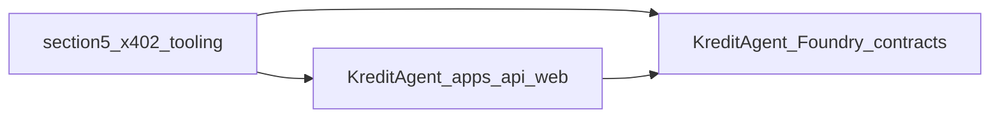

# Innovation map: runbook §5 clones → KreditAgent

This note ties **[§5 of the clone runbook](../06-clone-and-study-runbook.md)** (“Clone x402 tooling”) to **KreditAgent**. These repos are **supporting x402 implementations** — facilitators, wallet UX, agent scaffolding, hardening notes — not replacements for canonical **[§2](../06-clone-and-study-runbook.md)** [`external/x402`](../../../external/x402). Use them for **pattern mining** (verify/settle flows, signer wiring, HTTP shapes) rather than **copy-paste dependencies**.

**On-chain inventory:** [`docs/currentSmartContract.md`](../../currentSmartContract.md). **Normative x402 + ERC-8004 map:** [INNOVATION_MAP_X402_ERC8004.md](INNOVATION_MAP_X402_ERC8004.md). **Base docs:** [x402/01-x402-base-docs-and-integration.md](../x402/01-x402-base-docs-and-integration.md). **Adjacent runbook maps:** [INNOVATION_MAP_RUNBOOK_SECTION3.md](INNOVATION_MAP_RUNBOOK_SECTION3.md), [INNOVATION_MAP_RUNBOOK_SECTION4.md](INNOVATION_MAP_RUNBOOK_SECTION4.md). **Concept table:** [07 — Monorepo on-chain surface](../07-monorepo-onchain-surface.md).

## Repos from §5

After `git clone` per §5, read each README and locate **facilitator server code**, **wallet / client signing**, **agent-kit or skill templates**, and any **security / threat-model** notes.

| Upstream | Local path | What to study first |
|----------|------------|---------------------|
| [second-state/x402-facilitator](https://github.com/second-state/x402-facilitator) | [`external/second-state-x402-facilitator`](../../../external/second-state-x402-facilitator) | Facilitator HTTP API and verify/settle handling; diff env vars vs Kredit [`apps/api`](../../../apps/api). |
| [second-state/x402-skill](https://github.com/second-state/x402-skill) | [`external/second-state-x402-skill`](../../../external/second-state-x402-skill) | Skill packaging around x402-paid actions; DX for agents calling paid routes. |
| [0xkoda/x402-wallet](https://github.com/0xkoda/x402-wallet) | [`external/x402-wallet`](../../../external/x402-wallet) | Wallet connect and payment UX; compare to [`apps/web`](../../../apps/web) flows. |
| [xpaysh/x402-agent-kit](https://github.com/xpaysh/x402-agent-kit) | [`external/x402-agent-kit`](../../../external/x402-agent-kit) | Agent scaffolding and client patterns; naming and retry behaviour vs foundation SDK. |
| [t54-labs/x402-secure](https://github.com/t54-labs/x402-secure) | [`external/x402-secure`](../../../external/x402-secure) | Security-focused examples or middleware; mine for threat-model and validation checks. |
| [primev/mainnet-x402-facilitator](https://github.com/primev/mainnet-x402-facilitator) | [`external/mainnet-x402-facilitator`](../../../external/mainnet-x402-facilitator) | Mainnet-oriented facilitator; align assumptions with your target chain (see runbook chain IDs). |

Folders appear only **after** you run §5; paths above are the intended layout.

## x402 authority

- **Normative** protocol behaviour, types, and reference client layout remain [`external/x402`](../../../external/x402) and the **§2** innovation map. §5 tooling may **lag, fork, or assume different networks** — reconcile against upstream specs and Kredit deployments before integrating.

## Integration lens → KreditAgent

| Layer | §5 examples (typical) | KreditAgent (this monorepo) |
|--------|------------------------|------------------------------|
| Paid HTTP / facilitator | Alternate facilitator binaries and APIs | [`apps/api`](../../../apps/api); x402-shaped `402` and facilitator interaction; [x402/01-x402-base-docs-and-integration.md](../x402/01-x402-base-docs-and-integration.md) |
| Wallet / signing | Standalone wallet or demo clients | [`apps/web`](../../../apps/web) |
| Agent skills / kits | Templates for paid tool calls | Optional patterns only; production client choices stay anchored on `external/x402` |
| Payment audit trail | Often delegated to facilitator only | [`KreditPaymentReceiptRegistry`](../../../contracts/src/KreditPaymentReceiptRegistry.sol) anchors `receiptHash` / resource binding |
| Identity / `agentId` | Usually out of scope in pure x402 tooling | [`KreditAgentIdentityRegistry`](../../../contracts/src/KreditAgentIdentityRegistry.sol); full suite in [`docs/currentSmartContract.md`](../../currentSmartContract.md) |

Do not duplicate the full x402 spec or ERC-8004 contract comparison here; those live in [INNOVATION_MAP_X402_ERC8004.md](INNOVATION_MAP_X402_ERC8004.md).

## Caveats

Repos **drift**; **pin commits** when you fork patterns. **License** before reuse. Multiple facilitators are **examples** — pick one operational stack that matches **your network**, risk tolerance, and Kredit’s [`contracts/docs/DEPLOYMENT_RUNBOOK.md`](../../../contracts/docs/DEPLOYMENT_RUNBOOK.md).

## Gap and roadmap

1. Compare **facilitator verify/settle** call shapes from Second State / Primev examples to what [`apps/api`](../../../apps/api) implements today.
2. Skim **`x402-secure`** for checklist items (replay, amount binding, header validation) and fold into integration reviews, not silent copy-paste.
3. Keep **deploy and tests** ([`KreditProtocolDeployer`](../../../contracts/src/KreditProtocolDeployer.sol), [`DeployKreditProtocol.s.sol`](../../../contracts/script/DeployKreditProtocol.s.sol), [`contracts/test/`](../../../contracts/test/)) as the **source of truth** for on-chain behaviour.

## Traceability

| Topic | Document |
|--------|----------|
| §2 canonical maps | [INNOVATION_MAP_X402_ERC8004.md](INNOVATION_MAP_X402_ERC8004.md) |
| Contract spec | [`contracts/docs/CONTRACT_SPEC.md`](../../../contracts/docs/CONTRACT_SPEC.md) |
| Architecture | [`contracts/docs/SMART_CONTRACT_ARCHITECTURE.md`](../../../contracts/docs/SMART_CONTRACT_ARCHITECTURE.md) |
