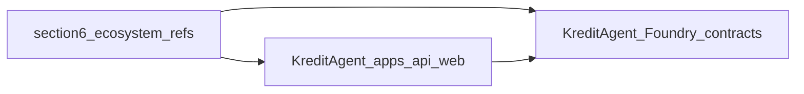

# Innovation map: runbook §6 clones → KreditAgent

This note ties **[§6 of the clone runbook](../06-clone-and-study-runbook.md)** (“Clone ecosystem references”) to **KreditAgent**. These sources are **discovery and DX references** — curated lists, skill packs, platform SDKs, wallet SDKs — not replacements for canonical **[§2](../06-clone-and-study-runbook.md)** [`external/x402`](../../../external/x402) or [`external/erc-8004-contracts`](../../../external/erc-8004-contracts). Prefer **pattern mining** (how ecosystems package agents, skills, and wallets) over **vendor-locking dependencies**.

**On-chain inventory:** [`docs/currentSmartContract.md`](../../currentSmartContract.md). **Normative maps:** [INNOVATION_MAP_X402_ERC8004.md](INNOVATION_MAP_X402_ERC8004.md). **Adjacent runbook maps:** [INNOVATION_MAP_RUNBOOK_SECTION3.md](INNOVATION_MAP_RUNBOOK_SECTION3.md), [INNOVATION_MAP_RUNBOOK_SECTION4.md](INNOVATION_MAP_RUNBOOK_SECTION4.md), [INNOVATION_MAP_RUNBOOK_SECTION5.md](INNOVATION_MAP_RUNBOOK_SECTION5.md). **Concept table:** [07 — Monorepo on-chain surface](../07-monorepo-onchain-surface.md).

## Repos from §6

After `git clone` per §6, read each README and scan for **skill manifests**, **TypeScript client patterns**, **wallet or agentwallet APIs**, and **curated ERC-8004 links** (do not treat lists as specification).

| Upstream | Local path | What to study first |
|----------|------------|---------------------|
| [sudeepb02/awesome-erc8004](https://github.com/sudeepb02/awesome-erc8004) | [`external/awesome-erc8004`](../../../external/awesome-erc8004) | **Further reading** and project discovery; verify any link before building on it — awesome lists go stale. |
| [celo-org/agent-skills](https://github.com/celo-org/agent-skills) | [`external/celo-agent-skills`](../../../external/celo-agent-skills) | How a chain org packages **agent skills**; compare doc shape to Kredit [`apps/api`](../../../apps/api) route and capability model. |
| [AgentlyHQ/aixyz](https://github.com/AgentlyHQ/aixyz) | [`external/aixyz`](../../../external/aixyz) | Multi-agent / platform patterns; naming and module layout for hackathon inspiration only. |
| [ChaosChain/chaoschain-sdk-ts](https://github.com/ChaosChain/chaoschain-sdk-ts) | [`external/chaoschain-sdk-ts`](../../../external/chaoschain-sdk-ts) | TS client for ChaosChain; complements **`chaoschain-x402`** from §3 — see [INNOVATION_MAP_RUNBOOK_SECTION3.md](INNOVATION_MAP_RUNBOOK_SECTION3.md). |
| [cobotgg/cobotsdk](https://github.com/cobotgg/cobotsdk) | [`external/cobotsdk`](../../../external/cobotsdk) | Agent/cobot SDK surface; diff auth and transport assumptions vs Kredit stack. |
| [up2itnow0822/agentwallet-sdk](https://github.com/up2itnow0822/agentwallet-sdk) | [`external/agentwallet-sdk`](../../../external/agentwallet-sdk) | Agent-facing wallet APIs; compare flows to [`apps/web`](../../../apps/web) and signing in x402 clients. |

Folders appear only **after** you run §6; paths above are the intended layout.

## Authority

- **Normative** Solidity and protocol semantics remain **§2** sources and [INNOVATION_MAP_X402_ERC8004.md](INNOVATION_MAP_X402_ERC8004.md). §6 repos **broaden the ecosystem picture**, not the contract ABI you ship.

## Integration lens → KreditAgent

| Layer | §6 references (typical) | KreditAgent (this monorepo) |
|--------|-------------------------|------------------------------|
| API routes / capabilities | Skill catalogs and examples | [`apps/api`](../../../apps/api) |
| Agent / wallet UX | Wallet and platform SDKs | [`apps/web`](../../../apps/web) |
| Identity / `agentId` | Indirect via docs and samples | [`KreditAgentIdentityRegistry`](../../../contracts/src/KreditAgentIdentityRegistry.sol) |
| Paid flows / receipts | May appear in SDK examples | [`KreditPaymentReceiptRegistry`](../../../contracts/src/KreditPaymentReceiptRegistry.sol); full trust stack in [`docs/currentSmartContract.md`](../../currentSmartContract.md) |

Do not duplicate the full ERC-8004 or x402 spec here; those live in [INNOVATION_MAP_X402_ERC8004.md](INNOVATION_MAP_X402_ERC8004.md).

## Caveats

Maintenance and quality **vary** across ecosystem repos. **Pin commits** if you reuse snippets. **License** before vendoring. Treat **`awesome-erc8004`** as a **starting index** — confirm projects are active and relevant to your chain before deepening.

## Gap and roadmap

1. Skim for **skill / agent packaging** ideas versus Kredit’s concrete HTTP routes in [`apps/api`](../../../apps/api).
2. Read **chaoschain-sdk-ts** alongside §3 **`chaoschain-x402`** to see client vs server-side ChaosChain integration.
3. Keep **deploy and tests** ([`KreditProtocolDeployer`](../../../contracts/src/KreditProtocolDeployer.sol), [`DeployKreditProtocol.s.sol`](../../../contracts/script/DeployKreditProtocol.s.sol), [`contracts/test/`](../../../contracts/test/)) as **source of truth** for on-chain behaviour.

## Traceability

| Topic | Document |
|--------|----------|
| §3 ChaosChain clone | [INNOVATION_MAP_RUNBOOK_SECTION3.md](INNOVATION_MAP_RUNBOOK_SECTION3.md) |
| Contract spec | [`contracts/docs/CONTRACT_SPEC.md`](../../../contracts/docs/CONTRACT_SPEC.md) |
| Architecture | [`contracts/docs/SMART_CONTRACT_ARCHITECTURE.md`](../../../contracts/docs/SMART_CONTRACT_ARCHITECTURE.md) |
