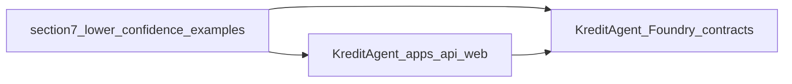

# Innovation map: runbook §7 clones → KreditAgent

This note ties **[§7 of the clone runbook](../06-clone-and-study-runbook.md)** (“Clone lower-confidence example apps”) to **KreditAgent**. The runbook labels these clones as **lower confidence** — hackathon-style demos and spikes, **not** canonical **[§2](../06-clone-and-study-runbook.md)** sources. Use for **isolated pattern hints** (resource gating, worker middleware, CRE automation sketches, combined x402 + 8004 demos) and **expect extra verification** before any reuse.

**On-chain inventory:** [`docs/currentSmartContract.md`](../../currentSmartContract.md). **Normative maps:** [INNOVATION_MAP_X402_ERC8004.md](INNOVATION_MAP_X402_ERC8004.md). **Adjacent runbook maps:** [INNOVATION_MAP_RUNBOOK_SECTION3.md](INNOVATION_MAP_RUNBOOK_SECTION3.md) through [INNOVATION_MAP_RUNBOOK_SECTION6.md](INNOVATION_MAP_RUNBOOK_SECTION6.md). **Concept table:** [07 — Monorepo on-chain surface](../07-monorepo-onchain-surface.md). **Guardrails:** align mindset with [§9 — What to avoid](../06-clone-and-study-runbook.md) in the same runbook (chain IDs, abandoned deps, unreviewed vendoring).

## Repos from §7

After `git clone` per §7, read each README and scan for **demo scope**, **chain assumptions**, **CRE or worker wiring**, and **combined x402 + ERC-8004** flows — then validate against Kredit’s deployment target.

| Upstream | Local path | What to study first |
|----------|------------|---------------------|
| [chaalpritam/x402-resource](https://github.com/chaalpritam/x402-resource) | [`external/x402-resource`](../../../external/x402-resource) | Resource / HTTP-gating demo patterns; do not assume maintenance or spec compliance. |
| [smartcontractkit/x402-cre-price-alerts](https://github.com/smartcontractkit/x402-cre-price-alerts) | [`external/x402-cre-price-alerts`](../../../external/x402-cre-price-alerts) | Illustrative **Chainlink CRE + x402** automation; compare to Kredit’s stack; no production parity implied. |
| [hetu-project/FLUX-Mining-8004-x402](https://github.com/hetu-project/FLUX-Mining-8004-x402) | [`external/flux-mining-8004-x402`](../../../external/flux-mining-8004-x402) | Combined mining + 8004 + x402 sample; mine for flow diagrams only; verify chain and token assumptions. |
| [Stable402/x402-worker-middleware](https://github.com/Stable402/x402-worker-middleware) | [`external/x402-worker-middleware`](../../../external/x402-worker-middleware) | Worker / edge middleware around x402; diff integration seams vs [`apps/api`](../../../apps/api). |

Folders appear only **after** you run §7; paths above are the intended layout.

## Authority

- **Normative** behaviour remains **§2** [`external/x402`](../../../external/x402) and [`external/erc-8004-contracts`](../../../external/erc-8004-contracts) plus [INNOVATION_MAP_X402_ERC8004.md](INNOVATION_MAP_X402_ERC8004.md). §7 repos are **spikes**, not specifications.

## Integration lens → KreditAgent

| Layer | §7 examples (typical) | KreditAgent (this monorepo) |
|--------|----------------------|------------------------------|
| API / middleware | Demo servers, worker middleware | [`apps/api`](../../../apps/api) |
| Client / UX | Minimal or niche demos | [`apps/web`](../../../apps/web) |
| Automation / CRE | Price-alert workflows | Optional reference only; Kredit product path may differ entirely |
| Identity / `agentId` | May be partial in demos | [`KreditAgentIdentityRegistry`](../../../contracts/src/KreditAgentIdentityRegistry.sol) |
| Paid flows / receipts | Varies by demo | [`KreditPaymentReceiptRegistry`](../../../contracts/src/KreditPaymentReceiptRegistry.sol); full trust stack in [`docs/currentSmartContract.md`](../../currentSmartContract.md) |

Do not duplicate the full ERC-8004 or x402 spec here; those live in [INNOVATION_MAP_X402_ERC8004.md](INNOVATION_MAP_X402_ERC8004.md).

## Caveats

**Higher bar than §6:** maintenance may be intermittent; **pin commits** if you extract anything. **License** review is mandatory. **Confirm chain IDs** and environments (see runbook §9). Do not add these repos as **dependencies** without the same review you would give production libraries.

## Gap and roadmap

1. Treat ideas as **checklists** (e.g. how a worker attaches payment proof), not drop-in code.
2. Compare any **middleware** layering to Kredit’s single API surface in [`apps/api`](../../../apps/api) before splitting services.
3. Keep **deploy and tests** ([`KreditProtocolDeployer`](../../../contracts/src/KreditProtocolDeployer.sol), [`DeployKreditProtocol.s.sol`](../../../contracts/script/DeployKreditProtocol.s.sol), [`contracts/test/`](../../../contracts/test/)) as **source of truth**.

## Traceability

| Topic | Document |
|--------|----------|
| §2 canonical maps | [INNOVATION_MAP_X402_ERC8004.md](INNOVATION_MAP_X402_ERC8004.md) |
| Runbook hazards | [06 — Clone and study runbook](../06-clone-and-study-runbook.md) §9 |
| Contract spec | [`contracts/docs/CONTRACT_SPEC.md`](../../../contracts/docs/CONTRACT_SPEC.md) |
