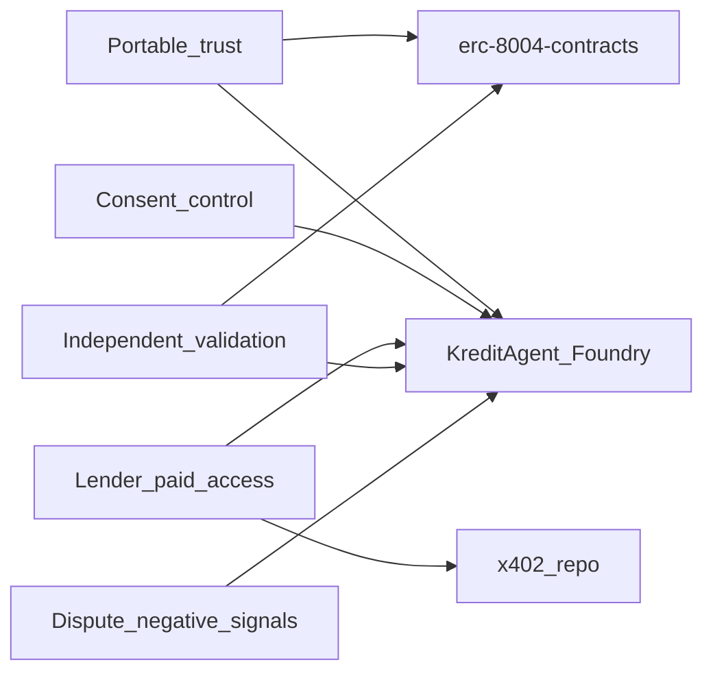

# Innovation map: canonical sources → KreditAgent contracts

This note ties **[§2 of the clone runbook](../06-clone-and-study-runbook.md)** (canonical `x402` + `erc-8004-contracts` clones) to what KreditAgent **ships in Solidity** and what stays **off-chain**. Canonical on-chain inventory: [`docs/currentSmartContract.md`](../../currentSmartContract.md). System architecture (API + chain): [`docs/ARCHITECTURE.md`](../../ARCHITECTURE.md).

## Canonical repos in this workspace

After running the runbook, you should have:

| Path | Upstream | What to study first |
|------|----------|---------------------|
| [`external/x402`](../../../external/x402) | [x402-foundation/x402](https://github.com/x402-foundation/x402) | [`specs/x402-specification-v2.md`](../../../external/x402/specs/x402-specification-v2.md) (and v1), `schemes/` payment shapes, [`typescript/packages/core`](../../../external/x402/typescript/packages/core), [`typescript/packages/http`](../../../external/x402/typescript/packages/http) for seller middleware patterns |
| [`external/erc-8004-contracts`](../../../external/erc-8004-contracts) | [erc-8004/erc-8004-contracts](https://github.com/erc-8004/erc-8004-contracts) | [`contracts/IdentityRegistryUpgradeable.sol`](../../../external/erc-8004-contracts/contracts/IdentityRegistryUpgradeable.sol), [`ValidationRegistryUpgradeable.sol`](../../../external/erc-8004-contracts/contracts/ValidationRegistryUpgradeable.sol), [`ReputationRegistryUpgradeable.sol`](../../../external/erc-8004-contracts/contracts/ReputationRegistryUpgradeable.sol); `ERC8004SPEC.md` and `abis/` for interface parity |

**Interim TypeScript bridge (optional):** [`external/agentwallet-sdk`](../../../external/agentwallet-sdk) shows how ecosystem code combines **x402 client/middleware** ideas with an **ERC-8004-shaped identity ABI** (e.g. `registerWithMetadata`, EIP-712-style wallet updates in consumer SDKs). Use it for integration ideas, not as the protocol source of truth.

## Demand → who benefits

| Stakeholder | Need | Satisfied by (canonical) | Satisfied by (KreditAgent) |
|-------------|------|---------------------------|-----------------------------|
| MSME borrower | Own consent, dispute unfair negatives, portable identity | ERC-8004 identity + reputation narratives | [`KreditAgentIdentityRegistry`](../../../contracts/src/KreditAgentIdentityRegistry.sol), [`KreditConsentRegistry`](../../../contracts/src/KreditConsentRegistry.sol), [`KreditReputationRegistry`](../../../contracts/src/KreditReputationRegistry.sol) |
| Licensed lender | Pay for audit-grade data, machine-rail, no PII on-chain | x402 HTTP 402 + facilitator | [`apps/api`](../../../apps/api) x402-shaped routes; anchor in [`KreditPaymentReceiptRegistry`](../../../contracts/src/KreditPaymentReceiptRegistry.sol) |
| Issuer / KreditAgent operator | Publish scores only with valid consent | App + policy + (optionally) reference registries | [`KreditScoreRegistry`](../../../contracts/src/KreditScoreRegistry.sol), [`KreditAccessController`](../../../contracts/src/KreditAccessController.sol) roles |
| Validator | Independent check, no self-validation | ERC-8004 validation patterns | [`KreditValidationRegistry`](../../../contracts/src/KreditValidationRegistry.sol) |
| Pilot / regulator | Pause, accountability, audit trail | Reference upgradeable + governance patterns | [`KreditAccessController`](../../../contracts/src/KreditAccessController.sol) pause + roles; deployment: [`contracts/docs/DEPLOYMENT_RUNBOOK.md`](../../../contracts/docs/DEPLOYMENT_RUNBOOK.md) |

## Mapping: reference primitives → [`currentSmartContract.md`](../../currentSmartContract.md)

| Source primitive | Typical location (local clone) | KreditAgent contract | Innovation / gap |
|------------------|-------------------------------|----------------------|------------------|
| Identity (agentId, URI, wallet, transfer) | `erc-8004-contracts/contracts/IdentityRegistryUpgradeable.sol` | `KreditAgentIdentityRegistry` | Same job-to-be-done. Kredit adds **explicit agent types** (`BORROWER_AGENT`, `ISSUER_AGENT`, …) and **bytes32** metadata keys. Reference stack is **upgradeable (UUPS)**; Kredit hackathon build is **immutable** deploy via [`KreditProtocolDeployer`](../../../contracts/src/KreditProtocolDeployer.sol). Optional hardening: EIP-712 gated `setAgentWallet` as in many reference/SDK paths — see [`contracts/docs/SECURITY_REVIEW.md`](../../../contracts/docs/SECURITY_REVIEW.md). |
| Validation requests / results | `ValidationRegistryUpgradeable.sol` | `KreditValidationRegistry` | Kredit adds **quorum**, **deadlines**, **anti-self-validation** tuned for credit attestation review. |
| Reputation / feedback | `ReputationRegistryUpgradeable.sol` patterns | `KreditReputationRegistry` | Kredit adds **borrower dispute window** and **resolver account** role for fairness. |
| Access / pause / governance | Split across reference + proxies | `KreditAccessController` | Single place for **owner**, **guardian pause**, **account and agent roles** aligned with [`KreditRoles`](../../../contracts/src/KreditRoles.sol). |
| Paid HTTP resource | x402 specs + `typescript/packages/http/*` | Off-chain middleware + `KreditPaymentReceiptRegistry` | x402 proves **payment + resource binding** in HTTP layer; Kredit **anchors** `receiptHash` / resource hashes on-chain for audit, without custodying user funds in these contracts. |
| Consent / purpose limitation | Often app-layer in generic stacks | `KreditConsentRegistry` | Regulatory story: borrower grants/revokes; [`KreditScoreRegistry`](../../../contracts/src/KreditScoreRegistry.sol) enforces **active consent** at issuance. |
| Score attestation ledger | Not in generic ERC-8004 | `KreditScoreRegistry` | Product-specific: bounded score, digest, consent id binding — see [`contracts/docs/CONTRACT_SPEC.md`](../../../contracts/docs/CONTRACT_SPEC.md). |

## Gap and roadmap (innovation backlog)

1. **Parity / migration:** Adapter or future migration from Kredit registries to **official** `IdentityRegistryUpgradeable` + validation/reputation if audits require byte-compatible ERC-8004 deployments.
2. **Wallet binding:** Evaluate **EIP-712** `setAgentWallet` (as in reference/SDK) vs current controller/owner model.
3. **Metadata keys:** Harmonise **string** metadata keys (reference / tooling) with **bytes32** keys (`setMetadata` on Kredit identity) for indexer ergonomics.
4. **x402 production:** Replace mock facilitator with CDP / partner facilitator; keep [`KreditPaymentReceiptRegistry`](../../../contracts/src/KreditPaymentReceiptRegistry.sol) fields in sync with resource + attestation binding (see [x402 integration notes](../x402/01-x402-base-docs-and-integration.md)).
5. **Indexing:** Subgraph or event-driven indexer for attestations, validations, receipts, disputes (reference repos are event-heavy; align event names in [`contracts/docs/SMART_CONTRACT_ARCHITECTURE.md`](../../../contracts/docs/SMART_CONTRACT_ARCHITECTURE.md)).
6. **Upgrade posture:** Reference uses **UUPS**; Kredit pilot is **immutable** — document versioned redeploy vs proxy in pilot proposals ([`contracts/docs/SMART_CONTRACT_ARCHITECTURE.md`](../../../contracts/docs/SMART_CONTRACT_ARCHITECTURE.md) upgrade section).

## Traceability

| Topic | Document |
|--------|----------|
| Behavioural spec | [`contracts/docs/CONTRACT_SPEC.md`](../../../contracts/docs/CONTRACT_SPEC.md) |
| Architecture + privacy boundary | [`contracts/docs/SMART_CONTRACT_ARCHITECTURE.md`](../../../contracts/docs/SMART_CONTRACT_ARCHITECTURE.md) |
| Invariants / threats | [`contracts/docs/SECURITY_REVIEW.md`](../../../contracts/docs/SECURITY_REVIEW.md) |
| Monorepo surface (duplicate of this folder’s 07) | [07 — Monorepo on-chain surface](../07-monorepo-onchain-surface.md) |

## Out of scope (for this note)

- Full replacement of Kredit contracts with upstream bytecode without migration design.
- Running a production x402 facilitator inside this repository (integration work lives beside `apps/api`).
